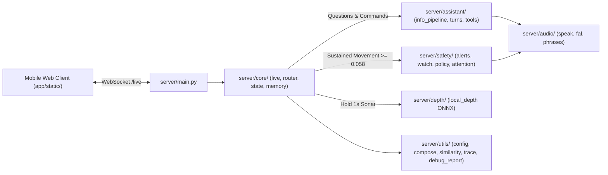

# VoxEye — Gen AI Summit Hackathon 2026
> **Athens LifeTech Park (Spata) & SNFCC (Book Castle) · 14–16 November 2026**  
> Co-organised by GenAI Summit (100mentors × Wiserwork) × Panathēnea · Title Sponsor: **Quintessential (€8,500 Cash Podium)**

Real-time spatial safety, voice Q&A, and tactile depth assistant for blind and low-vision users (English & Greek). Full application documentation: **[app/README.md](app/README.md)**.

---

## VoxEye Architecture & Flow (`app/`)

### Core Pipeline Summary
1. **Centralized Command, Memory & Answer Router (`app/server/core/router.py`)**: Evaluates every English/Greek utterance to decide whether to ignore room noise, execute a system/memory command, or answer a visual question—keeping `UserMemory` strictly for explicit goals/notes (`keep_memory=True`) while guaranteeing a spoken reply (`should_answer=True`) whenever asked.
2. **Movement-Gated Risk Pipeline (`app/server/safety/`)**: Only invokes the 3-frame trajectory risk model when sustained user movement exceeds `0.058` (ignoring camera panning and stationary sway), maps hazards to pre-cached standard navigation phrases (`Slide right.`, `Turn left.`, and `Stop!` only on large movement `>= 0.115`), cuts ongoing speech, laconically names the obstacle, and resumes the interrupted answer.
3. **Auto Mobile / Laptop Depth Sonar (`app/static/depth_worker.js` + `app/server/depth/local_depth.py`)**: Holding the screen for 1 second runs continuous proximity sonar on Mobile WebGPU when fast (`<= 280 ms`) or auto-switches to Laptop ONNX Depth-Anything-V2-Small.

### Core User Stories
- **Ask & Always Hear an Answer**: Ask *"What is ahead?"* or *"Πού είναι η πόρτα;"* and receive an immediate spoken clock-face + step answer without cluttering memory.
- **Explicit Memory Only When Needed**: Say *"I'm looking for the exit"* or *"Remember my cane is by the door"* to persist explicit context across turns and safety detours.
- **Movement-Gated Safety & Interrupt/Resume**: Walk toward an obstacle while VoxEye is speaking—only real sustained movement triggers an alert, cutting speech, guiding around the hazard with standard words, and continuing the interrupted answer.
- **Hold-1s Tactile Depth Sonar**: Press and hold for 1 second for continuous Geiger-style beep and vibration distance feedback.

---

## Hackathon Context & Strategy Docs (`context/` & `project-context/`)

- **[VoxEye Application Guide](app/README.md)** — Detailed server/client module diagram, dual-pipeline flow, user stories, and quickstart.
- **[TrialPulse Blueprint (ALTP Clinical Trials)](project-context/ideas/trialpulse-altp-challenge.md)** — Athens LifeHack challenge brief analysis.
- **[Top 5 Winning Ideas & 4-Stream Grand Slam](project-context/top-5-winning-ideas.md)** — Track concepts and architecture notes.
- **[Championship Blueprint](project-context/championship-blueprint.md)** — Hardware setup and sprint plan.
- **[Kickoff Deck Notes](project-context/kickoff-deck.md)** & **[Credits & Claim Links](project-context/credits-and-tools.md)** — Event schedule, judging criteria (*Usefulness*, *Craft*, *Aura*), and partner credits.
