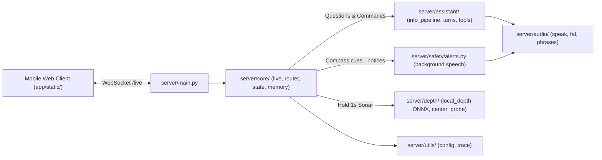

# VoxEye — Gen AI Summit Hackathon 2026
> **Athens LifeTech Park (Spata) & SNFCC (Book Castle) · 14–16 November 2026**  
> Co-organised by GenAI Summit (100mentors × Wiserwork) × Panathēnea · Title Sponsor: **Quintessential (€8,500 Cash Podium)**

Real-time spatial safety, voice Q&A, and tactile depth assistant for blind and low-vision users (English & Greek). Full application documentation: **[app/README.md](app/README.md)**.

---

## VoxEye Architecture & Flow (`app/`)

### Core Pipeline Summary
1. **Centralized Command, Memory & Answer Router (`app/server/core/router.py`)**: Evaluates every English/Greek utterance to decide whether to ignore room noise, execute a system/memory command, or answer a visual question—keeping `UserMemory` strictly for explicit goals/notes (`keep_memory=True`) while guaranteeing a spoken reply (`should_answer=True`) whenever asked.
2. **Places & Tour Guide (`app/server/geo/`)**: Phone GPS + compass with Google Places (or OpenStreetMap) tools: where am I, what is around, place details and guiding to a place, with exact steps and directions relative to where the user faces.
3. **Auto Mobile / Laptop Depth Sonar (`app/static/depth_worker.js` + `app/server/depth/local_depth.py`)**: Holding the screen for 1 second runs continuous proximity sonar on Mobile WebGPU when fast (`<= 280 ms`) or auto-switches to Laptop ONNX Depth-Anything-V2-Small.

### Core User Stories
- **Ask & Always Hear an Answer**: Ask *"What is ahead?"* or *"Πού είναι η πόρτα;"* and receive an immediate spoken clock-face + step answer without cluttering memory.
- **Explicit Memory Only When Needed**: Say *"I'm looking for the exit"* or *"Remember my cane is by the door"* to persist explicit context across turns and safety detours.
- **Talk Over It Anytime**: Speaking cuts whatever VoxEye is saying or doing and it listens.
- **Hold-1s Tactile Depth Sonar**: Press and hold for 1 second for continuous Geiger-style beep and vibration distance feedback.

---

## Hackathon Context & Research Docs (`context/`)

All project research, architecture plans, hackathon rules, and ideation live in **[context/](context/README.md)**:

- **[VoxEye Application Guide](app/README.md)** — Detailed server/client module diagram, dual-pipeline flow, user stories, and quickstart.
- **[BLV Research TL;DR: Problem Spectrum, SOTA, Competitors & OSS Upgrades](context/research/tldr-sota-competitors-oss.md)** — Master executive summary & prioritized roadmap:
  - **[Competitors & Commercial Landscape](context/research/competitors-solutions.md)** — 19 smartphone apps, wearables/mobility rigs, and live VLMs vs. VoxEye.
  - **[Open-Source Repositories & Codebase Upgrades](context/research/open-source-repos.md)** — 21 GitHub repos & Hugging Face models mapped to `app/static/` and `app/server/`.
  - **[BLV Problem Spectrum & 2024–2026 Academic SOTA](context/research/problem-spectrum-sota.md)** — Micro/meso/macro navigation taxonomy, walking kinematics vs. latency, and System-1/System-2 architectures.
- **[VoxEye Architecture & Optimization Plans](context/architecture/)** — Design notes (`eyes-app.md`, `fast-warnings-master-plan.md`, `ar-spatial-decision-plan.md`).
- **[Hackathon Strategy, Judges, Tracks & Credits](context/hackathon/)** — [Kickoff Deck Notes](context/hackathon/kickoff-deck.md), [Judges](context/hackathon/judges.md), [Sponsors](context/hackathon/sponsors-research.md), [Credits & Tools](context/hackathon/credits-and-tools.md), and [Championship Blueprint](context/hackathon/championship-blueprint.md).
