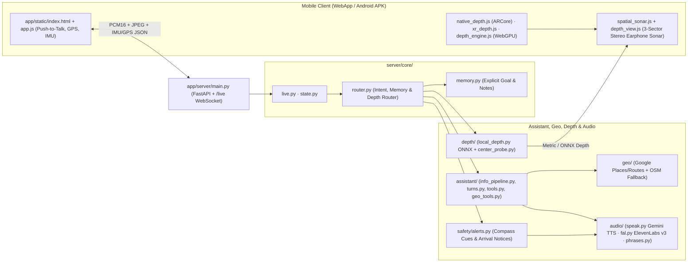

# VoxEye — Eyes in Your Ears

> **Gen AI Summit Hackathon 2026** · Athens LifeTech Park (Spata) & SNFCC (Book Castle) · 14–16 November 2026  
> Co-organised by GenAI Summit (100mentors × Wiserwork) × Panathēnea · Title Sponsor: **Quintessential (€8,500 Cash Podium)**

**VoxEye** turns any smartphone and stereo earphones into a real-time **3D stereo depth sonar**, **bilingual (English & Greek) visual voice assistant**, and **compass-locked GPS tour guide** for blind and low-vision (BLV) users—requiring zero extra hardware.

- **Detailed Backend & Client Documentation**: **[app/README.md](app/README.md)**
- **Research, Architecture Plans & Hackathon Context**: **[context/README.md](context/README.md)**

---

## Key Capabilities

1. **Always-On 3D Stereo Depth Sonar (`<50 ms` local feedback)**
   - Splits the camera's forward band into **LEFT / CENTER / RIGHT** sectors and maps nearest surfaces (`< 2.5 m`) into stereo earphone Geiger beeps (closer = louder, faster, higher pitch; left strictly in left ear, right in right ear, center in both).
   - **4-Tier Depth Engine**: Automatically selects the fastest depth source on the device:
     1. **Native ARCore Depth API** (`android/` Kotlin shell + `app/static/native_depth.js`, ~12 Hz metric depth).
     2. **WebXR Depth Sensing** (`app/static/xr_depth.js`).
     3. **On-Device WebGPU Depth** (`app/static/depth_engine.js` + `depth_worker.js`, ~5 fps).
     4. **Server ONNX Depth-Anything-V2-Small** (`app/server/depth/local_depth.py`, ~4 fps, metric-anchored via Gemini `center_probe.py`).
2. **Push-to-Talk & True Stereo Earphone Preservation**
   - Hold the main screen button (or `Space` on desktop / hardware volume keys in the Android APK) to speak; release for an immediate answer with zero silence-timeout delay. Pressing anytime barges in and cuts ongoing speech.
   - Keeps the microphone closed when not speaking and explicitly routes around Bluetooth SCO mono call-audio downgrade on Android, preserving full stereo separation for the depth sonar.
3. **Centralized Command, Memory & Answer Router (`app/server/core/router.py`)**
   - Evaluates every English/Greek utterance via Gemini to filter background noise (`intent="ignore"`), execute system/language/compass commands, or answer visual questions using clock-face directions (`10 o'clock, 2 steps`).
   - **Strict Explicit Memory (`app/server/core/memory.py`)**: Routine questions (`keep_memory=False`) never clutter state; explicit goals and notes (*"I'm looking for the pharmacy"*, *"Remember my cane is by the door"*) persist across turns (`keep_memory=True`) and guide obstacle detours.
   - **Guaranteed Spoken Reply**: Clause-streamed neural TTS (`app/server/audio/speak.py` + `fal.py`, supporting Gemini TTS & Fal.ai ElevenLabs v3) with pre-warmed bilingual phrases and deterministic fallback confirmations.
4. **Compass-Locked Places & Tour Guide (`app/server/geo/`)**
   - Combines phone GPS + live magnetometer heading with Google Places API (New), Geocoding, and Routes walking directions (with automatic OpenStreetMap Nominatim/Overpass fallback).
   - Answers *"Where am I?"*, *"What's around me?"*, or *"Guide me to the pharmacy"* in steps and relative bearing (*"40 degrees to your right"*), continuously re-aiming background compass cues (`app/server/safety/alerts.py`) until arrival.

---

## System Architecture



---

## Repository Structure

| Path | Description |
| :--- | :--- |
| **[`app/`](app/README.md)** | FastAPI backend (`app/server/`), zero-build mobile web client (`app/static/`), Dockerfile, and test suite (`app/tests/`). |
| **[`android/`](android/)** | Native Android Kotlin + ARCore Depth API shell (`com.voxeye.app`) exposing `window.VoxNative` (`ArDepth.kt`, `MainActivity.kt`). |
| **[`scripts/`](scripts/)** | Build & media utilities: `build_apk.sh` (CLI APK builder producing `app/static/voxeye.apk`) and `render_voiceover.py` (cached 60s TTS voiceover generator). |
| **[`brag-output/`](brag-output/)** | Programmatic 60s pitch videos, interactive storyboard panels, and audio mixes built with the [`.agents/skills/brag/`](.agents/skills/brag/SKILL.md) skill. |
| **[`context/`](context/README.md)** | BLV academic SOTA & competitor research, architecture blueprints, hackathon rules/judges, and the [Video Demo Blueprint](context/video-demo-blueprint.md). |
| **[`index.html`](index.html)** | Static mirror of the sketchbook landing page (served dynamically at `/` by FastAPI via `app/static/landing.html`). |

---

## Quickstart

### 1. Configure Environment
```bash
cp app/.env.example app/.env
```
Set your API keys in `app/.env`:
- `GEMINI_API_KEY` *(required)* — Used for multimodal Q&A, command/memory routing, TTS, and Google Maps/Places when using a standard `AIza…` Google Cloud key (otherwise set `GOOGLE_MAPS_API_KEY`, or rely on the automatic OpenStreetMap fallback).
- `FAL_API_KEY` & `EYES_TTS_PROVIDER=fal` *(optional)* — Uses Fal.ai ElevenLabs v3 (`fal-ai/elevenlabs/tts/eleven-v3`) for voice synthesis instead of Gemini TTS.

### 2. Run the Server
```bash
# Start or restart in background (writes server.pid and server.log):
./restart_server.sh

# Or run interactively in foreground:
cd app && uv run uvicorn server.main:app --host 0.0.0.0 --port 8000
```

### 3. Run via Docker
```bash
cd app
docker build -t voxeye .
docker run --rm -p 8000:8000 --env-file .env voxeye
```

### 4. Endpoints & Mobile Access
| Route | Purpose |
| :--- | :--- |
| **`http://localhost:8000/`** | Interactive Sketchbook Landing Page, pitch video, live browser sonar playground, and APK download. |
| **`http://localhost:8000/app`** | **Live VoxEye WebApp** (camera, push-to-talk voice, stereo depth sonar, compass & GPS). |
| **`http://localhost:8000/panel`** | **Judges' Live Telemetry Panel** (real-time trace of utterances, router decisions, memory, and latency). |
| **`http://localhost:8000/voxeye.apk`** | Direct download of the signed Android APK (`voxeye-v1.8.apk`). |

> **Using a Real Phone**: Mobile browsers require a secure context for camera/mic/GPS. Either connect via USB and run `adb reverse tcp:8000 tcp:8000` (then open `http://localhost:8000/app` or launch the Android app), or expose port `8000` via an HTTPS tunnel (e.g., `cloudflared tunnel --url http://localhost:8000`).

### 5. Run Tests
```bash
cd app && uv run pytest
```

---

## Documentation & Research Index

- **[Application Architecture & Module Reference (`app/README.md`)](app/README.md)** — Detailed server/client module table, stereo Bluetooth audio notes, and user stories.
- **[BLV Research TL;DR: Problem Spectrum, SOTA, Competitors & OSS (`context/research/tldr-sota-competitors-oss.md`)](context/research/tldr-sota-competitors-oss.md)**
  - [Competitors & Commercial Landscape](context/research/competitors-solutions.md) · [Open-Source Repos](context/research/open-source-repos.md) · [Academic SOTA](context/research/problem-spectrum-sota.md)
- **[Architecture & Optimization Plans (`context/architecture/`)](context/README.md)** — [System Overview](context/architecture/eyes-app.md), [Fast Warnings Plan](context/architecture/fast-warnings-master-plan.md), [AR Spatial Decision Plan](context/architecture/ar-spatial-decision-plan.md).
- **[Video Demo Blueprint (`context/video-demo-blueprint.md`)](context/video-demo-blueprint.md)** — Programmatic video pipeline (`brag`) and audio-first synthesis guide.
