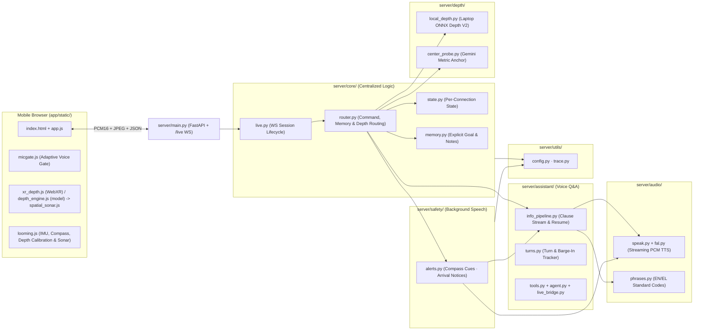
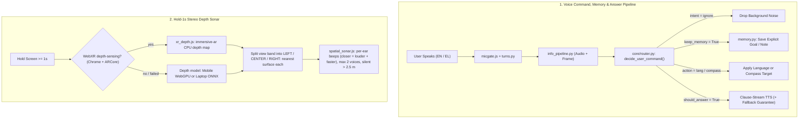

# VoxEye (`app/`)

Real-time camera, voice, and spatial safety assistant for blind and low-vision users (English & Greek). Built with FastAPI (`uvicorn server.main:app`) and a zero-build WebSocket + WebAudio/WebGPU mobile web client.

---

## Codebase Structure

`app/server/` is organized by functional scope around a centralized core router (`server/core/router.py`):



| Folder | Scope & Responsibility |
| :--- | :--- |
| `server/core/` | **Centralized brain**: `router.py` (user command/answer/memory classification + GPS / IMU / hold-scan depth routing), `state.py` (isolated session state), `memory.py` (persisted explicit goals/notes), `live.py` (`/live` WebSocket loop). |
| `server/assistant/` | **Interactive voice pipeline**: `turns.py` (voice turn & barge-in detection), `info_pipeline.py` (multimodal Gemini streaming, guaranteed reply fallback), `tools.py` (places & demo call tools). |
| `server/safety/` | **Background speech**: `alerts.py` (compass guidance cues toward the target bearing, arrival notices, shared `spawn` task helper). |
| `server/geo/` | **Places & GPS (tour guide)**: `providers.py` (Google Places API New + Geocoding + Routes walking with per-request OpenStreetMap fallback; uses `GOOGLE_MAPS_API_KEY`, or `GEMINI_API_KEY` when it is a standard `AIza…` Cloud key), `service.py` (GPS + compass -> distance, steps, "40 degrees to your right", place guidance that re-aims as you walk), `geo_math.py`. Exposed to the model by `assistant/geo_tools.py`. |
| `server/depth/` | **Server depth inference**: `local_depth.py` (Depth-Anything-V2-Small via ONNX Runtime for phones without fast WebGPU), `center_probe.py` (Gemini center-crop metric anchor for calibration). |
| `server/audio/` | **Speech synthesis & standard vocabulary**: `speak.py` & `fal.py` (24 kHz PCM TTS streaming + pre-warmed phrase cache), `phrases.py` (English/Greek compass cues + lookup filler). |
| `server/utils/` | **Shared utilities**: `config.py` (env thresholds), `trace.py` (`/panel` telemetry). |
| `static/` | **Browser client**: `app.js` (WS auto-reconnect, camera, audio player, GPS, barge-in, hold-scan sonar), `micgate.js` (noise-adaptive voice gate), `xr_depth.js` (WebXR depth sensing), `spatial_sonar.js` (3-sector stereo earphone sonar), `depth_engine.js` + `depth_worker.js` (WebGPU depth model fallback), `looming.js` (IMU, compass, depth calibration, sonar pulses). |

---

## Centralized System Flow



### Minimal Flow Summary
1. **Voice Command & Memory Decision (`core/router.py` -> `assistant/info_pipeline.py`)**: Every spoken turn is transcribed in English or Greek and evaluated by `decide_user_command()`. Routine questions (`keep_memory=False`) never pollute memory; explicit goals/notes/clears (`keep_memory=True`) update `UserMemory` and broadcast to the UI; every valid question or command has `should_answer=True` so VoxEye always replies aloud (using deterministic fallback confirmation if the model omits `REPLY:`).
2. **Stereo Depth Sonar (`static/xr_depth.js` + `static/spatial_sonar.js`)**: The danger feedback is earphone beeps only (no braking, no spoken stops). While the assistant runs, the sonar is always on, fed by the depth model (~5 fps phone WebGPU when fast, otherwise ~4 fps laptop ONNX, metres re-anchored every ~3 s); it pauses while the user talks, ducks while VoxEye speaks, drops readings older than 1.5 s, and is toggled by the "sonar" button (`?sonar=0`). Holding the main button for 1 second starts a focused full-speed scan: a WebXR Depth Sensing session (Chrome on ARCore phones; the app camera is handed back afterwards) or, where WebXR depth is unavailable, the Depth-Anything-V2 model (phone WebGPU or laptop ONNX). The view band is split into LEFT / CENTER / RIGHT and the nearest surface in each becomes earphone beeps in that ear: closer = louder and faster, strictly per ear (left only in the left ear, right only in the right ear, center in both; no bleed), parametric pitch per ear: each ear has its own base pitch, shifted per side, with a center split and a rise as surfaces get closer; all tunable from the **sonar settings** panel on the page: per ear pitch, max volume and max beep rate, plus the shared range limit, side offset, center split and closer-pitch rise (live, saved on the device, with test-left/center/right beeps and reset; URL overrides `?pitchL= ?pitchR= ?volL= ?volR= ?rateL= ?rateR= ?range=`). UX limits: silent beyond 2.5 m, at most two sectors at once (only those within 0.8 m of the closest), no overlapping beeps, capped volume behind a limiter, a soft alive tick every 1.5 s during a hold scan when nothing is near.

---

## User Stories

- **US-1 · Ask & Always Get a Spoken Answer**: *As a blind user, when I ask "What is in front of me?" or "Τι γράφει η πινακίδα;", VoxEye answers aloud within ~1 second using clock positions and step counts, without saving routine questions to memory.*
- **US-1b · Talk Over It Anytime**: *Whenever I start speaking, VoxEye stops whatever it is saying or doing (answer, thinking, compass cue or notice) instantly on the phone and on the server, and listens to me.*
- **US-1c · Tour Guide & Places**: *When I ask "Ξενάγησέ με στην περιοχή", "Is there a pharmacy nearby?" or "Take me to the Acropolis Museum", VoxEye uses my phone GPS + compass and Google Places (or OpenStreetMap) to tell me where I am and what is around, with exact steps and directions relative to where I face, and can aim compass guidance at a place until I arrive.*
- **US-2 · Explicit Goal & Note Memory**: *As a user navigating an unfamiliar space, when I say "I'm looking for the pharmacy" or "Remember my bag is by the couch", VoxEye decides `keep_memory=True`, persists the goal/note across reconnects, confirms aloud, and prioritizes that goal in subsequent answers and obstacle detours.*
- **US-3 · Exact Compass Answers**: *When I ask "Πόσες μοίρες κοιτάω;" VoxEye answers straight from the phone compass ("Κοιτάς 203 μοίρες, νοτιοδυτικά. Ο στόχος σου, νότια, είναι αριστερά σου, 23 μοίρες."), never a model guess.*
- **US-4 · Hands-Free System Control**: *As a user in a loud venue, when I say "Forget everything", or "Μίλα ελληνικά", VoxEye applies the setting immediately and speaks a short confirmation.*
- **Stereo needs media audio**: the default "audio: earphones (stereo)" mode opens the mic without echo cancellation and avoids a Bluetooth headset mic, because either puts Android into mono call audio (both ears would hear the same). "audio: speaker" keeps echo cancellation for use without earphones. The debug row "audio mode" shows output channels and the mic in use.
- **US-5 · Stereo Depth Sonar**: *As a user wearing earphones, while VoxEye runs (and more precisely when I hold the screen for 1 second) I hear where the nearest surfaces are: a wall on my right beeps in my right ear, getting louder and faster as I get closer, using WebXR depth on Chrome/ARCore or the depth model elsewhere.*

---

## Quickstart

```bash
# Run server (from repo root or app/)
./restart_server.sh
# Or directly:
cd app && uv run uvicorn server.main:app --host 0.0.0.0 --port 8000
```

- **Phone UI**: `http://localhost:8000` (use HTTPS tunnel for mobile mic/camera)
- **Live Judges' Trace Panel**: `http://localhost:8000/panel`
