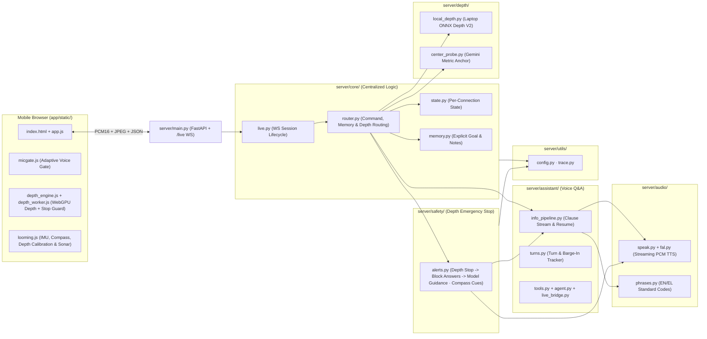

# VoxEye (`app/`)

Real-time camera, voice, and spatial safety assistant for blind and low-vision users (English & Greek). Built with FastAPI (`uvicorn server.main:app`) and a zero-build WebSocket + WebAudio/WebGPU mobile web client.

---

## Codebase Structure

`app/server/` is organized by functional scope around a centralized core router (`server/core/router.py`):



| Folder | Scope & Responsibility |
| :--- | :--- |
| `server/core/` | **Centralized brain**: `router.py` (user command/answer/memory classification + depth/stop message routing), `state.py` (isolated session state), `memory.py` (persisted explicit goals/notes), `live.py` (`/live` WebSocket loop). |
| `server/assistant/` | **Interactive voice pipeline**: `turns.py` (voice turn & barge-in detection), `info_pipeline.py` (multimodal Gemini streaming, guaranteed reply fallback, `guide_after_depth_stop` emergency guidance), `tools.py` (places & demo call tools). |
| `server/safety/` | **Depth emergency stop**: `steering.py` (pure turn math: image gap -> degrees, compass delta to target, side choice), `alerts.py` (`depth_emergency_stop`: cached "Stop!", blocks the answering pipeline, image + compass -> model "what to do", releases after playback; plus the compass-cue loop). |
| `server/geo/` | **Places & GPS (tour guide)**: `providers.py` (Google Places API New + Geocoding + Routes walking with per-request OpenStreetMap fallback; uses `GOOGLE_MAPS_API_KEY`, or `GEMINI_API_KEY` when it is a standard `AIza…` Cloud key), `service.py` (GPS + compass -> distance, steps, "40 degrees to your right", place guidance that re-aims as you walk), `geo_math.py`. Exposed to the model by `assistant/geo_tools.py`. |
| `server/depth/` | **Server depth inference**: `local_depth.py` (Depth-Anything-V2-Small via ONNX Runtime for phones without fast WebGPU), `center_probe.py` (Gemini center-crop metric anchor for calibration). |
| `server/audio/` | **Speech synthesis & standard vocabulary**: `speak.py` & `fal.py` (24 kHz PCM TTS streaming + pre-warmed alert cache), `phrases.py` (strict English/Greek standard movement codes). |
| `server/utils/` | **Shared utilities**: `config.py` (env thresholds), `trace.py` (`/panel` telemetry). |
| `static/` | **Browser client**: `app.js` (WS auto-reconnect, camera, audio player, depth stop guard), `micgate.js` (noise-adaptive voice gate), `depth_engine.js` + `depth_worker.js` (WebGPU depth, throttled guard / full-speed hold), `looming.js` (IMU, compass, depth calibration, sonar pulses). |

---

## Centralized System Flow

```mermaid
flowchart TD
    subgraph VoiceFlow["1. Voice Command, Memory & Answer Pipeline"]
        Mic["User Speaks (EN / EL)"] --> Gate["micgate.js + turns.py"]
        Gate --> LLM["info_pipeline.py (Audio + Frame)"]
        LLM --> CmdDec["core/router.py: decide_user_command()"]
        CmdDec -->|"intent = ignore"| Ign["Drop Background Noise"]
        CmdDec -->|"keep_memory = True"| SaveMem["memory.py: Save Explicit Goal / Note"]
        CmdDec -->|"action = mode / lang"| SysAct["Apply Mode or Language"]
        CmdDec -->|"should_answer = True"| SpeakAns["Clause-Stream TTS (+ Fallback Guarantee)"]
    end

    subgraph SafetyFlow["2. Depth Emergency Stop"]
        Guard["Always-on Depth Guard (~5 fps, phone WebGPU or laptop ONNX)"] --> Close{"Center depth <= 0.9 m (2 readings)?"}
        Close -->|"No"| Guard
        Close -->|"Yes"| Send["Send ONE image + compass/IMU + distance (depth_stop)"]
        Send --> Block["Server: cut speech, block answering pipeline, cached 'Stop!'"]
        Block --> Guide["Model JSON {side, deg, what} -> fast 'Turn right 30 degrees.' then 'Box one step ahead.'"]
        Guide --> Release["Release block after playback · re-arm after backing off 0.5 m"]
    end

    subgraph SonarFlow["3. Hold-1s Depth Sonar"]
        Hold["Hold Screen >= 1s"] --> AutoDev["Auto Device Selector (<= 280ms Mobile WebGPU else Laptop ONNX)"]
        AutoDev --> Pulse["Geiger Audio Beep + Haptic Vibration"]
    end
```



### Minimal Flow Summary
1. **Voice Command & Memory Decision (`core/router.py` -> `assistant/info_pipeline.py`)**: Every spoken turn is transcribed in English or Greek and evaluated by `decide_user_command()`. Routine questions (`keep_memory=False`) never pollute memory; explicit goals/notes/clears (`keep_memory=True`) update `UserMemory` and broadcast to the UI; every valid question or command has `should_answer=True` so VoxEye always replies aloud (using deterministic fallback confirmation if the model omits `REPLY:`).
2. **Depth Emergency Stop (`static/app.js` -> `safety/alerts.py` -> `assistant/info_pipeline.py`)**: There is no camera-video safety watcher any more. Depth-Anything-V2 runs continuously on the camera center as a throttled guard (phone WebGPU, or laptop ONNX when the phone is slow), calibrated to metres by PDAF / hold-scan anchors. Stops fire **only on movement**: the center depth must be falling (≥0.25 m drop at ≥0.2 m/s over ~1.5 s, `Looming.ApproachDetector`; phone rotation and calibration jumps reset it), so standing next to a wall never triggers. When the user is closing in and within `EYES_DEPTH_STOP_M` (0.9 m; 0.6 m in "close only" mode), or earlier when time-to-contact is ≤1.4 s, and the user is not talking or waiting for an answer (that has priority: only a silent haptic nudge then, and the stop fires once they are done) the phone beeps/buzzes instantly and sends one `depth_stop` with a camera image, the distance and the compass/IMU snapshot. The server cuts any speech, **blocks the answering pipeline** (mic turns and new answers are dropped), plays the cached "Stop!", asks the vision model only **where open floor is** in the image (JSON: left/right gap position, what is ahead) while `safety/steering.py` computes the side and degrees deterministically from the camera field of view, the phone compass and the target bearing (an explicit compass target, or a direction in the memory goal such as "να πάω νότια"), then speaks **first the degrees** (pre-cached, e.g. "Turn right 30 degrees." / "Στρίψε δεξιά 30 μοίρες.") **then what is ahead**, both trimmed and sped up 1.35× without changing pitch (`EYES_GUIDE_SPEECH_RATE`), and only then releases the block. The guard re-arms after the user backs off 0.5 m past the threshold; the server also enforces a 4 s cooldown.
3. **Adaptive Depth Sonar (`static/depth_worker.js` + `depth/local_depth.py`)**: Holding the main button for 1 second pauses speech alerts and runs continuous center-crosshair distance estimation—defaulting to on-device WebGPU when fast (`<= 280 ms`) and automatically switching to Laptop ONNX inference if mobile inference is slow or unavailable.

---

## User Stories

- **US-1 · Ask & Always Get a Spoken Answer**: *As a blind user, when I ask "What is in front of me?" or "Τι γράφει η πινακίδα;", VoxEye answers aloud within ~1 second using clock positions and step counts, without saving routine questions to memory.*
- **US-1b · Talk Over It Anytime**: *Whenever I start speaking, VoxEye stops whatever it is saying or doing (answer, thinking, compass cue, or stop guidance) instantly on the phone and on the server, and listens to me. Only the one-second "Stop!" itself cannot be talked over.*
- **US-1c · Tour Guide & Places**: *When I ask "Ξενάγησέ με στην περιοχή", "Is there a pharmacy nearby?" or "Take me to the Acropolis Museum", VoxEye uses my phone GPS + compass and Google Places (or OpenStreetMap) to tell me where I am and what is around, with exact steps and directions relative to where I face, and can aim compass guidance at a place until I arrive.*
- **US-2 · Explicit Goal & Note Memory**: *As a user navigating an unfamiliar space, when I say "I'm looking for the pharmacy" or "Remember my bag is by the couch", VoxEye decides `keep_memory=True`, persists the goal/note across reconnects, confirms aloud, and prioritizes that goal in subsequent answers and obstacle detours.*
- **US-3 · Depth Emergency Stop with Guidance**: *As a user walking while listening to an answer, when something gets within about one step of the camera, VoxEye cuts the answer, says "Stop!", and then tells me what is there and what to do using the picture and my compass heading (`"Turn right 30 degrees. Box one step ahead."`, spoken fast), ignoring my mic until it has finished.*
- **US-3b · Exact Compass Answers**: *When I ask "Πόσες μοίρες κοιτάω;" VoxEye answers straight from the phone compass ("Κοιτάς 203 μοίρες, νοτιοδυτικά. Ο στόχος σου, νότια, είναι αριστερά σου, 23 μοίρες."), never a model guess.*
- **US-4 · Hands-Free System Control**: *As a user in a loud venue, when I say "Urgent alerts only" (closer stop distance), "Turn off alerts" (disables the depth stop), "Forget everything", or "Μίλα ελληνικά", VoxEye applies the setting immediately and speaks a short confirmation.*
- **US-5 · Tactile Depth Sonar on Hold**: *As a user checking clear space ahead without speech chatter, when I press and hold the screen for 1 second, VoxEye translates obstacle proximity into faster audio/vibration pulses using the fastest available depth engine (Mobile WebGPU or Laptop ONNX).*

---

## Quickstart

```bash
# Run server (from repo root or app/)
./restart_server.sh
# Or directly:
cd app && uv run uvicorn server.main:app --host 0.0.0.0 --port 8000
```

- **Phone UI**: `http://localhost:8000` (use HTTPS tunnel for mobile mic/camera)
- **Live Judges' Trace Panel**: `http://localhost:8000/panel`
