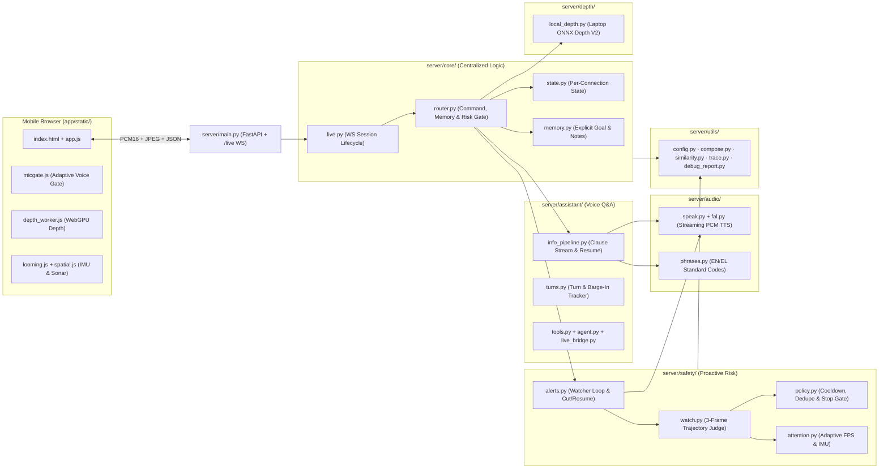

# VoxEye (`app/`)

Real-time camera, voice, and spatial safety assistant for blind and low-vision users (English & Greek). Built with FastAPI (`uvicorn server.main:app`) and a zero-build WebSocket + WebAudio/WebGPU mobile web client.

---

## Codebase Structure

`app/server/` is organized by functional scope around a centralized core router (`server/core/router.py`):



| Folder | Scope & Responsibility |
| :--- | :--- |
| `server/core/` | **Centralized brain**: `router.py` (user command/answer/memory classification + movement risk gate), `state.py` (isolated session state), `memory.py` (persisted explicit goals/notes), `live.py` (`/live` WebSocket loop). |
| `server/assistant/` | **Interactive voice pipeline**: `turns.py` (voice turn & barge-in detection), `info_pipeline.py` (multimodal Gemini streaming, guaranteed reply fallback, interrupted-speech resume), `tools.py` (places & demo call tools). |
| `server/safety/` | **Proactive obstacle pipeline**: `alerts.py` (background watcher & instant speech cut), `watch.py` (3-frame contact-sheet risk model), `policy.py` (movement thresholds, confirmation, deduplication), `attention.py` (adaptive 1–5 FPS & IMU). |
| `server/depth/` | **Server depth inference**: `local_depth.py` (Depth-Anything-V2-Small via ONNX Runtime for phones without fast WebGPU). |
| `server/audio/` | **Speech synthesis & standard vocabulary**: `speak.py` & `fal.py` (24 kHz PCM TTS streaming + pre-warmed alert cache), `phrases.py` (strict English/Greek standard movement codes). |
| `server/utils/` | **Shared utilities**: `config.py` (env thresholds), `compose.py` (numbered 3-frame strip), `similarity.py` (downsampled L1 movement scoring), `trace.py` (`/panel` telemetry), `debug_report.py`. |
| `static/` | **Browser client**: `app.js` (WS auto-reconnect, camera, audio player), `micgate.js` (noise-adaptive voice gate), `depth_worker.js` (WebGPU depth), `looming.js` (IMU + sonar pulses). |

---

## Centralized System Flow

```mermaid
flowchart TD
    subgraph VoiceFlow["1. Voice Command, Memory & Answer Pipeline"]
        Mic["User Speaks (EN / EL)"] --> Gate["micgate.js + turns.py"]
        Gate --> LLM["info_pipeline.py (Audio + Frame)"]
        LLM --> CmdDec["core/router.py: decide_user_command()"]
        CmdDec -->|"intent = ignore"| Ign["Drop Background Noise"]
        CmdDec -->|"keep_memory = True"| SaveMem["memory.py: Save Explicit Goal / Note"]
        CmdDec -->|"action = mode / lang"| SysAct["Apply Mode or Language"]
        CmdDec -->|"should_answer = True"| SpeakAns["Clause-Stream TTS (+ Fallback Guarantee)"]
    end

    subgraph SafetyFlow["2. Movement-Gated Risk Pipeline"]
        Cam["Camera Frames + Phone IMU"] --> MoveGate["core/router.py: evaluate_movement_risk_gate()"]
        MoveGate -->|"Panning or score < 0.058"| Silent["Stay Silent (Skip Risk Model)"]
        MoveGate -->|"Sustained Movement >= 0.058"| Judge["safety/watch.py: 3-Frame Risk Judge"]
        Judge --> Pol["safety/policy.py: Standard Code Mapping"]
        Pol -->|"0.058..0.114 (Moderate)"| Steer["Speak Guidance ('Slide right.')"]
        Pol -->|">= 0.115 (Large Collision Risk)"| StopCut["Speak 'Stop!' + Cut Active Speech"]
        StopCut --> Explain["Laconic Obstacle + Code + Resume Interrupted Answer"]
    end

    subgraph SonarFlow["3. Hold-1s Depth Sonar"]
        Hold["Hold Screen >= 1s"] --> AutoDev["Auto Device Selector (<= 280ms Mobile WebGPU else Laptop ONNX)"]
        AutoDev --> Pulse["Geiger Audio Beep + Haptic Vibration"]
    end
```



### Minimal Flow Summary
1. **Voice Command & Memory Decision (`core/router.py` -> `assistant/info_pipeline.py`)**: Every spoken turn is transcribed in English or Greek and evaluated by `decide_user_command()`. Routine questions (`keep_memory=False`) never pollute memory; explicit goals/notes/clears (`keep_memory=True`) update `UserMemory` and broadcast to the UI; every valid question or command has `should_answer=True` so VoxEye always replies aloud (using deterministic fallback confirmation if the model omits `REPLY:`).
2. **Movement-Gated Risk Identification (`core/router.py` -> `safety/alerts.py`)**: `evaluate_movement_risk_gate()` measures sustained multi-frame motion and gyroscope panning before calling the vision risk model. Standing still, hand sway (`score < 0.058`), or camera panning stays completely silent. Sustained movement (`>= 0.058`) evaluates 3 sequential frames (`1 -> 2 -> 3 NEW`), emits pre-cached standard navigation phrases (`Slide right.`, `Turn left.`, and `Stop!` only when `score >= 0.115`), cuts ongoing assistant speech on danger, states the obstacle laconically, and resumes any interrupted answer from the exact word cut off.
3. **Adaptive Depth Sonar (`static/depth_worker.js` + `depth/local_depth.py`)**: Holding the main button for 1 second pauses speech alerts and runs continuous center-crosshair distance estimation—defaulting to on-device WebGPU when fast (`<= 280 ms`) and automatically switching to Laptop ONNX inference if mobile inference is slow or unavailable.

---

## User Stories

- **US-1 · Ask & Always Get a Spoken Answer**: *As a blind user, when I ask "What is in front of me?" or "Τι γράφει η πινακίδα;", VoxEye answers aloud within ~1 second using clock positions and step counts, without saving routine questions to memory.*
- **US-2 · Explicit Goal & Note Memory**: *As a user navigating an unfamiliar space, when I say "I'm looking for the pharmacy" or "Remember my bag is by the couch", VoxEye decides `keep_memory=True`, persists the goal/note across reconnects, confirms aloud, and prioritizes that goal in subsequent answers and obstacle detours.*
- **US-3 · Movement-Gated Hazard Protection & Smooth Resume**: *As a user walking while listening to a room description, if I move meaningfully toward a chair or stairs, VoxEye only alerts when my movement is sustained—cutting the description to say `"Stop! Chair at 12, one step. Slide right."` and then `"Continuing, ..."` from where it stopped, while staying quiet when I stand still.*
- **US-4 · Hands-Free System Control**: *As a user in a loud venue, when I say "Urgent alerts only", "Turn off alerts", "Forget everything", or "Μίλα ελληνικά", VoxEye applies the setting immediately and speaks a short confirmation.*
- **US-5 · Tactile Depth Sonar on Hold**: *As a user checking clear space ahead without speech chatter, when I press and hold the screen for 1 second, VoxEye translates obstacle proximity into faster audio/vibration pulses using the fastest available depth engine (Mobile WebGPU or Laptop ONNX).*

---

## Quickstart

```bash
# Run server (from repo root or app/)
./restart_server.sh
# Or directly:
cd app && uv run uvicorn server.main:app --host 0.0.0.0 --port 8000
```

- **Phone UI**: `http://localhost:8000` (use HTTPS tunnel for mobile mic/camera)
- **Live Judges' Trace Panel**: `http://localhost:8000/panel`
