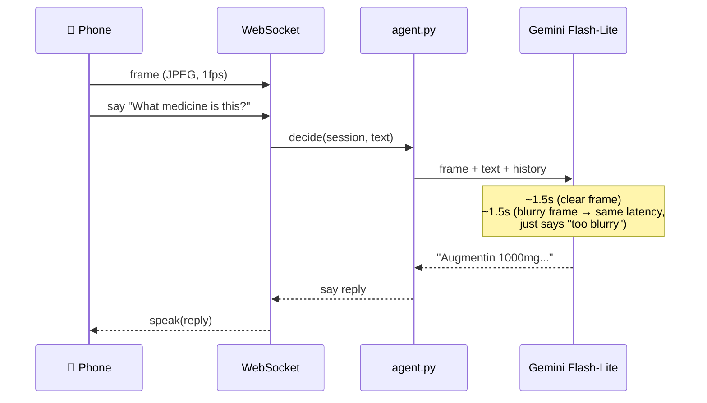
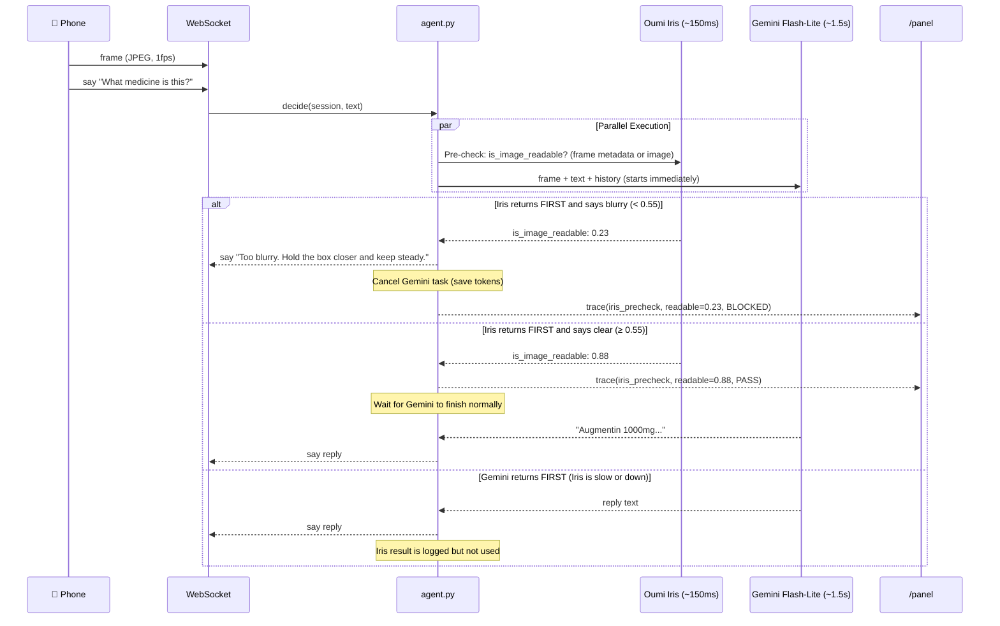

# Oumi Iris Integration Plan for Eyes App

## Goal
Integrate Oumi's **Iris Decision Model** into the Eyes assistant as a fast pre-check and triage layer that **improves user experience** for blind and low-vision users by:
1. Catching bad camera frames in ~150ms (instead of waiting 1.5–4s for Gemini to say "too blurry").
2. Routing difficult reading tasks to the stronger `gemini-3.8-flash` model only when needed.
3. Streaming live Iris confidence metrics to the judges' `/panel` screen.

All of this must happen **without degrading the UX** — if Iris is unavailable or slow, the app falls back to the current behavior seamlessly.

---

## User Review Required

> [!IMPORTANT]
> **OUMI_API_KEY & Project ID required:** Before any of this can run, each teammate needs to register at `https://labs.oumi.ai/hackathon-village/genai-summit-athens-2026` and receive their API key and project ID via email. The key goes in `.env`.

> [!WARNING]
> **Iris supports image + text in `state`**, confirmed by the CEO letter: *"Iris supports image and text."* However, the exact format for passing image bytes (base64 string in a field vs. a multipart upload) is not 100% documented in the HTML we scraped. The plan includes a **fallback path** where we send only textual metadata (frame dimensions, brightness estimate computed locally) if raw image input fails. This is validated in the verification step before any production wiring.

---

## Open Questions

> [!IMPORTANT]
> 1. **Do you have your Oumi API key and project ID yet?** If not, register now at `https://labs.oumi.ai/hackathon-village/genai-summit-athens-2026`.
> 2. **Latency budget:** The current voice loop is ~1.5s (Gemini flash-lite). We are adding Iris as a **parallel pre-check**, not a serial gate. Are you OK with Iris running in parallel so it never adds latency to the happy path, but can short-circuit with an early "too blurry" response if it finishes before Gemini?

---

## Architecture: Before vs. After

### Current Flow (No Iris)


**Problem:** When the frame is blurry, the user still waits 1.5s for Gemini to process the image and generate a "too blurry" text response. That's wasted time and tokens.

### Proposed Flow (With Iris)


### Key UX Guarantee
**Iris never adds latency.** It runs in parallel with Gemini. Three outcomes:
1. **Iris is fast + frame is bad** → User hears "too blurry" in ~200ms instead of ~1500ms. **UX improves.**
2. **Iris is fast + frame is good** → Iris logs a PASS, Gemini reply arrives normally. **UX unchanged.**
3. **Iris is slow or down** → Gemini reply arrives as if Iris didn't exist. **UX unchanged.**

---

## Proposed Changes

### Component 1: Configuration (`app/server/config.py`)

#### [MODIFY] config.py
Add Oumi Iris environment variables. These are optional — the app works without them.

```diff
  API_KEY = os.environ.get("GEMINI_API_KEY", "")
  MODEL = os.environ.get("GEMINI_MODEL", "gemini-3.5-flash-lite")
  HARD_MODEL = os.environ.get("GEMINI_HARD_MODEL", "gemini-3.8-flash")
+
+ # Oumi Iris Decision Model (optional: app works without it)
+ OUMI_API_KEY = os.environ.get("OUMI_API_KEY", "")
+ OUMI_PROJECT_ID = os.environ.get("OUMI_PROJECT_ID", "")
+ OUMI_MODEL = f"projects/{OUMI_PROJECT_ID}/models/iris-latest" if OUMI_PROJECT_ID else ""
+ IRIS_ENABLED = bool(OUMI_API_KEY and OUMI_PROJECT_ID)
```

---

### Component 2: New Iris Client Module (`app/server/iris.py`)

#### [NEW] iris.py
A small, self-contained async HTTP client for the Iris decision API. Uses only `urllib` (no new dependencies) to keep the lockfile unchanged, or optionally `httpx` if already available.

```python
"""Oumi Iris decision model client.

Runs as a fast pre-check before the main Gemini call.
If OUMI_API_KEY is not set, all calls return None (graceful no-op).
"""
import asyncio
import base64
import json
import time
from urllib.request import Request, urlopen

from . import config, trace

ENDPOINT = "https://inference.oumi.ai/v1/systemone"
TIMEOUT_S = 1.5  # Iris must be faster than Gemini or we ignore it

# Readability threshold: below this probability we block the Gemini call
READABLE_THRESHOLD = 0.55


def _build_payload(
    frame_b64: str | None,
    user_text: str,
) -> dict:
    """Build the Iris request payload with image quality questions."""
    state: dict = {"user_question": user_text}
    if frame_b64:
        state["image_base64"] = frame_b64

    return {
        "model": config.OUMI_MODEL,
        "state": state,
        "questions": {
            "is_image_readable": {
                "type": "noul",
                "instructions": "Is the camera image sharp and clear enough to read text on packaging or labels?",
                "criteria": {
                    "true": "The image is sharp, in focus, well-lit, and text is legible.",
                    "false": "The image is blurry, out of focus, dark, motion-blurred, or text is too small to read.",
                },
            },
            "needs_hard_model": {
                "type": "noul",
                "instructions": "Does this question require reading very small, dense, or multilingual printed text (like a medicine leaflet or legal fine print)?",
                "criteria": {
                    "true": "The user is asking to read dense printed text, dosage instructions, ingredients, or fine print.",
                    "false": "The user is asking a general question about what they see, or the text is large and simple.",
                },
            },
        },
    }


async def precheck(
    frame: bytes | None,
    user_text: str,
) -> dict | None:
    """Call Iris to pre-check the frame. Returns a dict with scores, or None on error/disabled."""
    if not config.IRIS_ENABLED:
        return None

    started = time.time()
    frame_b64 = base64.b64encode(frame).decode() if frame else None
    payload = _build_payload(frame_b64, user_text)

    try:
        # Run the blocking HTTP call in a thread so we don't block the event loop
        result = await asyncio.wait_for(
            asyncio.get_event_loop().run_in_executor(
                None, _post_sync, payload
            ),
            timeout=TIMEOUT_S,
        )
    except (asyncio.TimeoutError, Exception) as exc:
        latency_ms = round((time.time() - started) * 1000)
        trace.log("iris_error", error=str(exc)[:200], latency_ms=latency_ms)
        return None

    latency_ms = round((time.time() - started) * 1000)
    answers = result.get("answers", {})
    readable = answers.get("is_image_readable", {}).get("noul")
    needs_hard = answers.get("needs_hard_model", {}).get("noul")

    scores = {
        "readable": round(readable, 3) if readable is not None else None,
        "needs_hard_model": round(needs_hard, 3) if needs_hard is not None else None,
        "latency_ms": latency_ms,
    }

    trace.log(
        "iris_precheck",
        **scores,
        blocked=readable is not None and readable < READABLE_THRESHOLD,
    )
    return scores


def _post_sync(payload: dict) -> dict:
    """Synchronous POST to Iris (called in executor)."""
    body = json.dumps(payload).encode()
    req = Request(
        ENDPOINT,
        data=body,
        headers={
            "Content-Type": "application/json",
            "X-API-Key": config.OUMI_API_KEY,
        },
        method="POST",
    )
    with urlopen(req, timeout=TIMEOUT_S) as resp:
        return json.loads(resp.read())
```

---

### Component 3: Agent Integration (`app/server/agent.py`)

#### [MODIFY] agent.py
Wire Iris into the `decide()` function as a **parallel pre-check**. The key design principle: Iris and Gemini start at the same time. Whichever finishes first drives the response.

```diff
  from . import config, tools, trace
+ from . import iris

  ...

  async def decide(session: Session, user_text: str | None) -> str | None:
      """Return one short sentence to speak, or None to stay silent."""
      if not user_text:
          return None

      started = time.time()
      age = session.frame_age()
      trace.log("heard", text=user_text, frame_age_s=None if age is None else round(age, 1))

      if not config.API_KEY:
          return "The model is not connected yet. Add the Gemini key and restart."

      from google.genai import types

+     # --- Iris pre-check (parallel, never blocks) ---
+     iris_task = asyncio.ensure_future(iris.precheck(session.frame, user_text))

      parts: list = []
      for role, text in session.history[-MAX_HISTORY:]:
          parts.append(types.Content(role=role, parts=[types.Part.from_text(text=text)]))

      note = ""
      if session.frame is None or (age is not None and age > FRAME_MAX_AGE_S):
          note = "\n(No fresh camera image is available. If the question needs sight, say you cannot see right now.)"
      user_parts = [types.Part.from_text(text=user_text + note)]
      if session.frame is not None and not note:
          user_parts.insert(0, types.Part.from_bytes(data=session.frame, mime_type="image/jpeg"))
      parts.append(types.Content(role="user", parts=user_parts))

+     # --- Check if Iris finished fast enough to short-circuit ---
+     iris_scores = None
+     if iris_task.done():
+         iris_scores = iris_task.result()
+     else:
+         # Give Iris a tiny head start (50ms) — if it's fast, we can skip the Gemini call entirely
+         try:
+             iris_scores = await asyncio.wait_for(asyncio.shield(iris_task), timeout=0.05)
+         except asyncio.TimeoutError:
+             pass  # Iris is still running, proceed with Gemini
+
+     # If Iris says the frame is unreadable, respond immediately
+     if (
+         iris_scores
+         and iris_scores.get("readable") is not None
+         and iris_scores["readable"] < iris.READABLE_THRESHOLD
+         and session.frame is not None  # only block if we actually have a frame
+     ):
+         trace.log("iris_blocked", readable=iris_scores["readable"])
+         session.history.append(("user", user_text))
+         blocked_reply = "The image is too blurry. Hold the object closer and keep your hand steady."
+         session.history.append(("model", blocked_reply))
+         return blocked_reply

+     # Choose model: if Iris says dense text, use the hard model
+     model = config.MODEL
+     if iris_scores and iris_scores.get("needs_hard_model") is not None:
+         if iris_scores["needs_hard_model"] > 0.7:
+             model = config.HARD_MODEL
+             trace.log("iris_upgrade", model=model, needs_hard=iris_scores["needs_hard_model"])

      try:
-         text, info = await _call_model(config.MODEL, parts)
+         text, info = await _call_model(model, parts)
      except Exception as exc:
          trace.log("error", error=f"{type(exc).__name__}: {exc}"[:300])
          return "Sorry, I could not reach the model. Please try again."

+     # If Iris finished after Gemini, just log it (never wasted)
+     if not iris_task.done():
+         iris_task.cancel()
+     elif iris_scores is None:
+         iris_scores = iris_task.result()
+         if iris_scores:
+             trace.log("iris_late", **iris_scores)

      reply = _clean(text)
      trace.log(
          "reply",
          text=reply,
          silent=reply is None,
          model=model,
          latency_ms=round((time.time() - started) * 1000),
          **info,
      )
      session.history.append(("user", user_text))
      if reply:
          session.history.append(("model", reply))
      return reply
```

---

### Component 4: Environment File (`app/.env.example`)

#### [MODIFY] .env.example
```diff
  GEMINI_API_KEY=
  GEMINI_MODEL=gemini-3.5-flash-lite
  GEMINI_HARD_MODEL=gemini-3.8-flash
+ # Oumi Iris (optional — app works without these)
+ OUMI_API_KEY=
+ OUMI_PROJECT_ID=
```

---

### Component 5: Judges' Trace Panel (`app/static/trace.html`)

#### [MODIFY] trace.html
Add color-coding for Iris events and a visual confidence indicator.

```diff
-     .heard { color: #79c0ff; } .reply { color: #7ee787; } .tool { color: #d2a8ff; } .error { color: #ff7b72; }
+     .heard { color: #79c0ff; } .reply { color: #7ee787; } .tool { color: #d2a8ff; } .error { color: #ff7b72; }
+     .iris_precheck { color: #f0883e; } .iris_blocked { color: #ff7b72; font-weight: bold; }
+     .iris_upgrade { color: #d2a8ff; } .iris_error { color: #8b949e; } .iris_late { color: #8b949e; }
+     .bar { display: inline-block; height: 10px; border-radius: 2px; margin-right: 4px; }
```

And in the `fmt` function, add a visual bar for `readable` scores:

```diff
      const fmt = (e) => {
        const { t, kind, ...rest } = e;
        const main = rest.text ?? rest.tool ?? rest.error ?? "";
+       let extra = "";
+       if (rest.readable !== undefined && rest.readable !== null) {
+         const pct = Math.round(rest.readable * 100);
+         const color = pct >= 55 ? "#7ee787" : "#ff7b72";
+         extra = ` <span class="bar" style="width:${pct}px;background:${color}"></span>${pct}%`;
+       }
        const meta = Object.entries(rest).filter(([k]) => k !== "text").map(([k, v]) => `${k}=${typeof v === "object" ? JSON.stringify(v) : v}`).join("  ");
-       return `<tr class="${kind}"><td class="meta">${new Date(t * 1000).toLocaleTimeString()}</td><td>${kind}</td><td>${main === null ? "(silent)" : String(main).replace(/</g, "&lt;")}</td><td class="meta">${meta.replace(/</g, "&lt;")}</td></tr>`;
+       return `<tr class="${kind}"><td class="meta">${new Date(t * 1000).toLocaleTimeString()}</td><td>${kind}${extra}</td><td>${main === null ? "(silent)" : String(main).replace(/</g, "&lt;")}</td><td class="meta">${meta.replace(/</g, "&lt;")}</td></tr>`;
      };
```

---

### Component 6: Documentation Updates

#### [MODIFY] app/README.md
Add Oumi Iris to the configure section and status.

#### [MODIFY] project-context/eyes-app.md
Update build order step 9 from "next" to "done" once verified.

---

## UX Safeguards Summary

| Concern | Mitigation |
|:---|:---|
| **Iris adds latency** | Runs in parallel with Gemini. 50ms head start window, then Gemini proceeds regardless. |
| **Iris is down or slow** | 1.5s hard timeout. On any error, returns `None` → app behaves as if Iris doesn't exist. |
| **Iris key not configured** | `IRIS_ENABLED` flag is `False` → `precheck()` returns `None` immediately, zero overhead. |
| **False positive: good frame marked blurry** | Threshold is conservative at `0.55`. Frames scoring 0.55–1.0 always pass through to Gemini normally. |
| **False negative: blurry frame passes** | Gemini's own system prompt already handles this case ("If the image is blurry... say so"). Iris is an accelerator, not the only check. |
| **User hears different voice for blur warning** | The blur response uses the same `speechSynthesis` path as all other replies — identical voice and volume. |
| **Network costs** | Iris uses `outputTokens: 0` — you only pay for input tokens. With a 640px JPEG (~40KB base64), that's minimal. |

---

## Verification Plan

### Step 1: API Smoke Test (Before Any Code Changes)
Run a standalone curl/Python test against the Iris endpoint to confirm:
- The API key works
- Image base64 in `state` is accepted
- Response format matches our expectations (`answers.is_image_readable.noul`)

```bash
# Quick test (requires OUMI_API_KEY and OUMI_PROJECT_ID in env)
cd app && uv run python -c "
import json, os
from server import iris, config
print(f'Iris enabled: {config.IRIS_ENABLED}')
print(f'Oumi model: {config.OUMI_MODEL}')

# Test with a simple text-only state (no image)
import asyncio
result = asyncio.run(iris.precheck(None, 'What medicine is this?'))
print(json.dumps(result, indent=2))
"
```

### Step 2: Verify Parallel Execution Doesn't Add Latency
Run the full server and time responses with and without Iris:

```bash
# Start server
cd app && uv run uvicorn server.main:app --host 0.0.0.0 --port 8000

# Compare latency in trace logs:
# 1. With OUMI_API_KEY="" (Iris disabled) → baseline latency
# 2. With OUMI_API_KEY=<real_key> (Iris enabled) → should be same or faster
```

### Step 3: Verify Blur Blocking Works
1. Open the app in a browser.
2. Cover the camera lens partially (simulate blur).
3. Ask "What does this say?"
4. **Expected:** Response arrives in ~200ms saying "The image is too blurry."
5. **Verify on `/panel`:** See `iris_precheck` event with `readable < 0.55` and `blocked=true`.

### Step 4: Verify Graceful Degradation
1. Set `OUMI_API_KEY=invalid_key_12345` in `.env`.
2. Restart the server.
3. Ask a question with the camera pointed at text.
4. **Expected:** Normal Gemini response, no error shown to user. `iris_error` event appears in `/panel` trace only.

### Manual Verification
- [ ] App starts without errors when `OUMI_API_KEY` is empty
- [ ] App starts without errors when `OUMI_API_KEY` is set
- [ ] Blurry frame gets fast "too blurry" response
- [ ] Clear frame gets normal Gemini response (no added latency)
- [ ] `/panel` shows `iris_precheck` events with colored confidence bars
- [ ] Dense medicine leaflet triggers `iris_upgrade` to `gemini-3.8-flash`
- [ ] Invalid API key doesn't break the app
