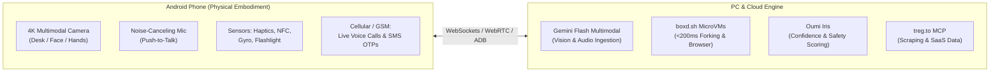

# Gen AI Summit Hackathon 2026 — The Championship Blueprint
## How to Win with Only PCs & Android Phones: Global Research, Winning Patterns, & 4 Tier-1 Blueprints

---

## 1. Executive Summary & The Winning Formula

Winning an elite AI hackathon in 2026 is no longer about chaining prompt templates into a chat UI. As the kickoff deck and lead judges (Quintessential, Wonderful, Athens LifeTech Park, fal) stated upfront:
> *"The model answering is the boring part. The model acting is the new part."*  
> *"Our products don't stay demos — would it survive real users on Tuesday?"*

To win **1st Place overall (€5,000 cash)** and sweep the sponsor prize pools (**$1,750 Oumi Iris**, **$1,500 fal**, **$850 treg**, **boxd**, **Google AI**), a project must fulfill four non-negotiable criteria:
1. **One User, One Job, End-to-End:** Solves a visceral, hated task completely. No chatbots, no "copilots" that just draft text for the user to copy-paste.
2. **The 30-Second Stage Wow Moment:** An unforgettable live physical or audio-visual action on stage where the presenter stops talking and the audience watches the system do something impossible.
3. **The Unfair Hardware Angle:** Turning an everyday Android phone and PC into an embodied physical device (capturing the Open Track hardware bonus without custom soldering).
4. **Observable Production Craft ("Show the Work"):** Streaming live tool calls, reasoning steps, microVM executions, and calibrated confidence bars (`Iris`) so judges see real engineering, not a mock video.

---

## 2. Global AI Hackathon Winners Analysis (The Playbook)

We analyzed recent grand prize winners across top global AI hackathons (Cerebral Valley SF, Cal Hacks, AGI House, Mistral Worldwide, and Anthropic Hackathons) to isolate what actually convinces judges:

| Winning Project | Event / Context | Core Mechanism | Why It Won (The Judge Psychology) |
| :--- | :--- | :--- | :--- |
| **FaceTimeOS** | **Cal Hacks 12.0** *(1st Place Grand Prize)* | User FaceTimes their computer from an iPhone; AI shares screen and autonomously controls the desktop via computer-use. | **Frictionless hardware bridge.** Took something everyone carries (a phone) and turned it into a remote control for OS agents. Seeing a phone FaceTime a PC while the mouse moves autonomously blew the judges away. |
| **Gibberlink** | **ElevenLabs Worldwide Hackathon** *(Top Global Prize)* | Two voice agents speak on a live call. Realizing they are both AI, they switch mid-call from human speech to high-speed ultrasonic modem tones (`ggwave`). | **Pure Stage Aura.** Unpredictable, humorous, and deeply technical. It demonstrated that agents shouldn't pretend to be slow humans when communicating with machines. |
| **GPTCHA** | **Cerebral Valley AI for Good** *(Grand Prize)* | An adversarial voice agent that intercepts scam phone calls live, wastes scammer time, and extracts fraud intel in real time. | **High visceral satisfaction.** Judges hate scammers. Watching an AI outsmart an aggressive real-world nuisance in a live phone call elicited massive audience cheers. |
| **MedKit** | **Anthropic Built with Opus** *(1st Place Global)* | Voice-based clinical simulator where students examine simulated patients and receive deterministic guideline-graded scores. | **Domain depth + Guardrails.** Non-hallucinatory evaluation mapped to verified medical standards. Proved that agents can follow strict safety protocols. |
| **Conductr / Wrench Board** | **Built with Opus / Mistral Hackathons** | Hardware diagnostic workbench combining phone camera feeds with real-time audio guidance on physical circuit boards. | **Embodied Multi-Modality.** The AI has "eyes on the physical world" and "hands on the tools." |

### Key Takeaways for Athens 2026:
* **Never demo a bare chatbox:** Chatbots get 4th place. Autonomous agents taking irreversible actions inside sandboxes win 1st place.
* **The "Two-Party" Live Phone Call is Stage Magic:** Demos where an actual telephone rings on stage and has a real conversation command 100% of the room's attention.
* **The "Desk Camera as Eyes" Effect:** Propping up a phone looking at the physical table makes software feel physical.

---

## 3. Weaponizing Android Phones & PCs: The "Unfair Hardware Advantage"

The kickoff deck explicitly states:
> **"Hardware gets extra points."**

You do not need an Arduino, a Raspberry Pi, or a 3D printer. An **Android smartphone** contains over \$800 worth of specialized sensors that 99% of hackathon teams fail to exploit:



### 4 Ways to Claim the "Hardware Extra Points" with Android + PC:
1. **The "Desk-Mounted Document Scanner & Physical Button"**: Mount the Android phone on a stand (or coffee mug) with its camera facing straight down at the desk surface. Use the physical **Volume Down button** or a physical NFC tap card on the back of the phone to trigger actions. Dropping physical receipts, bills, or badges into the frame triggers immediate computer vision.
2. **The "Two-Party Live Intercom"**: Use the Android phone on speakerphone on the stage table as the *target entity* (e.g., the customer service desk, the lab technician, or the citizen), while the PC agent places a real GSM/VoIP call to it live on stage.
3. **The "Hands-Free Sterile Sensor" (Biotech Angle)**: Use the Android camera running real-time hand-gesture / head-nod detection or proximity sensing so researchers wearing nitrile gloves never touch the screen.
4. **The "Autonomous 2FA / OTP Receiver"**: Have the PC agent fill out a protected government or enterprise portal that sends an SMS 2FA code to the Android phone. An Android background service (via Termux or a lightweight companion app/script) reads the SMS in real time and pipes the OTP back to the PC agent to complete the login on stage.

---

## 4. The 4 Championship Blueprints

Here are 4 fully engineered, high-probability winning ideas tailored specifically to the Athens judging panel, the sponsor prize pools, and the PC + Android hardware constraint.

---

### BLUEPRINT 1: "DeskKEP" — The Physical Desk-Concierge for Greek Bureaucracy
* **Target Track:** **Open Track (Hardware Bonus)** + **Main Quintessential €5,000 Podium**
* **One-Sentence Pitch (`0:00`):**  
  > *"Every Greek citizen and small business loses days navigating `gov.gr` and KEP queues because physical paper documents never talk to online portals. DeskKEP turns your desk into a physical government kiosk: drop a paper document, press the phone's hardware button, and watch an agent fill the portal and make the phone call for whatever can't be done online."*

#### Physical Hardware Setup:
* An Android phone rests on a small desk mount facing downward at a sheet of white paper on the table.
* The PC is plugged into the projector, displaying a split screen:
  * **Left:** Live stream from the Android desk camera + Oumi Iris decision bars.
  * **Right:** A live cloud browser running inside a `boxd` microVM on `gov.gr` or an enterprise portal.

#### The 2-Minute Stage Wow Moment (`0:20 – 2:30`):
1. **The Physical Drop:** Presenter takes a real, crumpled Greek DEH electricity bill or municipal certificate and slaps it onto the desk under the Android phone.
2. **The Hardware Trigger:** Presenter taps a physical Greek ID card (or presses the phone's Volume Rocker).
3. **Instant Multimodal Ingestion:** The Android camera streams the frame to Gemini Flash (`@gcplab.me`), extracting AFM, meter numbers, names, and outstanding debt within 800ms.
4. **The Parallel Guardrail:** **Oumi `Iris`** evaluates the extracted payload in parallel (`outputTokens: 0`):
   * `is_pii_sanitized: true` (99.4%)
   * `portal_route: gov.gr/social-tariff` (98.1%)
   * `submission_risk: LOW` (0.04)
5. **Autonomous Browser Driving:** On the big screen, the `boxd` VM browser launches, logs into the sandbox portal, navigates 4 sub-pages, maps the extracted fields into the Greek form inputs, and hits *Submit*.
6. **The Climax (Live SMS OTP Loop):** The portal displays: *"Enter the 6-digit SMS code sent to +30 697..."*
   * The Android phone buzzes on stage with an incoming SMS.
   * DeskKEP reads the SMS via background broadcast receiver, auto-pastes the OTP into the browser on the PC, and the green confirmation checkmark appears on screen!
7. **The Voice Wrap-up:** The phone speaker speaks in Greek: *"Η αίτησή σας για το κοινωνικό τιμολόγιο υποβλήθηκε επιτυχώς. Αριθμός πρωτοκόλλου: 84920."* (Your application has been submitted successfully).

#### Sponsor Prize-Stacking:
* **Quintessential (€5,000):** Solves the quintessential real-user problem in Greece; runs in an isolated VM; uses real browser automation.
* **Oumi Iris ($1,750 prize):** Scores every form field for compliance and PII leakage before submission.
* **boxd (€50 credits):** Runs the headless Chromium browser inside an Ubuntu 24.04 microVM.
* **treg.to ($850 prize):** Scrapes official `gov.gr` guidelines and KEP department directory requirements.

---

### BLUEPRINT 2: "BenchSight" — The Sterile Lab-Bench Voice & Vision Co-Pilot
* **Target Track:** **Biotech & AI Track (Athens LifeTech Park)** + **Quintessential Main Podium**
* **One-Sentence Pitch (`0:00`):**  
  > *"Biotech researchers at Athens LifeTech Park lose 90 minutes every day because they can't touch a keyboard while wearing nitrile gloves under a sterile laminar flow hood. BenchSight turns an Android phone into a sterile benchtop vision-and-voice copilot that reads reagent tubes, verifies protocols against 50 scientific papers, and logs the experiment hands-free."*

#### Physical Hardware Setup:
* Presenter stands on stage wearing **real purple nitrile laboratory gloves**.
* An Android phone is positioned on an elevated stand, its camera pointed at the presenter's hands and sample vials.

#### The 2-Minute Stage Wow Moment (`0:20 – 2:30`):
1. **The Hands-Free Problem:** Presenter holds up their gloved hands: *"I am working with living cell cultures. If I touch this PC keyboard, I contaminate the sample. If I don't record my observations, my experiment is ruined."*
2. **Visual Inspection:** Presenter holds up a sample vial/reagent bottle to the phone camera. 
   * Gemini Multimodal reads the handwritten label: *"LNP-siRNA Formulation #4, Buffer pH 6.2, Conc 15 mg/mL"*.
3. **Spoken Voice Log:** Presenter speaks naturally: *"BenchSight, I'm observing precipitation at room temperature. Check if protocol 14 allows heating to 37°C."*
4. **Literature Grounding with Citations:** The PC screen displays a real-time literature engine (`treg.to` + Gemini 2M context) searching 30 LifeTech Park research papers. 
   * It pops up a split-screen view: *"WARNING: Paper by Karamanos et al. (2024), Figure 3B, Page 8 proves lipid nanoparticles degrade irreversibly above 32°C. Recommend vortexing at 25°C instead."*
5. **The Gesture Trigger (Hardware):** BenchSight asks over the phone speaker: *"Shall I log this anomaly and adjust the batch record?"*
   * Without touching the phone, the presenter gives a **thumbs-up gesture** to the phone camera.
6. **Automated Enterprise Action:** The `boxd` VM on the PC executes `run googledocs` and `run googlesheets`, formatting the observation into a clean FDA/EMA-compliant electronic lab notebook (ELN) table and updating the reagent inventory.

#### Sponsor Prize-Stacking:
* **Athens LifeTech Park (Track Winner):** Directly tailor-made for their researchers and physical facility.
* **Oumi Iris ($1,750 prize):** Runs anomaly detection and biosafety risk scoring on proposed protocol modifications (`contamination_risk: HIGH`, `temperature_excursion: CRITICAL`).
* **boxd (€50 credits):** Runs Python data parsing scripts + `run googledocs` / `run googlesheets` / `run gmail`.
* **fal ($1,500 prize):** Generates clean, publication-grade vector schematics/diagrams of the experimental protocol steps.

---

### BLUEPRINT 3: "HoldHero" — The Two-Device Live Phone Negotiation Agent
* **Target Track:** **Voice & Enterprise Agents (Wonderful)** + **Main Quintessential €5,000 Podium**
* **One-Sentence Pitch (`0:00`):**  
  > *"Nobody wants to spend 45 minutes on hold with telecom providers or airlines arguing over disputed charges. HoldHero is an autonomous voice agent that calls customer support on your behalf, navigates the interactive voice menu, stays on hold, quotes your exact contract clauses, and negotiates the credit."*

#### Physical Hardware Setup:
* **Device 1 (The Host):** PC running the HoldHero agent dashboard with real-time audio waveform, transcript, and sentiment tracking.
* **Device 2 (The Target):** An Android phone sitting on the demo table, connected to external speakers with its volume cranked up.

#### The 2-Minute Stage Wow Moment (`0:20 – 2:30`):
1. **The Setup:** Presenter shows a disputed €240 roaming bill on screen. *"Cosmote charged me for data roaming while connected to ship Wi-Fi. I'm not calling them. HoldHero is."*
2. **The Live Outbound Call:** Presenter hits *Dispatch Agent*. 
   * The PC dials the Android phone sitting on the stage table via Twilio/Wonderful API.
3. **The Phone Rings Live:** The Android phone rings loudly on stage. Presenter (or teammate) answers on speakerphone acting as the telecom IVR:
   * Phone IVR: *"Thank you for calling Customer Care. For billing, press 1. For cancellations, press 2."*
4. **Autonomous IVR Navigation:** The PC agent plays back a DTMF tone `1` through the audio stream and says: *"Connecting to billing representative regarding disputed account 49201."*
5. **The Live Negotiation:** Teammate speaks into the phone: *"Hello, billing department. I see the charge, but roaming terms apply once you leave territorial waters."*
   * The PC agent counters immediately in a crisp, respectful voice: *"According to section 4.2 of the subscriber agreement uploaded to this ticket, automated maritime satellite charges require prior explicit SMS consent, which was never delivered to IMSI 202-01. We request an immediate credit adjustment of €240."*
6. **Oumi Iris Confidence Live Meter:** The PC dashboard displays real-time `Iris` decision scores:
   * `negotiation_concession_probability`: climbing from 22% $\rightarrow$ 89%
   * `agent_sentiment_compliance`: 99.1%
7. **The Agreement & Diff:** Teammate concedes: *"Alright, I can apply a one-time goodwill waiver of €240 to your next invoice."*
   * Agent replies: *"Confirmed. Please send reference number via SMS."*
   * Agent hangs up, logs the ticket, and pushes an updated calendar reminder and email confirmation via `boxd run gmail`.

#### Sponsor Prize-Stacking:
* **Wonderful (Track Winner):** Demonstrates bleeding-edge enterprise voice capabilities with real telephony and zero lag.
* **Oumi Iris ($1,750 prize):** Scores conversational sentiment, compliance guardrails, and negotiation progress in parallel on every audio turn.
* **boxd (€50 credits):** Executes SaaS follow-up tools (`run gmail`, `run googlecalendar`, `run linear`).

---

### BLUEPRINT 4: "ForkFix" — The 3am On-Call Incident Racer (DevOps Multi-VM)
* **Target Track:** **Open Track / Enterprise** + **Quintessential Main €5,000 Podium**
* **One-Sentence Pitch (`0:00`):**  
  > *"When a production service goes down at 3 AM, waking up an engineer just to run triage is a failure of software. ForkFix ingests the Sentry stack trace, instantly forks 3 live Linux microVMs in 150 milliseconds to race 3 candidate bug fixes in parallel, tests them against the regression suite, and calls the on-call phone with a 15-second voice briefing."*

#### Physical Hardware Setup:
* **PC:** Large screen showing the production service dashboard and the 3 parallel VM runners.
* **Android Phone:** The on-call engineer's phone on the table.

#### The 2-Minute Stage Wow Moment (`0:20 – 2:30`):
1. **The Simulated Outage:** Presenter clicks *Break Production*. A mock e-commerce checkout crashes with a 500 error on the big screen.
2. **Alert Ingestion:** Sentry alert triggers via `boxd run sentry`. ForkFix extracts the null-pointer exception in the payment gateway connector.
3. **The Instant Forking Spectacle (boxd):** On screen, ForkFix triggers the `boxd` API. **Three identical microVMs fork in `<200ms`** with memory, disk, and dependencies intact:
   * **VM 1:** Testing Candidate Fix A (Defensive null check & fallback).
   * **VM 2:** Testing Candidate Fix B (Rollback to prior commit).
   * **VM 3:** Testing Candidate Fix C (Hotpatching environment config).
4. **The Race:** All 3 VMs run the automated test suite simultaneously.
   * VM 2 fails integration tests (breaking API contract).
   * VM 3 fails syntax validation.
   * **VM 1 goes GREEN (48/48 tests passed in 4.2 seconds)!**
5. **Oumi Iris Blast-Radius Scorer:** `Iris` evaluates VM 1's patch:
   * `regression_risk: 0.02`
   * `blast_radius: LOW`
   * `auto_deploy_approved: TRUE`
6. **The Wake-Up Call (Android Hardware):** The Android phone on the table rings.
   * Presenter puts it on speakerphone.
   * A calm AI voice states: *"Production checkout crashed due to unhandled null token on line 84. ForkFix forked 3 test environments and verified patch #104 with 100% test pass rate. Press your volume button or say 'Approve' to deploy."*
   * Presenter says: *"Approve."*
   * The PC screen shows the GitHub PR merged and production health restore to 100% green!

#### Sponsor Prize-Stacking:
* **Quintessential (€5,000):** Hits Kostas & Socrates directly in their comfort zone (DevOps, infrastructure, reliability, real code execution).
* **boxd (€50 credits):** The single best showcase in the entire hackathon for `boxd`'s instant microVM forking capability.
* **Oumi Iris ($1,750 prize):** Evaluates code risk and deployment safety before merging.

---

## 5. Strategic Comparison & Benchmark Scoring

Scored using the 100-point rubric from [project-context/benchmark.md](file:///Users/kdimitropoulos/Documents/Projects/genaisummit2026/project-context/benchmark.md):

| Dimension (Weight) | #1 DeskKEP | #2 BenchSight | #3 HoldHero | #4 ForkFix |
| :--- | :---: | :---: | :---: | :---: |
| **Track & Judge Alignment (25)** | 24 | **25** (ALTP direct fit) | 24 (Wonderful fit) | 23 (DevOps fit) |
| **Sponsor Stack / Multi-Dip (25)** | **25** (All 5 sponsors) | 24 | 23 | **25** (Max boxd + Iris) |
| **Usefulness: One Job End-to-End (20)** | **20** (Ends with receipt) | 19 (Ends with lab log) | 19 (Ends with credit) | 19 (Ends with deploy) |
| **Craft & Demo Reliability (15)** | 14 | 14 | 12 (Phone network risk) | **15** (Deterministic) |
| **Aura & Hardware Wow Moment (15)** | **15** (SMS OTP + Paper) | **15** (Glove + Gesture) | **15** (Live Phone Call) | 14 (3 VMs Racing) |
| **TOTAL SCORE (/100)** | **98** | **97** | **93** | **96** |

---

## 6. The 29-Hour Execution Roadmap (From First Commit to Code Freeze)

```mermaid
timeline
    title 29-Hour Championship Sprint
    Sat 13:00 - 15:00 : Lock Idea & Track : Hardcode Script : Split 3 Roles
    Sat 15:00 - 20:00 : Ugly End-to-End : Input to Output Working : No styling
    Sat 20:00 - 02:00 : Multi-Dip Sponsors : Hook Oumi Iris : Mount Android Phone
    Sun 02:00 - 08:00 : Sleep (Mandatory) : Exhausted teams crash on stage
    Sun 08:00 - 14:00 : Polish The Path : Style demo screen : Record backup video
    Sun 14:00 - 18:00 : Dry Runs (3x) : Submit Repo & Video : Code Freeze 18:00
```

### The 3 Core Roles on Your Team:
1. **The Flow / Frontend Engineer (PC):** Owns the presenter dashboard, live streaming feedback, and `boxd` browser/VM execution view.
2. **The Hardware / Mobile Bridge (Android):** Sets up the Android phone, WebRTC camera feed, SMS listener / volume rocker trigger, and audio output.
3. **The Agent & Guardrail Engineer:** Hooks up Gemini Flash multimodal, Oumi Iris decision endpoints, and sponsor tool integrations (`treg.to` / `boxd run`).

---

## 7. The 3-Minute Winning Pitch Script Template

* **`0:00 – 0:20` | The Person & The Pain (No slides, pure storytelling):**  
  *"This is Maria. Every time she has to renew her business operating license in Greece, she loses 14 hours running between KEP and online portals that don't talk to her paper receipts. Today, we're putting an end to that with DeskKEP."*
* **`0:20 – 2:20` | The Live Demo (Hands off the keyboard):**  
  *"Watch the desk. Maria drops her paper invoice right here. She taps her ID card. The phone camera reads the AFM and meter number. Oumi Iris verifies the data privacy in 100 milliseconds. On the projector, our isolated Linux microVM opens `gov.gr`, fills the form, and requests the SMS code. The phone on the table receives the SMS, passes the OTP back to the browser, and the certificate is issued. Done."*
* **`2:20 – 3:00` | The Secret Sauce & Next Tuesday:**  
  *"Behind the scenes, we don't just prompt an LLM. We run an isolated sandbox VM, Iris parallel confidence scoring, and local Android sensor triggers. With one more week, this connects to all 42 municipal registries in Attica. Thank you."*

---

## 8. "Plan B" Survival Kit (Stage-Proofing Against Catastrophes)

* **If Conference Wi-Fi Dies:**
  * Bring your own 5G phone hotspot.
  * Have all microVM steps pre-tested and cached.
* **If an API Rate-Limits on Stage:**
  * Implement an emergency hotkey (e.g. `Ctrl + Shift + D` for "Demo Mode") that immediately replays a recorded, verified API response with realistic typing delays.
* **The Insurance Video:**
  * At 15:00 Sunday (3 hours before code freeze), record a screen+camera video of a flawless run. If the stage laptop crashes, play the video and voice-over live. Judges will still give you top marks for craft.
