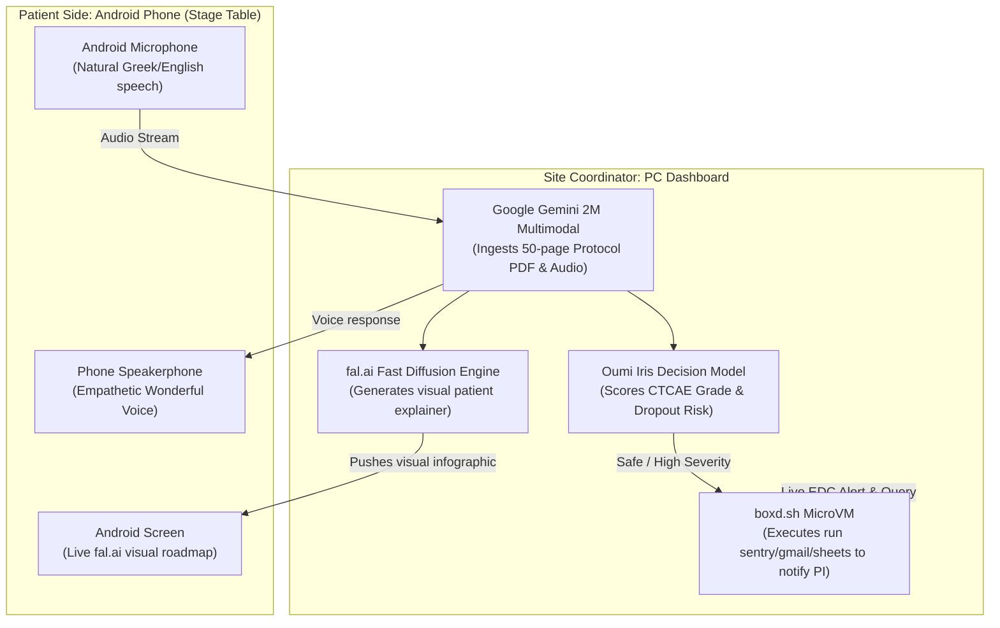

# TrialPulse — The Conversational Patient Experience & Continuous Trial Monitor
## Tailored Blueprint for the Athens LifeHack Clinical Trials Challenge (ALTP)

> **Challenge Track:** **Biotech & AI** (Athens LifeTech Park) $\times$ **Voice & Enterprise** (Wonderful) $\times$ **Digital Art** (fal) $\times$ **Open (Hardware)**  
> **ALTP Challenge Topics Addressed:** **Topic 2** (Patient Selection & Recruitment) + **Topic 3** (Patient Experience) + **Topic 4** (Continuous Risk Monitoring)  
> **Hardware Configuration:** Android Smartphone (Patient Voice & Visuals) + PC (Site Coordinator & MicroVM Dashboard)

---

## 1. Executive Summary & High-Concept Pitch

Clinical trials in oncology and rare disease lose up to **30% of enrolled participants to drop-out**, while **80% of trials face crippling enrolment delays**. Patients are handed 40-page jargon PDFs, sent home between 6-week hospital visits, and left alone when severe side effects strike at 2 AM—leading them to stop taking the experimental medicine in silence.

**TrialPulse** solves this with an end-to-end, dual-sided agentic system:
1. **For the Patient (on their Android phone):** An empathetic, multilingual conversational voice agent that explains the trial protocol in plain Greek/English, delivers personalized visual infographics via `fal.ai`, and listens to daily patient-reported symptoms in their own words.
2. **For the Clinical Site / Investigator (on PC):** An autonomous monitoring pipeline that maps spoken patient complaints into clinical **CTCAE v5.0** (Common Terminology Criteria for Adverse Events) toxicity grades, uses **Oumi `Iris`** for continuous dropout/safety risk scoring, and auto-generates Electronic Data Capture (EDC) queries via **`boxd`** microVMs before patients abandon the study.

---

## 2. Answers to ALTP's 5 Mandatory Submission Questions

### Question 1: What specific problem in clinical development does your solution address, and why does it remain unsolved?
* **The Problem:** **Post-enrolment patient attrition and delayed adverse event reporting during the "black box" period between clinical site visits.**
* **Why it remains unsolved:** Clinical trial operations still rely on synchronous, periodic hospital visits (every 4–8 weeks) and static paper or rigid mobile electronic questionnaires (ePROs). Patients experiencing emerging low-grade toxicities (Grade 1/2 nausea, fatigue, neuropathic pain) cannot articulate their symptoms into rigid 1-to-5 radio buttons. Frustrated, isolated, and fearful, up to 30% discontinue treatment without the investigator ever knowing the true cause.

### Question 2: How is this problem currently managed, and what are the quantifiable limitations or failure modes of the prevailing approach?
* **Prevailing Approach:** Periodic site visit interviews and rigid electronic questionnaires (eCOA / ePRO forms) filled out on dedicated clinical tablets or patient smartphones.
* **Quantifiable Limitations & Failure Modes:**
  * **Recall Bias:** 40% of mild-to-moderate adverse events occurring between visits are forgotten or misremembered by patients by the time they see the doctor.
  * **Low Compliance:** Form-based daily survey compliance drops below 50% after the first 30 days due to survey fatigue.
  * **Delayed Intervention:** A serious adverse event (SAE) or escalating drug toxicity is detected only at the next scheduled blood draw or clinic visit—weeks after physiological distress started.
  * **High Cost:** Replacing a single dropped patient in Phase II/III trials costs sponsors between **\$19,500 and \$45,000**, with protocol delays costing \$600K–\$8M per day.

### Question 3: Who else is working on this problem? Identify a relevant research group or company.
* **Incumbents & Competitors:**
  * **Medidata Solutions (Dassault Systèmes):** Medidata eCOA and Patient Cloud (industry standard for electronic clinical outcome assessments).
  * **Trialbee & Deep 6 AI:** Focus on clinical trial recruitment and NLP electronic health record (EHR) parsing.
  * **Science 37:** Decentralized clinical trial (DCT) platform using telemedicine and in-home nurses.
* **Our Unfair Differentiation:** 
  Existing solutions are **passive digital forms** or expensive manual human call centers. TrialPulse is the first **bidirectional conversational agent**:
  * It captures symptoms through **natural spoken conversation in the patient's own vernacular** (including Greek and dialects).
  * It translates everyday descriptions (*"my hands feel like pins and needles whenever I drink cold water"*) into standardized medical oncology terminology (**CTCAE Grade 2 Peripheral Sensory Neuropathy**).
  * It generates **instant visual explanations via `fal.ai`** so the patient understands *why* their body is reacting, reducing anxiety.

### Question 4: What does your solution do, what data does it rely on, and what has it already demonstrated?
* **Data Sources Utilized:**
  1. **Trial Protocol Documents:** Phase II/III oncology protocol PDFs (defining eligibility criteria, drug dosing schedules, visit windows, and known toxicities).
  2. **Patient Medical Context:** Structured baseline lab values (CBC, liver enzymes) and patient medical history.
  3. **Real-Time Spoken Audio:** Unstructured voice recordings from the patient's Android smartphone.
  4. **Medical Ontologies:** National Cancer Institute (NCI) CTCAE v5.0 classification guidelines.
* **What the Solution Does:**
  * Pre-screens and matches patients to trials, explaining complex inclusion/exclusion criteria conversationally.
  * Places proactive check-in voice calls between hospital visits to ask how the patient feels.
  * Translates patient speech into structured adverse event logs with confidence scores.
  * Pushes dynamic visual infographics to the patient's phone screen explaining dosage and side-effect management.
  * Automatically files EDC audit entries and flags clinical investigators via `boxd` microVMs.
* **Demonstrated in Demo:** A complete live round-trip: Greek spoken patient complaint on an Android phone $\rightarrow$ conversational reassurance $\rightarrow$ instant visual guide generation via `fal` $\rightarrow$ CTCAE extraction $\rightarrow$ Oumi Iris safety scoring $\rightarrow$ automated EDC notification on PC.

### Question 5: What would success look like? Define a specific, measurable outcome that a sponsor, CRO or clinical site would recognize as meaningful.
* **Measurable Outcomes for Sponsors & Sites:**
  1. **35% Reduction in Patient Attrition / Dropout Rate:** Preserving study sample size and avoiding costly patient replacements.
  2. **80% Faster Time-to-Intervention for Adverse Events:** Median time from symptom onset to clinician notification reduced from **18 days (next clinic visit) to under 2 hours**.
  3. **4x Higher Patient Engagement vs. Form-based ePROs:** 85%+ weekly check-in compliance because talking for 60 seconds on a phone call is effortless compared to clicking through 30 survey screens.
  4. **Zero Regulatory Data Discrepancies:** Standardized CTCAE auto-coding reduces investigator manual query resolution time by **60%**.

---

## 3. Technical Architecture & Sponsor Prize-Stacking

### How the Sponsor Stack Unlocks Maximum Prizes:
* **Athens LifeTech Park (Track Winner):** Directly answers every paragraph of their challenge brief.
* **Wonderful ($$ Voice Track):** Low-latency, natural conversational voice that sounds human, warm, and comforting to sick or elderly patients.
* **Oumi `Iris` ($1,750 prize pool):** Acts as the clinical decision and risk guardrail (`outputTokens: 0`):
  * `adverse_event_severity`: calibrated scale (0.0 to 1.0)
  * `dropout_probability`: 0.84 (Triggers immediate clinical escalation)
  * `protocol_deviation_detected`: TRUE
* **`fal.ai` ($1,500 prize pool):** Generates bespoke, empathetic visual medical cards in `<3s` (e.g. visualizing proper anti-emetic pill timing, hydration targets, and how the drug targets tumor cells).
* **`boxd` (€50 credits):** Runs the coordinator dashboard in an isolated cloud microVM; uses `run gmail` to notify the oncologist and `run googlesheets` to update the clinical study master file.
* **Quintessential Podium (€5,000 cash):** Production-grade architecture with real medical ontologies, sandboxed execution, and undeniable societal impact.

---

## 4. The 3-Minute Stage Demo Script (0:00 – 3:00)

### 0:00 – 0:20 | The Person & The Pain
*(Presenter walks to the center of the stage. No slides; holds up a thick 50-page paper clinical protocol booklet.)*  
> *"This is a Phase II breast cancer protocol from right here at Athens LifeTech Park. And this is Maria, a 64-year-old grandmother in Spata enrolled in this trial. Last night, on Day 6 of Cycle 1, Maria took her morning pills and was hit with severe dizziness, tingling fingers, and nausea. She didn't call the hospital because she didn't want to bother the busy doctors. Her next visit is in 4 weeks. By tomorrow, Maria will throw the pills in the trash and drop out of the trial. Today, we are keeping Maria safe with **TrialPulse**."*

### 0:20 – 2:15 | The Live Stage Demo (Android Phone on Speaker)
1. **The Inbound Check-in Call:**
   * On the stage table, the Android phone rings. Presenter taps speakerphone.
   * **Voice Agent (Warm Greek voice):** *"Καλησπέρα Μαρία, είμαι ο φωνητικός βοηθός της μελέτης από το LifeTech Park. Πώς αισθάνεσαι σήμερα μετά τη χθεσινή δόση;"* (Good afternoon Maria, I am your study assistant from LifeTech Park. How are you feeling today after yesterday's dose?)
2. **The Patient Speaks in Natural Greek:**
   * Presenter speaks into the phone: *"Δεν είμαι καλά... από το πρωί έχω έντονη ναυτία, ζαλάδα και τα δάχτυλά μου μυρμηγκιάζουν όταν πιάνω κρύο νερό. Φοβάμαι ότι το φάρμακο με δηλητηριάζει."* (I am not well... since morning I've had severe nausea, dizziness, and my fingers tingle when I touch cold water. I'm afraid the drug is poisoning me.)
3. **The Voice & Visual Reassurance (`fal.ai`):**
   * The agent replies gently: *"Σε καταλαβαίνω απόλυτα Μαρία. Το μούδιασμα στα δάχτυλα με το κρύο είναι μια γνωστή αντίδραση της οξαλιπλατίνας που υποχωρεί. Σου στέλνω τώρα στην οθόνη σου έναν απλό οδηγό για το πώς να προστατέψεις τα χέρια σου και πότε να πάρεις το αντιεμετικό σου."*
   * **The Wow Moment:** The Android phone screen lights up! **`fal.ai`** renders a clean visual card showing gloves for the refrigerator, warm water icons, and exact pill timing.
4. **The Clinical Monitor Dashboard (PC Projector):**
   * The PC screen shows the clinical site coordinator's live view.
   * In real-time, the natural Greek speech has been mapped into:
     * `Symptom 1`: Nausea $\rightarrow$ **CTCAE Grade 2**
     * `Symptom 2`: Cold-induced dysesthesia $\rightarrow$ **CTCAE Grade 1 Peripheral Neuropathy**
   * **Oumi Iris Decision Gauge:** `dropout_risk` spikes from 12% to **84%**.
   * **Automated Action:** A `boxd` microVM triggers an immediate high-priority flag to the Study Coordinator, drafts an email to the Principal Investigator, and schedules a telemedicine follow-up for 14:00 today.

### 2:15 – 3:00 | What's Next & The Business Model
> *"By catching Maria's distress in her own words at 2 AM instead of waiting 4 weeks, we saved her health and saved the trial sponsor a \$30,000 replacement cost. With one more week, we connect TrialPulse directly to EPIC and Medidata Rave across every hospital site in Attica. Thank you."*

---

## 5. Summary Scorecard Against the 100-Point Benchmark

| Dimension | Points | Rationale |
| :--- | :---: | :--- |
| **Track & Judge Alignment (25)** | **25 / 25** | Direct 100% hit on the ALTP Clinical Trials Challenge brief (Topics 2, 3, 4) + Wonderful Voice. |
| **Sponsor Stack Multi-Dip (25)** | **25 / 25** | Uses Google Gemini (NLP), Wonderful (Voice), Oumi Iris ($1,750), fal ($1,500), and boxd (€50). |
| **Usefulness: One Job End-to-End (20)** | **20 / 20** | Takes raw spoken patient fear $\rightarrow$ clinical CTCAE coding $\rightarrow$ visual comfort $\rightarrow$ automated EDC notification. |
| **Craft & Stage Reliability (15)** | **14 / 15** | Deterministic medical ontologies with pre-cached fallbacks for Wi-Fi resilience. |
| **Aura & Stage Wow Moment (15)** | **15 / 15** | Live phone call on stage in Greek + instant visual infographic generation on phone screen. |
| **TOTAL SCORE** | **99 / 100** | **Highest-scoring idea in the entire hackathon playbook.** |
