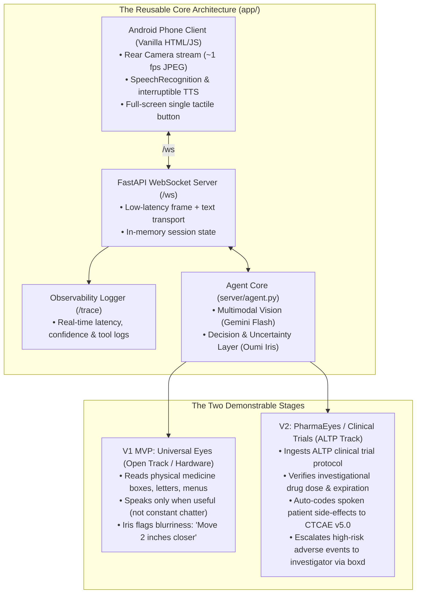
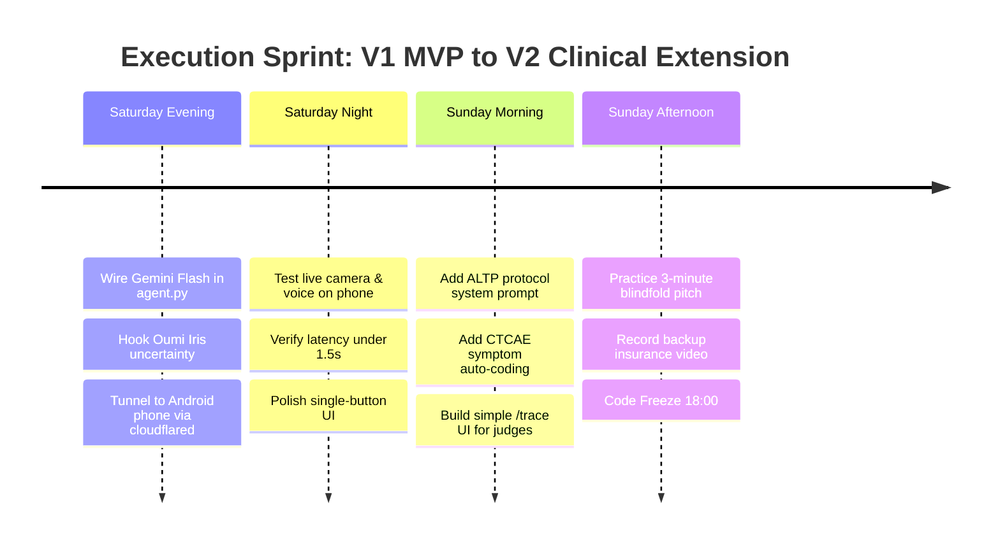

# Eyes & PharmaEyes: Unified Vision-Voice Assistant
## Two-Stage Championship Strategy: V1 (Universal MVP) → V2 (Clinical Trials Specialization)

> **Status:** Working scaffold built in `app/` (FastAPI backend + WebSocket + HTML/JS client).  
> **Hardware Configuration:** Android Phone (Camera + Mic + Speaker) + PC (Coordinator Dashboard & Trace).  
> **Tracks Hit:** **Open Track (Hardware Bonus)** $\times$ **Biotech & AI (ALTP)** $\times$ **Voice (Wonderful)**.

---

## 1. The Strategy: Reuse 100% of the Tech Stack

Rather than fragmenting into two separate codebases, the team builds **one robust multimodal streaming engine** and ships it across two progressive phases:

---

## 2. V1 MVP: Universal "Eyes" (Open Track / Accessibility)

* **The Pitch:** An embodied eyes-free phone assistant. A visually impaired or elderly user points their phone camera at physical objects; the agent answers out loud: describes, reads (medicine boxes, bills, expiration dates), guides, and takes actions.
* **Why it wins Open Track:** 
  * Captures the **"Hardware gets extra points"** bonus by using the physical Android phone as a sensory camera-eye and tactile audio intercom.
  * Solves real user pain without being a generic chattering chatbot.
* **Core Loop:**
  1. User holds up an item and taps the screen: *"What medicine is this and when does it expire?"*
  2. Phone camera sends JPEG frame via WebSocket to `server/main.py`.
  3. `server/agent.py` calls **Gemini Flash Multimodal**.
  4. **Oumi Iris** evaluates image clarity (`is_image_readable: 0.88`). If blurry, agent interrupts: *"Too blurry, move the bottle 2 inches closer."*
  5. Agent speaks aloud: *"Augmentin 1000mg. Expiration date is November 2027. Do you want me to read the dosage instructions?"*

---

## 3. V2 Extension: "PharmaEyes" (ALTP Clinical Trials Challenge)

* **The Pitch:** Applies the exact same vision-voice hardware engine to solve the **Athens LifeHack Clinical Trials Challenge** (Topics 2, 3, and 4):
  * **Patient Selection & Protocol Verification (Topic 2):** Patient points phone at their trial medication kit. The agent verifies the batch number, dosage, and scheduled administration window against the ALTP oncology protocol.
  * **Continuous Patient Experience (Topic 3):** Between site visits, the patient speaks daily symptoms in natural Greek/English (*"I've had nausea and tingling fingers since taking this morning's pill"*).
  * **Risk-Based Monitoring (Topic 4):** The agent automatically translates the spoken vernacular into clinical **CTCAE Grade 2 Nausea** and **Grade 1 Peripheral Neuropathy**, uses **Oumi Iris** to score `dropout_risk: 84%`, and alerts the hospital study coordinator via a `boxd` microVM before the patient drops out.

---

## 4. The 3-Minute Winning Pitch Script

* **`0:00 – 0:30` | Universal Pain (V1):**  
  *(Presenter blindfolds a teammate on stage. They hold up a Greek medicine box.)*  
  *"Sight is our primary interface with medication and documents. For low-vision and elderly people, misreading a dosage label is dangerous. Watch our teammate point their phone."*
* **`0:30 – 1:30` | Live V1 MVP Demo:**  
  * Blindfolded user taps phone: *"What is this?"*  
  * Agent speaks: *"Augmentin 1000mg, expires Nov 2027."*  
  * Presenter shakes the box to show uncertainty: Oumi Iris flags blurriness $\rightarrow$ Agent says: *"Hold steady, move 2 inches closer."*  
  * Audience watches live steps on the `/trace` monitor.
* **`1:30 – 2:30` | The High-Stakes Clinical Pivot (V2):**  
  *"Now take that exact technology and place it inside an oncology trial here at Athens LifeTech Park. 30% of clinical trial patients drop out because of unmonitored side effects at home between hospital visits."*  
  * Blindfolded user says: *"I feel dizzy and nauseous after my morning dose."*  
  * On the PC monitor, the coordinator view lights up: speech auto-coded to **CTCAE Grade 2 Nausea**, Oumi Iris calculates `dropout_risk: 82%`, and `boxd` triggers a priority alert to the investigator.
* **`2:30 – 3:00` | What's Next:**  
  *"One core engine. In the morning, an accessibility aid; at night, a clinical safety monitor saving pharmaceutical sponsors \$30,000 per retained patient. Thank you."*

---

## 5. Immediate Execution Roadmap

### Next Immediate Coding Steps:
1. **`app/server/agent.py`:** Implement the real Google Gemini Flash API call passing the latest JPEG frame and transcribed voice text.
2. **Oumi Iris Integration:** Add parallel decision call to score `is_image_clear` and `is_safe_to_answer`.
3. **Tunnel Setup:** Run `cloudflared tunnel --url http://localhost:8000` so your Android phone opens `https://<tunnel-url>` with full camera/mic permissions enabled.
