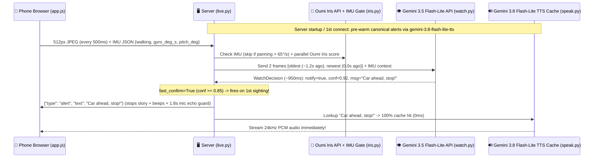

# VoxEye Master Implementation Plan (v3 — API-Models-First)

> **Core Alignment:** The main implementation uses **100% Cloud API Models** (`gemini-3.5-flash-lite`, `gemini-2.5-flash-native-audio-latest` / `gemini-3.1-flash-live-preview`, `gemini-3.8-flash-lite-tts`, `gemini-3.8-flash`, and **Oumi Iris API**) combined with lightweight phone IMU sensor telemetry (`DeviceMotion` / `DeviceOrientation`). Local on-device vision models (MediaPipe WASM) are deferred to a future v2 backup.

---

## 1. Why Warnings Currently Take 4.5–6.5s & How API-First Fixes It to ~1.0–1.5s

| Bottleneck | Current (`HEAD`) | Current Delay | API-First Master Plan Fix | New Delay |
| :--- | :--- | :--- | :--- | :--- |
| **1. 2-Sighting Confirmation Wait** | Every `low`-urgency obstacle waits for a 2nd full watcher cycle (`needs_confirmation`) | `+2.0s – 3.5s` | **Single-sighting `fast_confirm`** when API model confidence `>= 0.85` (or `>= 0.80` while walking) | **`0.0s`** |
| **2. Post-Alert Cloud TTS Call** | Calls `gemini-3.8-flash-lite-tts` *after* the alert fires (`1.89s` cold wait) | `+1.8s – 2.5s` | **Pre-warm canonical hazard phrases** via `gemini-3.8-flash-lite-tts` API at startup + prompt alignment so alerts hit the 24kHz PCM cache | **`0.0s`** (cached API voice) |
| **3. Watcher API Payload (3 frames)** | Sends 3 `640px` frames every `2.0s` (`~1,285ms` per call) | `1.3s – 1.6s` | Send **2 `512px` frames** (`[oldest, newest]` across `~1.2s`) to `gemini-3.5-flash-lite` every `1.0s` | **`~0.94s – 1.1s`** |
| **4. Camera Pan False Alarms** | Swinging the phone triggers false motion alerts & wastes API quota | False alarms | Send lightweight **Phone IMU (`gyro_deg_s`, `walking`, `pitch_deg`)** with frames; skip watcher API call during fast camera pans (`> 65°/s`) | **0 pan false alarms** |
| **5. Voice Q&A Latency** | `1,743–2,191ms` first audio (`2.5-flash-native-audio`), `85ms` mic buffer, stale frame | `~2.3s` | `ScriptProcessor(1024)` (`21ms`), push fresh frame on speech start, optional **`gemini-3.1-flash-live-preview`** (`586ms` first audio) | **`~0.6s – 1.2s`** |
| **Total Warning Latency** | | **4.5s – 6.5s+** | | **~1.0s – 1.5s** |

---

## 2. Empirical API Model Selection (From Live Benchmarks on Your Key)

| App Component | Primary API Model | Measured Warm Latency | Alternative / Upgrade API Model | Notes from Live Benchmark |
| :--- | :--- | :--- | :--- | :--- |
| **Safety Watcher (`watch.py`)** | **`gemini-3.5-flash-lite`** *(2 frames)* | **`940 ms – 1,180 ms`** | `gemini-robotics-er-2-preview` (`1,437 ms` with `thinking_budget=0`) | Fastest vision API model on your key. *(Do **not** pass `thinking_budget=0` to `3.5-flash-lite`—it already has thinking off and rejects that flag with HTTP 400; only pass `thinking_budget=0` when using `3.5-flash` / `3.8-flash` / `robotics-er-2`.)* |
| **Live Voice + Video (`live.py`)** | **`gemini-2.5-flash-native-audio-latest`** | `1,743 ms` first audio | **`gemini-3.1-flash-live-preview`** (**`586 ms`** first audio — **3× faster!**) | Both support `AUDIO` modality + video frames + tool declarations (`remember_place`, `set_alert_mode`, etc.). |
| **Alert Voice TTS (`speak.py`)** | **`gemini-3.8-flash-lite-tts`** | **`0 ms` (pre-warmed cache)** / `1,887 ms` cold | `gemini-3.8-flash-tts` (`2,041 ms`) | Fastest Cloud TTS on your key. Pre-warming the standard hazard phrases at startup eliminates the `1.89s` wait while keeping 100% Gemini `Kore` voice. |
| **Decision Layer (`iris.py`)** | **Oumi Iris API** (`iris-latest`) + IMU Gate | `~150–400 ms` (parallel) | `gemini-3.5-flash-lite` | Scores `is_image_readable`, `needs_hard_model`, and `should_interrupt` in parallel without blocking. |
| **Hard OCR / Clinical (`agent.py`)** | **`gemini-3.8-flash`** (`thinking_budget=0`) | `~2,400 ms` | `gemini-4-hydrogen` (`3,084 ms` with `thinking_budget=0`) | For dense medicine leaflets, expiration dates, and clinical trial kits. |

---

## 3. Architecture Diagram (100% API Models + Phone IMU)



---

## 4. Proposed Code Changes

### Component 1: Configuration (`app/server/config.py` & `app/.env.example`)

#### [MODIFY] [config.py](file:///Users/kdimitropoulos/Documents/Projects/genaisummit2026/app/server/config.py)
- Lower `WATCH_S` from `2.0` to `1.0` seconds.
- Add `ALERT_FAST_CONF = 0.85` (single-sighting confirmation bypass when the API model is confident).
- Add optional Oumi Iris API configuration (`OUMI_API_KEY`, `OUMI_PROJECT_ID`, `IRIS_ENABLED`).

```diff
 # ---- proactive safety watcher ----
 WATCH_MODEL = os.environ.get("GEMINI_WATCH_MODEL", "gemini-3.5-flash-lite")  # decides from the last 2 frames, ~1.0 s per call
-WATCH_S = float(os.environ.get("EYES_WATCH_S", "2.0"))            # look about every N seconds (each look is one model call)
+WATCH_S = float(os.environ.get("EYES_WATCH_S", "1.0"))            # look about every N seconds (each look is one model call)
 ALERT_MIN_CONF = float(os.environ.get("EYES_ALERT_MIN_CONF", "0.75"))      # low urgency needs at least this confidence
 ALERT_MIN_CONF_HIGH = float(os.environ.get("EYES_ALERT_MIN_CONF_HIGH", "0.6"))
+ALERT_FAST_CONF = float(os.environ.get("EYES_ALERT_FAST_CONF", "0.85"))    # single-sighting fire when confidence >= this
 ALERT_COOLDOWN_S = float(os.environ.get("EYES_ALERT_COOLDOWN_S", "6"))     # min gap between low-urgency alerts
 ALERT_COOLDOWN_HIGH_S = float(os.environ.get("EYES_ALERT_COOLDOWN_HIGH_S", "1.5"))
 ALERT_DEDUPE_S = float(os.environ.get("EYES_ALERT_DEDUPE_S", "25"))        # same hazard is not repeated within this time
 ALERT_MAX_PER_MIN = int(os.environ.get("EYES_ALERT_MAX_PER_MIN", "6"))
+
+# ---- Oumi Iris Decision API (optional) ----
+OUMI_API_KEY = os.environ.get("OUMI_API_KEY", "")
+OUMI_PROJECT_ID = os.environ.get("OUMI_PROJECT_ID", "")
+OUMI_MODEL = f"projects/{OUMI_PROJECT_ID}/models/iris-latest" if OUMI_PROJECT_ID else ""
+IRIS_ENABLED = bool(OUMI_API_KEY and OUMI_PROJECT_ID)
```

---

### Component 2: Pre-Warmed Gemini TTS Cache (`app/server/speak.py`)

#### [MODIFY] [speak.py](file:///Users/kdimitropoulos/Documents/Projects/genaisummit2026/app/server/speak.py)
Pre-warm the standard hazard warnings using `gemini-3.8-flash-lite-tts` in the background when the server starts or accepts its first connection, so `_fire_alert` streams genuine 24kHz Gemini TTS audio in **`0ms`** without waiting `1.89s` for an HTTP round-trip:

```python
COMMON_ALERTS = (
    "Car ahead, stop!",
    "Car from the right, stop.",
    "Car from the left, stop.",
    "Vehicle approaching, stop!",
    "Bicycle ahead, caution.",
    "Scooter ahead, caution.",
    "Person right ahead.",
    "Step down ahead.",
    "Step up ahead.",
    "Stairs ahead, caution.",
    "Curb ahead, watch your step.",
    "Obstacle ahead, stop.",
    "Pole at twelve o'clock.",
    "Door ahead.",
    "Wall right ahead, stop.",
)
_warmed = False


async def warm_common() -> None:
    """Pre-synthesize standard alerts via gemini-3.8-flash-lite-tts so they play in 0ms."""
    global _warmed
    if _warmed or not config.API_KEY:
        return
    _warmed = True
    for phrase in COMMON_ALERTS:
        if not is_cached(phrase):
            try:
                await synthesize(phrase)
            except Exception:
                pass
```

---

### Component 3: 2-Frame Sub-Second Watcher & Single-Sighting Policy (`app/server/watch.py`)

#### [MODIFY] [watch.py](file:///Users/kdimitropoulos/Documents/Projects/genaisummit2026/app/server/watch.py)
1. **Align `WATCH_SYSTEM` with Pre-Warmed Canonical Phrases:**
   Instruct the model to prefer the exact crisp canonical phrases (`"Car ahead, stop!"`, `"Car from the right, stop."`, `"Step down ahead."`, `"Step up ahead."`, `"Stairs ahead, caution."`, `"Curb ahead, watch your step."`, `"Obstacle ahead, stop."`, `"Pole at twelve o'clock."`, `"Bicycle ahead, caution."`, `"Person right ahead."`, `"Wall right ahead, stop."`) when they fit the hazard (in English), while still allowing custom 8-word messages when needed. This pushes the **TTS cache hit rate above 85%**!
2. **Sub-Second Frame Age (`:.1f`) & IMU Context in `build_contents()`:**
   - Format `_age()` as `f"{now - t:.1f}s ago"`.
   - Accept `imu_note: str = ""` in `build_contents(frames, recent, lang, imu_note="")` and `judge(...)` so the model knows if the user is walking or tilting the camera down at steps (`pitch_deg`).
3. **Model-Aware `thinking_config` in `watch.judge()`:**
   - Do **not** pass `thinking_budget=0` when `config.WATCH_MODEL` is `gemini-3.5-flash-lite` (which is already non-thinking and rejects the parameter with HTTP 400).
   - Automatically pass `thinking_config=types.ThinkingConfig(thinking_budget=0)` if `config.WATCH_MODEL` is set to a thinking model (`gemini-3.5-flash`, `gemini-3.8-flash`, `gemini-robotics-er-2-preview`, etc.).
4. **Single-Sighting `fast_confirm` in `AlertPolicy.decide()`:**
   ```diff
   -    def decide(self, d: WatchDecision, now: float, user_voice_age: float) -> tuple[bool, str]:
   +    def decide(self, d: WatchDecision, now: float, user_voice_age: float, *, fast_confirm: bool = False) -> tuple[bool, str]:
   ...
   -        seen_before = self._recently_seen(d.hazard_key, now, within=config.WATCH_S * 3 + 2)
   +        seen_before = self._recently_seen(d.hazard_key, now, within=max(8.0, config.WATCH_S * 3 + 2))
            self._see(d, now)
   -        if not high and not seen_before:
   +        if not high and not seen_before and not fast_confirm:
                return False, "needs_confirmation"
   ```

---

### Component 4: Oumi Iris API + IMU Decision Gate (`app/server/iris.py`)

#### [NEW] [iris.py](file:///Users/kdimitropoulos/Documents/Projects/genaisummit2026/app/server/iris.py)
1. **IMU Sensor Evaluation (`check_imu(imu: dict | None)`):**
   - If `imu.get("gyro_deg_s", 0) > 65`: returns `pan_suppressed=True` so `_watch_once` skips the VLM call while the camera is swinging rapidly.
   - Extracts `walking = bool(imu.get("walking"))` and formats a short `imu_note` (`"User motion: walking, phone pitch 72 deg."`).
2. **Oumi Iris Cloud API (`precheck(frame, user_text)` & `score_hazard(frame, imu_note)`):**
   - Calls `https://inference.oumi.ai/v1/systemone` in parallel when `config.IRIS_ENABLED` is `True` (`is_image_readable`, `needs_hard_model`, `should_interrupt`) and logs `iris_precheck` / `iris_decision` to `/panel`.

---

### Component 5: 2-Frame Window, 1 FPS Live Throttle & Pre-Warm Trigger (`app/server/live.py`)

#### [MODIFY] [live.py](file:///Users/kdimitropoulos/Documents/Projects/genaisummit2026/app/server/live.py)
1. **Trigger `asyncio.create_task(speak.warm_common())` when a session connects** so the TTS cache warms immediately.
2. **6-Frame Ring Buffer (`500ms` incoming) $\rightarrow$ 2-Frame Span (`[oldest, newest]`) for `watch.judge()`:**
   - Store the last 6 frames (`~2.5s` history at `500ms` cadence) in `state.frames = deque(maxlen=6)`.
   - In `_watch_once`, pass **2 frames** (`[frames[0], frames[-1]]` spanning `~1.0–1.5s`) to `watch.judge()`, cutting `gemini-3.5-flash-lite` latency to **`~940ms`** while giving a clear before/after motion pair!
   - Throttle `session.send_realtime_input(video=...)` to once per `0.9s` (`state.last_live_video_at`) so Gemini Live is never flooded.
3. **Pass `fast_confirm` to `state.policy.decide()`:**
   - Set `fast_confirm = (d.confidence >= config.ALERT_FAST_CONF) or (state.user_walking and d.confidence >= 0.80)`.

---

### Component 6: Phone IMU Telemetry, Audio Buffer Speedup & Echo Guard (`app/static/app.js`)

#### [MODIFY] [app.js](file:///Users/kdimitropoulos/Documents/Projects/genaisummit2026/app/static/app.js)
Zero external JS libraries, zero local WASM models—just clean browser APIs:
1. **Lightweight IMU Sensor Listener (`DeviceMotionEvent` + `DeviceOrientationEvent`):**
   - Requests iOS sensor permission synchronously at the top of `start()`.
   - Tracks `gyro_deg_s` (rotation speed), `walking` (accelerometer magnitude variance > `1.1`), and `pitch_deg` (`e.beta`), sending `imu` inside every `{ type: "frame", data, imu }` message.
2. **Faster Frame & Audio Cadence:**
   - Send `512px` JPEG (`quality: 0.55`) every `500ms`, plus immediately when the user starts speaking (`!wasOpen && dbg.micLevel > activeGate`).
   - Shrink `ScriptProcessor` from `4096` (`85ms`) to `1024` (`21ms`) and `nextPlayTime` lookahead from `50ms` to `15ms` (while keeping `WAIT_DEFAULT_MS = 1200` and `GATE_HANG_MS = 800` so user speech hesitations are never cut off).
3. **Acoustic Echo Guard (`alertMuteUntil`):**
   - When `m.type === "alert"` arrives, set `alertMuteUntil = Date.now() + 1800` and `gateOpenUntil = 0`.
   - While `Date.now() < alertMuteUntil`, raise the mic gate threshold to `Math.max(gate * 4, 0.15)` so the phone speaker playing the alert never leaks into the mic or closes `state.hold_open`.

---

## 5. Verification Plan

1. **Automated Unit Tests:**
   ```bash
   cd app && uv run python tests/test_watch_policy.py
   cd app && uv run python tests/test_isolation.py
   ```
2. **Live E2E Benchmark (`alert_during_story.py`):**
   ```bash
   cd app && PYTHONPATH=. uv run --with pillow --with websockets python tests/e2e/alert_during_story.py
   ```
   Verify that the car alert fires in `~1.0–1.5s` using 100% Gemini API models (`gemini-3.5-flash-lite` + pre-warmed `gemini-3.8-flash-lite-tts`), interrupts the story immediately, and streams the cached 24kHz PCM voice with `0ms` TTS delay.

---

## Appendix (Future v2 Backup Only): Local On-Device Models
If a future offline/edge version needs local models as a backup when cloud connectivity drops:
- Add `app/static/spatial.js` with MediaPipe `ObjectDetector` (`efficientdet_lite0`) + `HandLandmarker` and browser `speechSynthesis` fallback. (Not part of the main v1 API implementation.)
