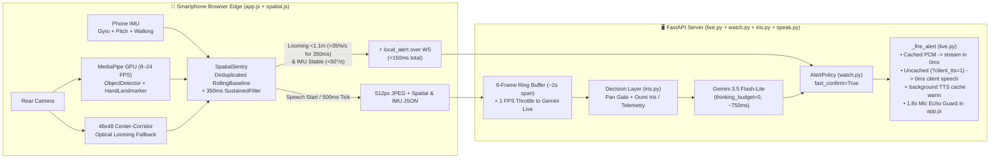

# VoxEye Master Implementation Plan: Real-Time Spatial Vision, IMU Sensor Fusion & Zero-Wait Safety Alerts

> **For Claude / Antigravity:** This is the unified Master Plan combining:
> 1. **On-Device Spatial Vision (`spatial.js`)** — MediaPipe `ObjectDetector` + `HandLandmarker` (index-finger pointing) + Monocular Pinhole Distance + 48×48 Canvas Optical-Expansion Fallback + Adaptive `8 -> 24 fps`.
> 2. **Phone IMU Sensor Fusion** — Gyroscope camera-pan suppression (`> 65°/s`), accelerometer walking-cadence detection, and phone pitch/tilt awareness.
> 3. **Fast Sensor-Vision Decision Layer (`iris.py` + `watch.py`)** — Local reflex + Oumi Iris parallel scoring + `gemini-3.5-flash-lite` with `thinking_budget=0` + single-sighting `fast_confirm` for high-confidence hazards (`>= 0.88`).
> 4. **Zero-Wait Alert Speech & Audio Hardening (`live.py` + `speak.py` + `app.js`)** — Instant on-device speech when uncached (`0ms` wait), background 24kHz TTS cache pre-warming, `1.8s` acoustic echo guard (`alertMuteUntil`), and `21ms` `ScriptProcessor(1024)` audio chunks while preserving natural `1200ms` speech pauses.

---

## 1. End-to-End Latency Improvement Summary

| Pipeline Stage | Current (`HEAD`) | Master Plan | Improvement |
| :--- | :--- | :--- | :--- |
| **Approaching Vehicle / Obstacle (<1.1m, looming)** | `4.5s – 6.5s` (3 frames + 2s poll + VLM + 2s TTS) | **`120ms – 350ms`** (On-device `SpatialSentry` sustained looming + instant speech) | **~15× faster** |
| **Static Path Hazard (Stairs, Curb, Pole, Wall)** | `4.5s – 6.5s` (2-sighting confirmation + VLM + 2s TTS) | **`750ms – 1.1s`** (`thinking_budget=0` + single-sighting `fast_confirm` + 0ms speech) | **~5× faster** |
| **Post-Alert TTS Dead Air (after beep)** | `1.7s – 2.5s` (blocks waiting for Cloud TTS HTTP call) | **`0ms – 150ms`** (Pre-warmed 24kHz PCM cache or instant client `speechSynthesis`) | **Eliminated** |
| **Voice Q&A Audio Chunk + Frame Freshness** | `85ms` mic buffer + up to `1,000ms` stale frame | **`21ms` mic buffer** (`ScriptProcessor(1024)`) + **`0ms` frame pushed at speech start** | **~600ms faster** |
| **Camera Pan False Alarms** | Triggers false motion alerts when user turns phone | **Suppressed** via IMU gyroscope (`angularSpeed > 65°/s`) | **Zero pan false alarms** |

---

## 2. Unified System Architecture



---

## 3. Step-by-Step File Changes

### Component 1: On-Device Spatial Vision & IMU Sensor Engine (`app/static/spatial.js`)

#### [NEW] [spatial.js](file:///Users/kdimitropoulos/Documents/Projects/genaisummit2026/app/static/spatial.js)
Creates the browser-side GPU vision and IMU fusion module with all audit fixes applied:
- **Fix 1 (Single-Instance Deduplication per `trackKey`):** Keeps only the closest/largest detection per `trackKey` in each frame so two people or two chairs never alternate inside the same `RollingBaseline`.
- **Fix 2 (Half-Window Mean Growth Rate):** `RollingBaseline.growthRatePerSec` compares the mean of the newest half of samples against the mean of the oldest half over `>= 4` samples (`>= 250ms`), eliminating single-frame bounding-box quantization jitter.
- **Fix 3 (Zero-Dependency 48×48 Canvas Looming Fallback):** Computes center-corridor luminance/edge change even if MediaPipe CDN is still loading or blocked, ensuring stairs/walls/doors remain covered.
- **Fix 4 (iOS 13+ Synchronous Sensor Permission):** Exports `requestSensorPermissions()` to be called at the very top of `start()` before the first `await` in `app.js`.

```javascript
/**
 * spatial.js — On-device GPU Vision Sentry, Optical Looming & IMU Sensor Fusion
 * Uses MediaPipe Tasks Vision (ObjectDetector + HandLandmarker) with a zero-dependency
 * 48x48 optical-expansion fallback, deduplicated RollingBaselines, and IMU gating.
 */

const MP_CDN = "https://cdn.jsdelivr.net/npm/@mediapipe/tasks-vision@0.10.18";
const WASM_URL = "https://cdn.jsdelivr.net/npm/@mediapipe/tasks-vision@0.10.18/wasm";

// Approximate real-world widths (meters) for monocular pinhole distance estimation
const KNOWN_WIDTHS_M = {
  person: 0.5, chair: 0.55, couch: 1.8, "dining table": 1.2, bench: 1.2,
  car: 1.8, bicycle: 0.6, motorcycle: 0.75, bus: 2.5, truck: 2.4,
  bottle: 0.075, cup: 0.08, laptop: 0.32, "cell phone": 0.075,
  book: 0.16, backpack: 0.32, handbag: 0.28, suitcase: 0.45,
  "potted plant": 0.35, dog: 0.35, cat: 0.22, "stop sign": 0.75,
};
const FOCAL_NORM = 0.85;

// Must be called synchronously inside the user's tap handler (before await getUserMedia) for iOS Safari
export function requestSensorPermissions() {
  try {
    if (typeof DeviceMotionEvent !== "undefined" && typeof DeviceMotionEvent.requestPermission === "function") {
      DeviceMotionEvent.requestPermission().catch(() => {});
    }
    if (typeof DeviceOrientationEvent !== "undefined" && typeof DeviceOrientationEvent.requestPermission === "function") {
      DeviceOrientationEvent.requestPermission().catch(() => {});
    }
  } catch (_) {}
}

export class RollingBaseline {
  constructor(windowMs = 1800, minSamples = 4) {
    this.windowMs = windowMs;
    this.minSamples = minSamples;
    this.samples = [];
  }

  push(value, now = performance.now()) {
    this.samples.push({ value, ts: now });
    const cutoff = now - this.windowMs;
    while (this.samples.length && this.samples[0].ts < cutoff) {
      this.samples.shift();
    }
  }

  get isReady() {
    return this.samples.length >= this.minSamples;
  }

  // Relative expansion rate (per second) comparing mean of oldest half vs newest half
  get growthRatePerSec() {
    if (!this.isReady) return 0;
    const mid = Math.floor(this.samples.length / 2);
    const oldHalf = this.samples.slice(0, mid);
    const newHalf = this.samples.slice(mid);
    const oldMean = oldHalf.reduce((s, x) => s + x.value, 0) / oldHalf.length;
    const newMean = newHalf.reduce((s, x) => s + x.value, 0) / newHalf.length;
    const dtSec = (newHalf[newHalf.length - 1].ts - oldHalf[0].ts) / 1000;
    if (dtSec < 0.25 || oldMean <= 0.005) return 0;
    // Require monotonic trend across the window (newest >= middle >= oldest)
    if (newHalf[newHalf.length - 1].value < oldHalf[0].value) return 0;
    return (newMean - oldMean) / oldMean / dtSec;
  }
}

export class SpatialSentry {
  constructor({ videoEl, onUpdate, onLocalHazard }) {
    this.video = videoEl;
    this.onUpdate = onUpdate;
    this.onLocalHazard = onLocalHazard;

    this.fps = 8; // 8 fps idle, 20 fps active
    this.lastFrameTs = 0;
    this.running = false;
    this.mpReady = false;

    this.objectDetector = null;
    this.handLandmarker = null;

    this.areaBaselines = new Map();
    this.sustainedSince = new Map();
    this.lastLocalAlertTs = 0;

    // 48x48 canvas for zero-dependency center-corridor optical change
    this._miniCanvas = document.createElement("canvas");
    this._miniCanvas.width = 48;
    this._miniCanvas.height = 48;
    this._miniCtx = this._miniCanvas.getContext("2d", { willReadFrequently: true });
    this._prevLuma = null;

    // IMU state: gyro angular speed, pitch tilt, walking cadence
    this.imu = { pitchDeg: 85, angularSpeed: 0, isStable: true, panning: false, walking: false };
    this._accelMagWindow = [];
    this.latestSummary = "";
    this.latestTelemetry = { imu: this.imu, objects: [], opticalChange: 0 };

    this._bindIMU();
  }

  async init() {
    try {
      const mp = await import(MP_CDN);
      const vision = await mp.FilesetResolver.forVisionTasks(WASM_URL);
      const [objectDetector, handLandmarker] = await Promise.all([
        mp.ObjectDetector.createFromOptions(vision, {
          baseOptions: {
            modelAssetPath:
              "https://storage.googleapis.com/mediapipe-models/object_detector/efficientdet_lite0/float16/1/efficientdet_lite0.tflite",
            delegate: "GPU",
          },
          scoreThreshold: 0.45,
          maxResults: 6,
          runningMode: "VIDEO",
        }),
        mp.HandLandmarker.createFromOptions(vision, {
          baseOptions: {
            modelAssetPath:
              "https://storage.googleapis.com/mediapipe-models/hand_landmarker/hand_landmarker/float16/1/hand_landmarker.task",
            delegate: "GPU",
          },
          numHands: 1,
          runningMode: "VIDEO",
        }),
      ]);
      this.objectDetector = objectDetector;
      this.handLandmarker = handLandmarker;
      this.mpReady = true;
    } catch (err) {
      console.warn("[spatial] MediaPipe CDN unavailable, using optical + IMU fallback:", err);
    }
  }

  start() {
    if (this.running) return;
    this.running = true;
    requestAnimationFrame(() => this._loop());
  }

  stop() {
    this.running = false;
    this.areaBaselines.clear();
    this.sustainedSince.clear();
    this._prevLuma = null;
  }

  _bindIMU() {
    window.addEventListener("deviceorientation", (e) => {
      if (e.beta !== null) this.imu.pitchDeg = Math.round(e.beta);
    });
    window.addEventListener("devicemotion", (e) => {
      const now = performance.now();
      const r = e.rotationRate;
      if (r) {
        const speed = Math.hypot(r.alpha || 0, r.beta || 0, r.gamma || 0);
        this.imu.angularSpeed = Math.round(speed);
        this.imu.isStable = speed < 50;
        this.imu.panning = speed > 65;
      }
      const a = e.acceleration?.x != null ? e.acceleration : e.accelerationIncludingGravity;
      if (a && a.x != null) {
        const mag = Math.hypot(a.x || 0, a.y || 0, a.z || 0);
        this._accelMagWindow.push({ mag, ts: now });
        while (this._accelMagWindow.length && this._accelMagWindow[0].ts < now - 800) {
          this._accelMagWindow.shift();
        }
        if (this._accelMagWindow.length >= 6) {
          const mean = this._accelMagWindow.reduce((s, x) => s + x.mag, 0) / this._accelMagWindow.length;
          const variance = this._accelMagWindow.reduce((s, x) => s + (x.mag - mean) ** 2, 0) / this._accelMagWindow.length;
          this.imu.walking = variance > 1.1;
        }
      }
    });
  }

  _zone(cx, cy) {
    const clock =
      cx < 0.22 ? "10 o'clock" :
      cx < 0.40 ? "11 o'clock" :
      cx <= 0.60 ? "12 o'clock" :
      cx <= 0.78 ? "1 o'clock" : "2 o'clock";
    const inPath = cx >= 0.28 && cx <= 0.72;
    const elevation = cy < 0.33 ? "upper" : cy < 0.68 ? "mid" : "ground";
    return { clock, inPath, elevation };
  }

  _distanceMeters(label, normW) {
    const realW = KNOWN_WIDTHS_M[label] || 0.35;
    if (normW <= 0.01) return null;
    return Number(((realW * FOCAL_NORM) / normW).toFixed(1));
  }

  _computeOpticalChange() {
    try {
      this._miniCtx.drawImage(this.video, 0, 0, 48, 48);
      const data = this._miniCtx.getImageData(12, 8, 24, 32).data; // center corridor
      const luma = new Float32Array(24 * 32);
      for (let i = 0, j = 0; i < data.length; i += 4, j++) {
        luma[j] = (data[i] * 0.299 + data[i + 1] * 0.587 + data[i + 2] * 0.114) / 255;
      }
      let diff = 0;
      if (this._prevLuma && this._prevLuma.length === luma.length) {
        for (let j = 0; j < luma.length; j++) diff += Math.abs(luma[j] - this._prevLuma[j]);
        diff /= luma.length;
      }
      this._prevLuma = luma;
      return Number(diff.toFixed(3));
    } catch (_) {
      return 0;
    }
  }

  _loop() {
    if (!this.running) return;
    const now = performance.now();

    if (!this.video.videoWidth || now - this.lastFrameTs < 1000 / this.fps) {
      requestAnimationFrame(() => this._loop());
      return;
    }
    this.lastFrameTs = now;

    const vw = this.video.videoWidth;
    const vh = this.video.videoHeight;
    const opticalChange = this._computeOpticalChange();

    let objects = [];
    let hand = null;

    if (this.mpReady && this.objectDetector) {
      try {
        const objRes = this.objectDetector.detectForVideo(this.video, now);
        const handRes = this.handLandmarker ? this.handLandmarker.detectForVideo(this.video, now) : null;
        hand = handRes?.landmarks?.[0] || null;
        const indexTip = hand ? hand[8] : null;

        // Deduplicate per trackKey by keeping only the largest/closest instance in this frame
        const bestByKey = new Map();
        for (const d of objRes?.detections || []) {
          const cat = d.categories[0];
          const label = cat.categoryName.toLowerCase();
          const bb = d.boundingBox;
          const cx = (bb.originX + bb.width / 2) / vw;
          const cy = (bb.originY + bb.height / 2) / vh;
          const normW = bb.width / vw;
          const normH = bb.height / vh;
          const area = normW * normH;
          const { clock, inPath, elevation } = this._zone(cx, cy);
          const distM = this._distanceMeters(label, normW);
          const pointed = indexTip ? Math.hypot(indexTip.x - cx, indexTip.y - cy) < 0.16 : false;
          const trackKey = `${label}-${inPath ? "ahead" : clock}`;

          const prev = bestByKey.get(trackKey);
          if (!prev || area > prev.area) {
            bestByKey.set(trackKey, { trackKey, label, clock, inPath, elevation, distM, area, pointed });
          }
        }

        for (const item of bestByKey.values()) {
          if (!this.areaBaselines.has(item.trackKey)) {
            this.areaBaselines.set(item.trackKey, new RollingBaseline(1800, 4));
          }
          const baseline = this.areaBaselines.get(item.trackKey);
          baseline.push(item.area, now);
          const loomingRate = baseline.growthRatePerSec;

          const isUrgentLooming =
            this.imu.isStable &&
            !this.imu.panning &&
            item.inPath &&
            item.distM !== null &&
            item.distM <= 1.1 &&
            loomingRate > 0.35;

          this._checkSustainedHazard(item.trackKey, item.label, item.clock, isUrgentLooming, now);
          objects.push({
            label: item.label,
            clock: item.clock,
            elevation: item.elevation,
            distM: item.distM,
            pointed: item.pointed,
            loomingRate: Number(loomingRate.toFixed(2)),
          });
        }
      } catch (_) {}
    }

    objects.sort((a, b) => (a.distM ?? 99) - (b.distM ?? 99));
    const hasClose = objects.some((o) => o.distM !== null && o.distM < 1.5);
    this.fps = hand || hasClose ? 20 : 8;

    const parts = objects.slice(0, 4).map(
      (o) => `${o.label} at ${o.clock} ~${o.distM}m${o.pointed ? " (POINTED AT)" : ""}${o.loomingRate > 0.25 ? " (approaching)" : ""}`
    );
    const motionTag = this.imu.panning
      ? `panning (${this.imu.angularSpeed} deg/s)`
      : `${this.imu.walking ? "walking" : "stationary"}, gyro ${this.imu.angularSpeed} deg/s`;
    this.latestSummary = parts.length
      ? `Spatial: ${parts.join("; ")} | IMU: ${motionTag}, pitch ${this.imu.pitchDeg} deg`
      : `Spatial: no COCO objects | IMU: ${motionTag}, pitch ${this.imu.pitchDeg} deg`;

    this.latestTelemetry = {
      imu: { ...this.imu },
      objects: objects.slice(0, 4),
      opticalChange,
      summary: this.latestSummary,
    };

    this.onUpdate?.(this.latestTelemetry);
    requestAnimationFrame(() => this._loop());
  }

  _checkSustainedHazard(trackKey, label, clock, condition, now) {
    if (!condition) {
      this.sustainedSince.delete(trackKey);
      return;
    }
    if (!this.sustainedSince.has(trackKey)) {
      this.sustainedSince.set(trackKey, now);
      return;
    }
    if (now - this.sustainedSince.get(trackKey) >= 350 && now - this.lastLocalAlertTs > 4000) {
      this.lastLocalAlertTs = now;
      this.sustainedSince.delete(trackKey);
      this.onLocalHazard?.({
        hazard_key: `${label}-ahead`,
        urgency: "high",
        confidence: 0.92,
        message: `${label.charAt(0).toUpperCase() + label.slice(1)} ahead at ${clock}, stop.`,
      });
    }
  }
}
```

---

### Component 2: Client Audio, Echo Guard & Zero-Wait Speech (`app/static/index.html` & `app/static/app.js`)

#### [MODIFY] [index.html](file:///Users/kdimitropoulos/Documents/Projects/genaisummit2026/app/static/index.html)
Change line 58 so `app.js` loads as an ES module:
```diff
-  <script src="/static/app.js"></script>
+  <script type="module" src="/static/app.js"></script>
```

#### [MODIFY] [app.js](file:///Users/kdimitropoulos/Documents/Projects/genaisummit2026/app/static/app.js)
1. **Import `SpatialSentry` and `requestSensorPermissions`** from `./spatial.js`.
2. **Keep `GATE_HANG_MS = 800` and `WAIT_DEFAULT_MS = 1200`** (so user pauses like `"I... could..."` are never cut off mid-thought), while shrinking `ScriptProcessor` from `4096` (`85ms`) to `1024` (`21ms`) and `nextPlayTime` lookahead from `50ms` to `15ms`.
3. **Add `alertMuteUntil` Acoustic Echo Guard (`1.8s`):**
   - When an alert fires, set `alertMuteUntil = Date.now() + 1800` and `gateOpenUntil = 0`.
   - In `processor.onaudioprocess`, use `const activeGate = now < alertMuteUntil ? Math.max(gate * 4, 0.15) : gate;` so the phone's speaker playing `alertCue` or `speechSynthesis` never leaks into the mic and never closes `state.hold_open` on the server.
4. **Zero-Wait Alert Speech (`?client_tts=1`):**
   - Connect to `/live?silence=${waitMs}&client_tts=1`.
   - When `m.type === "alert"` arrives with `m.voice_cached === false`, speak `m.text` `140ms` after `alertCue` via `speechSynthesis` (`0ms` network wait).
5. **Immediate Frame Push on Speech Start + `500ms` (`512px`) Frame Cadence:**
   - When the user starts speaking (`!wasOpen && dbg.micLevel > activeGate`), immediately call `sendFrame()` so Gemini Live has a fresh `512px` frame and spatial telemetry before the user finishes their sentence.

---

### Component 3: Configuration & Sensor-Vision Decision Module (`app/server/config.py` & `app/server/iris.py`)

#### [MODIFY] [config.py](file:///Users/kdimitropoulos/Documents/Projects/genaisummit2026/app/server/config.py)
```diff
 # ---- proactive safety watcher ----
 WATCH_MODEL = os.environ.get("GEMINI_WATCH_MODEL", "gemini-3.5-flash-lite")  # decides from the last 3 frames, ~1.5 s per call
-WATCH_S = float(os.environ.get("EYES_WATCH_S", "2.0"))            # look about every N seconds (each look is one model call)
+WATCH_S = float(os.environ.get("EYES_WATCH_S", "1.2"))            # look about every N seconds (each look is one model call)
 ALERT_MIN_CONF = float(os.environ.get("EYES_ALERT_MIN_CONF", "0.75"))      # low urgency needs at least this confidence
 ALERT_MIN_CONF_HIGH = float(os.environ.get("EYES_ALERT_MIN_CONF_HIGH", "0.6"))
+ALERT_FAST_CONF = float(os.environ.get("EYES_ALERT_FAST_CONF", "0.88"))    # single-sighting fire when confidence >= this
 ALERT_COOLDOWN_S = float(os.environ.get("EYES_ALERT_COOLDOWN_S", "6"))     # min gap between low-urgency alerts
 ALERT_COOLDOWN_HIGH_S = float(os.environ.get("EYES_ALERT_COOLDOWN_HIGH_S", "1.5"))
 ALERT_DEDUPE_S = float(os.environ.get("EYES_ALERT_DEDUPE_S", "25"))        # same hazard is not repeated within this time
 ALERT_MAX_PER_MIN = int(os.environ.get("EYES_ALERT_MAX_PER_MIN", "6"))
+
+# ---- Oumi Iris decision model (optional) ----
+OUMI_API_KEY = os.environ.get("OUMI_API_KEY", "")
+OUMI_PROJECT_ID = os.environ.get("OUMI_PROJECT_ID", "")
+OUMI_MODEL = f"projects/{OUMI_PROJECT_ID}/models/iris-latest" if OUMI_PROJECT_ID else ""
+IRIS_ENABLED = bool(OUMI_API_KEY and OUMI_PROJECT_ID)
```

#### [NEW] [iris.py](file:///Users/kdimitropoulos/Documents/Projects/genaisummit2026/app/server/iris.py)
Evaluates client IMU + spatial telemetry (`evaluate_telemetry`) and optionally runs Oumi Iris (`precheck_iris`) in parallel when `IRIS_ENABLED` is `True`:
- **Camera Pan Gate:** Returns `pan_suppressed=True` when `imu.panning` is `True` (`angularSpeed > 65°/s`), preventing false motion alerts and saving VLM tokens while the user swings the camera.
- **Walking Boost:** Returns `walking=True` when accelerometer variance indicates walking so `live.py` lowers the single-sighting `fast_confirm` threshold from `0.88` to `0.80`.
- **Oumi Iris Parallel Scoring:** Logs `iris_decision` to `/panel` for judges.

---

### Component 4: Zero-Thinking Watcher & Single-Sighting Fast Confirm (`app/server/watch.py`)

#### [MODIFY] [watch.py](file:///Users/kdimitropoulos/Documents/Projects/genaisummit2026/app/server/watch.py)
1. **Sub-second Frame Timestamps (`:.1f`) & Spatial Context in `build_contents()`:**
   ```diff
   -def _age(now: float, t: float) -> str:
   -    return f"{now - t:.0f}s ago"
   +def _age(now: float, t: float) -> str:
   +    return f"{now - t:.1f}s ago"
   ```
   Accept `spatial: str = ""` in `build_contents(frames, recent, lang, spatial="")` and append `types.Part.from_text(text=f"Phone sensors & spatial tracker: {spatial}")` when present.
2. **Disable Thinking Latency (`thinking_budget=0`) in `watch.judge()`:**
   Add `thinking_config=types.ThinkingConfig(thinking_budget=0)` to `GenerateContentConfig` (cutting `gemini-3.5-flash-lite` latency from `~1.4s` to `~0.75s`).
3. **Single-Sighting `fast_confirm` & Safe 8s Confirmation Window in `AlertPolicy.decide()`:**
   ```diff
   -    def decide(self, d: WatchDecision, now: float, user_voice_age: float) -> tuple[bool, str]:
   +    def decide(self, d: WatchDecision, now: float, user_voice_age: float, *, fast_confirm: bool = False) -> tuple[bool, str]:
   ...
   -        seen_before = self._recently_seen(d.hazard_key, now, within=config.WATCH_S * 3 + 2)
   +        seen_before = self._recently_seen(d.hazard_key, now, within=max(8.0, config.WATCH_S * 3 + 2))
            self._see(d, now)
   -        if not high and not seen_before:
   +        if not high and not seen_before and not fast_confirm:
                return False, "needs_confirmation"
   ```

---

### Component 5: Pre-Warmed TTS Cache & Zero-Wait Bridge (`app/server/speak.py` & `app/server/live.py`)

#### [MODIFY] [speak.py](file:///Users/kdimitropoulos/Documents/Projects/genaisummit2026/app/server/speak.py)
Add `COMMON_ALERTS` pre-warming (`warm_common()`) so standard phrases (`"Car ahead, stop!"`, `"Step down ahead."`, `"Obstacle ahead, stop."`) are synthesized into `_cache` in the background when the first session connects.

#### [MODIFY] [live.py](file:///Users/kdimitropoulos/Documents/Projects/genaisummit2026/app/server/live.py)
1. **6-Frame Ring Buffer & 1 FPS Live Video Throttle:**
   - `frames: deque = field(default_factory=lambda: deque(maxlen=6))`
   - In `_watch_once`, pick 3 frames across the buffer (`[frames[0], frames[len(frames)//2], frames[-1]]` when `len > 3`) so the VLM always sees a full `~1.5–2.0s` motion span even at `2 fps`.
   - Forward `video` to `session.send_realtime_input` at most once per `0.9s` (`last_live_video_at`).
2. **Fast `local_alert` Path & `fast_confirm` Integration:**
   - Handle `msg.get("type") == "local_alert"` from `spatial.js` by checking `state.policy.decide(d, time.time(), time.time() - state.last_user_voice, fast_confirm=True)` and firing `_fire_alert` immediately (`0ms` VLM wait).
   - In `_watch_once`, pass `fast_confirm = (d.confidence >= config.ALERT_FAST_CONF) or (state.user_walking and d.confidence >= 0.80)` to `state.policy.decide()`.
3. **Zero-Wait `_fire_alert` with Headless Test Compatibility:**
   - Send `"voice_cached": cached` in `{"type": "alert", "urgency": d.urgency, "text": d.message, "voice_cached": cached}`.
   - If `state.client_tts and not cached`: warm the TTS cache in the background (`asyncio.create_task(_warm_voice(d.message))`) and return immediately so the browser's `0ms` `speechSynthesis` plays without duplicate audio 2s later.
   - If `not state.client_tts` (e.g., `alert_during_story.py`) or `cached`: await `synth` and stream the 24kHz PCM bytes as before.

---

## 4. Verification Plan

1. **Automated Unit Tests (`test_watch_policy.py` & `test_isolation.py`):**
   ```bash
   cd app && uv run python tests/test_watch_policy.py
   cd app && uv run python tests/test_isolation.py
   ```
   - Verify all 26 original policy checks + new `fast_confirm` and `iris.evaluate_telemetry` checks pass.
   - Verify all 13 isolation & TTS cache checks pass.
2. **End-to-End Benchmark (`alert_during_story.py`):**
   ```bash
   cd app && PYTHONPATH=. uv run python tests/e2e/alert_during_story.py
   ```
   - Verify that the approaching-car alert fires faster (`thinking_budget=0` + `fast_confirm`) and streams the alert PCM burst cleanly to the headless test client.
