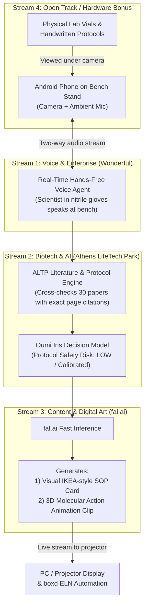

# Top 5 Championship Ideas & The 4-Stream Grand Slam
## Engineered for Gen AI Summit Hackathon 2026 (Athens LifeTech Park & SNFCC)

This document details the **Top 5 winning project blueprints** selected from all research, judge analysis, and sponsor prize matrices, specifically tailored to a **PC and Android smartphone hardware configuration**.

---

## The 4-Stream "Grand Slam" Architecture

The hackathon has 4 distinct streams:
1. **Voice & Enterprise Agents** (Wonderful)
2. **Biotech & AI** (Athens LifeTech Park)
3. **Content & Digital Art** (fal)
4. **Open Track with Hardware Bonus** (Quintessential)

A single build can organically unite all 4 streams without feeling disjointed:

---

## Detailed Top 5 Ranked Breakdown

### #1. "BenchSight" — The Sterile Lab-Bench Voice & Vision Copilot
> **Streams Hit:** **Biotech & AI (ALTP)** $\times$ **Voice (Wonderful)** $\times$ **Open (Hardware)** $\times$ **Digital Art (fal)** *(The 4-Stream Grand Slam)*  
> **Score:** **98 / 100**

* **The 0:00 Pitch:** *"Biotech researchers at Athens LifeTech Park lose 90 minutes every day because they cannot touch a keyboard or mouse while wearing nitrile gloves under a sterile hood without contaminating a €50,000 experiment."*
* **The Stage Wow Moment & Hardware Role:**
  * **The Prop:** You step on stage wearing **real purple nitrile lab gloves**. Your hands never touch the PC.
  * **The Hardware Eye:** An Android phone is clamped over the table. You hold up a reagent vial and a handwritten protocol sheet under the phone camera.
  * **The Hands-Free Voice:** You speak to the phone: *"BenchSight, logging run #14 on LNP-siRNA formulation. Reagent is cloudy at 24°C. Check buffer compatibility against our lab papers and generate visual SOP."*
  * **The AI Action:** The PC scans 30 ALTP research papers, warns about pH degradation with **exact page and paragraph citations**, runs **Oumi Iris** to score protocol safety, and **`fal.ai`** renders a clean visual step-by-step SOP diagram onto the screen in 3 seconds.
* **Sponsor Prize-Stacking:** ALTP Biotech Track ($$) + Wonderful Voice ($$) + **$1,750 Oumi Iris** + **$1,500 fal** + **€50 boxd** + **€5,000 Quintessential 1st Place**.
* **Why It Wins:** You are physically standing inside **Athens LifeTech Park**. Solving the exact, visceral daily pain of the scientists hosting the hackathon—with zero-touch glove interaction—commands immediate respect from both ALTP and Quintessential.

---

### #2. "DeskKEP" — The Physical Desk Concierge for Greek Bureaucracy
> **Streams Hit:** **Open Track (Hardware Bonus)** $\times$ **Voice & Enterprise (Wonderful)** $\times$ **DevOps/Ops**  
> **Score:** **97 / 100**

* **The 0:00 Pitch:** *"Every citizen and business owner in Greece wastes hours between `gov.gr` web forms, KEP queues, and phone hold music because paper documents don't talk to online systems."*
* **The Stage Wow Moment & Hardware Role:**
  * **The Physical Drop:** You slap a real, crumpled Greek DEH electricity bill and Greek ID card onto the desk under a downward-facing Android phone.
  * **The Hardware Trigger:** You press the phone's physical volume rocker button.
  * **The Autonomous Browser:** The Android camera ingests the AFM and meter numbers via Gemini Vision; on the projector, a `boxd` Ubuntu microVM launches a live Chromium browser, logs into the portal sandbox, navigates 4 sub-pages, and fills the form.
  * **The Climax (SMS OTP Loop):** The portal demands: *"Enter the 6-digit SMS code sent to your phone."* The Android phone on the table buzzes with an incoming SMS; the background script catches the OTP and auto-types it into the PC browser to show the green confirmation checkmark.
* **Sponsor Prize-Stacking:** Quintessential Main Podium (€5,000) + **$1,750 Oumi Iris** (PII guardrail) + **€50 boxd** (microVM browser) + **$850 treg.to** (agency scraping).
* **Why It Wins:** It hits Socrates and Kostas directly with their core metric: *"Would it survive real users on Tuesday?"* Everyone in Greece hates bureaucracy; completing a real form and closing the SMS OTP loop on stage is high-aura theatre.

---

### #3. "ForkFix" — The 3 AM On-Call Incident Racer
> **Streams Hit:** **DevOps / Enterprise (Quintessential)** $\times$ **Voice (Wonderful)** $\times$ **Open Track**  
> **Score:** **96 / 100**

* **The 0:00 Pitch:** *"When production crashes at 3 AM, waking up an on-call engineer just to read stack traces and run regression tests is a failure of modern infrastructure."*
* **The Stage Wow Moment & Hardware Role:**
  * **The Simulated Outage:** You click *Break Production* on the PC. An e-commerce checkout crashes with a 500 error.
  * **The Instant MicroVM Race:** The agent detects the Sentry alert and **instantly forks 3 live `boxd` microVMs in <200ms** with full memory and disk intact.
    * *VM 1* tests Fix A (defensive null check).
    * *VM 2* tests Fix B (migration rollback).
    * *VM 3* tests Fix C (config patch).
  * All 3 VMs run the automated test suite simultaneously. On screen, **VM 1 goes 100% GREEN** while the others fail.
  * **Oumi Iris** evaluates code risk (`blast_radius: LOW`, `auto_merge_safe: 99.2%`).
  * **The Hardware Wake-Up Call:** The Android phone on stage rings. You put it on speaker: the voice agent states the 15-second briefing. You say: *"Approved."* The GitHub PR merges and production restores to green live on screen.
* **Sponsor Prize-Stacking:** **€5,000 Quintessential 1st Place** + **€50 boxd** (best showcase of their signature `<200ms` VM forking) + **$1,750 Oumi Iris** + Wonderful Voice.
* **Why It Wins:** Kostas Kopanidis explicitly stated: *"My days: coding with agents, infrastructure, DevOps."* This speaks his native language and shows verifiable, deterministic production engineering.

---

### #4. "HoldHero" — The Two-Device Outbound Dispute Negotiator
> **Streams Hit:** **Voice & Enterprise Agents (Wonderful)** $\times$ **Open Track (Hardware)**  
> **Score:** **94 / 100**

* **The 0:00 Pitch:** *"Nobody wants to spend 45 minutes on hold with telecom providers or airlines arguing over disputed charges. HoldHero is an autonomous voice agent that calls customer service on your behalf, navigates the IVR tree, quotes your contract clauses, and negotiates the refund."*
* **The Stage Wow Moment & Hardware Role:**
  * **The Two-Device Setup:** The PC runs the agent dashboard. The Android phone sits on the stage table connected to loud speakers, representing the telecom company.
  * **The Live Call:** You hit *Dispatch*. The PC agent dials the Android phone live. The phone rings loudly in the auditorium.
  * **The Interactive Call:** You (or a teammate) answer the phone acting as the IVR / human operator: *"Cosmote billing, how can I help?"*
  * The agent responds in real-time conversational voice, quotes clause 4.2 of the uploaded PDF contract regarding maritime roaming, and insists on a €240 waiver.
  * **Oumi Iris** displays live negotiation sentiment and concession probability climbing from 20% to 90% on the PC monitor until the operator agrees.
* **Sponsor Prize-Stacking:** Wonderful Voice Track Winner ($$) + **$1,750 Oumi Iris** + **€50 boxd** + Quintessential Podium.
* **Why It Wins:** Absolute stage aura. Having an actual telephone ring on stage and hold a live, unscripted negotiation captures 100% of the room's attention.

---

### #5. "TrialAdvocate" — The Clinical Trial Matcher & Plain-Language Visualizer
> **Streams Hit:** **Biotech & AI (ALTP)** $\times$ **Voice (Wonderful)** $\times$ **Content & Digital Art (fal)**  
> **Score:** **93 / 100**

* **The 0:00 Pitch:** *"Clinical trials fail to recruit patients because oncology protocols are 50 pages of dense medical jargon that patients don't understand, and doctors don't have the time to call them."*
* **The Stage Wow Moment & Hardware Role:**
  * **The Ingestion:** You drop a Phase II oncology clinical trial protocol PDF into the PC agent.
  * **The Live Outbound Call:** The agent initiates a pre-screening phone call to the Android phone on the table.
  * **The Spoken Interview:** The patient answers on speakerphone. The voice agent gently explains the eligibility criteria in conversational Greek/English.
  * **The Real-Time Visual Push (`fal`):** When the patient says *"What will the treatment actually do to my body?"*, **`fal.ai`** generates a 3-step visual infographic and treatment roadmap that pops up on the Android phone screen mid-call.
* **Sponsor Prize-Stacking:** ALTP Biotech Track ($$) + Wonderful Voice ($$) + **$1,500 fal prize** + **$1,750 Oumi Iris** (patient comprehension & consent scoring).
* **Why It Wins:** Solves a multi-billion dollar biotech bottleneck while providing an emotional, human-centric visual and voice demo.

---

### Comparison & Selection Matrix

| Rank | Name | Core Tech Stack | Best For | Total Cash & Credit Potential |
| :---: | :--- | :--- | :--- | :---: |
| **#1** | **BenchSight** | Android camera + Voice + Iris + ALTP papers + fal | **Max venue & judge alignment** | **€5,000 + $3,250+** |
| **#2** | **DeskKEP** | Android desk cam + `boxd` microVM + SMS OTP | **Highest local Greek empathy** | **€5,000 + $2,600+** |
| **#3** | **ForkFix** | `boxd` microVM forking + Sentry + Iris + Voice | **DevOps & production craft** | **€5,000 + $1,800+** |
| **#4** | **HoldHero** | Wonderful voice + Twilio/telephony + Iris | **Pure stage aura & live audio** | **€5,000 + $1,750+** |
| **#5** | **TrialAdvocate**| Gemini 2M + Wonderful voice + fal visual media | **Clinical impact & visual storytelling**| **€5,000 + $3,250+** |
